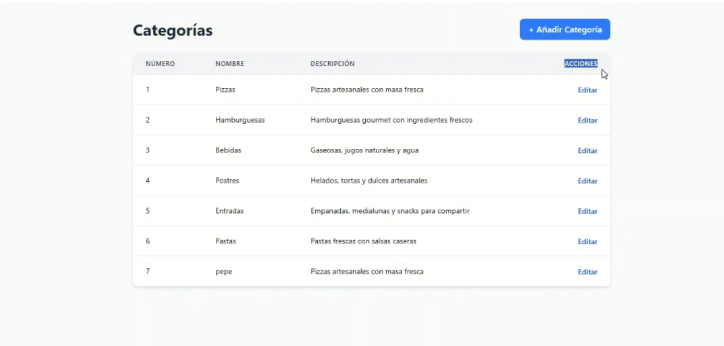
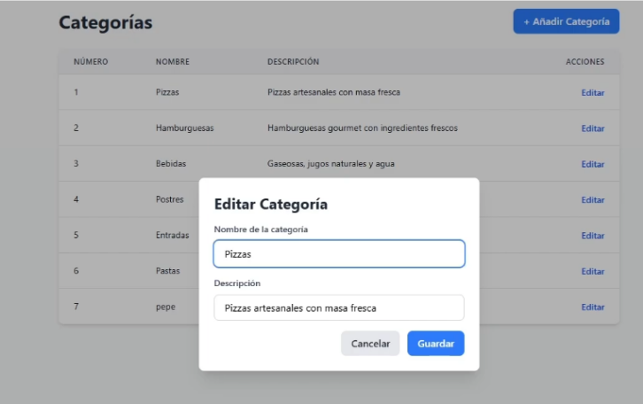

# Especificación y Análisis de Mockups — Frontend de Categorías

Este documento describe detalladamente las dos pantallas de referencia visual provistas por la cátedra en el directorio `docs/mockup/img/`, correspondientes al flujo de interfaz de usuario para la gestión de categorías del **Trabajo Práctico 6**.

---

## 1. Pantalla 1: Vista Principal — Listado de Categorías (`img/ejemplo1.png`)

### 1.1. Propósito y Contexto
Es la pantalla inicial del frontend al ingresar a la aplicación (`http://localhost:5173/`). Su función es presentar la nómina completa de categorías persistidas y proveer el punto de entrada para agregar nuevas entidades o iniciar la edición de un registro existente.

### 1.2. Desglose Estructural y Componentes

1. **Barra Superior / Encabezado de Sección**:
   - **Título**: `"Categorías"` ubicado en la esquina superior izquierda, con tipografía sans-serif bold en tono oscuro neutro (`#0f172a` / Slate 900), tamaño `text-2xl` o `text-3xl`.
   - **Acción Primaria**: Botón `"+ Añadir Categoría"` alineado a la derecha superior:
     - Color de fondo: Azul primario sólido (`#2563eb` / Blue 600) con hover oscurecido (`#1d4ed8` / Blue 700).
     - Tipografía: Texto en blanco con peso semibold/medium y prefijo de signo más (`+`).
     - Forma: Esquinas redondeadas (`rounded-lg` o `rounded-md`), con espaciado interno equilibrado (`px-4 py-2`).

2. **Contenedor Principal de Datos (Tabla / Data Grid)**:
   - Superficie: Tarjeta con fondo blanco (`bg-white`), esquinas redondeadas (`rounded-xl`), borde perimetral sutil (`border border-slate-100`) y sombra ligera (`shadow-sm`).
   - **Fila de Encabezado (Header Table)**:
     - Fondo: Tono gris azulado muy suave (`bg-slate-50` / `bg-gray-50`).
     - Tipografía de cabeceras: Mayúsculas compactas (`text-xs font-semibold uppercase tracking-wider`), color gris secundario (`text-slate-500` / `text-gray-500`).
     - **Columnas definidas**:
       1. `NÚMERO`: Identificador correlativo numérico (`id`), alineado a la izquierda.
       2. `NOMBRE`: Denominación principal de la categoría, alineado a la izquierda.
       3. `DESCRIPCIÓN`: Detalle contextual del tipo de productos, alineado a la izquierda (ocupa el mayor ancho proporcional de la tabla).
       4. `ACCIONES`: Cabecera de la columna de control, en tono azul o resaltado, alineada a la derecha.

3. **Filas de Registros (Rows)**:
   - Separadores: Líneas divisorias horizontales finas (`divide-y divide-slate-100`).
   - Tipografía de datos: Tamaño estándar legible (`text-sm text-slate-700`), con el número y nombre en tono más firme (`text-slate-900 font-medium`).
   - Ejemplos visibles en el mockup:
     - `1` | `Pizzas` | `Pizzas artesanales con masa fresca` | `Editar`
     - `2` | `Hamburguesas` | `Hamburguesas gourmet con ingredientes frescos` | `Editar`
     - `3` | `Bebidas` | `Gaseosas, jugos naturales y agua` | `Editar`
     - `4` | `Postres` | `Helados, tortas y dulces artesanales` | `Editar`
     - `5` | `Entradas` | `Empanadas, medialunas y snacks para compartir` | `Editar`
     - `6` | `Pastas` | `Pastas frescas con salsas caseras` | `Editar`
     - `7` | `pepe` | `Pizzas artesanales con masa fresca` | `Editar`
   - **Acción interactiva**: Enlace/botón `"Editar"` en color azul interactivo (`text-blue-600 hover:text-blue-800 font-medium`), posicionado a la derecha de cada registro.

---

## 2. Pantalla 2: Modal de Edición / Creación (`img/ejemplo2.png`)

### 2.1. Propósito y Contexto
Se activa al interactuar con el botón `"+ Añadir Categoría"` (para creación con campos vacíos) o con el enlace `"Editar"` de una fila en particular (precargando la información correspondiente, tal como se ilustra con la categoría *"Pizzas"*).

### 2.2. Desglose Estructural y Componentes

1. **Capa de Fondo (Backdrop / Overlay)**:
   - Fondo oscurecido semitransparente (`bg-black/40` o `bg-slate-900/50`) que cubre el 100% del viewport.
   - Efecto visual: Aplica foco atencional directo sobre el diálogo flotante, bloqueando la interacción con la tabla subyacente.

2. **Ventana Modal (Dialog Container)**:
   - Centrado absoluto en viewport horizontal y verticalmente.
   - Ancho contenido (aproximadamente `max-w-md` o `max-w-lg`, ~480px a 520px).
   - Superficie: Fondo blanco puro (`bg-white`), esquinas pronunciadamente redondeadas (`rounded-2xl`), elevación con sombra pronunciada (`shadow-2xl`).
   - Espaciado interior generoso (`p-6` o `p-8`).

3. **Cabecera del Modal**:
   - Título: `"Editar Categoría"` (o `"Nueva Categoría"` en modo alta), en tipografía sans-serif prominente (`text-xl font-bold text-slate-900`).

4. **Campos del Formulario (Form Controls)**:
   - **Campo 1: Nombre de la Categoría**:
     - Label: `"Nombre de la categoria"`, tipografía `text-sm font-medium text-slate-700`, espaciado inferior de 6px.
     - Input: Campo de texto con valor precargado `"Pizzas"`.
     - Estado de foco visual: Resaltado con anillo y borde azul (`ring-2 ring-blue-500 border-blue-500 rounded-lg px-3 py-2 text-slate-900`).
   - **Campo 2: Descripción**:
     - Label: `"Descripción"`, tipografía `text-sm font-medium text-slate-700`.
     - Input: Campo de texto de una línea o textarea compacto con valor precargado `"Pizzas artesanales con masa fresca"`.
     - Estilo estándar: Borde gris neutro (`border border-slate-300 rounded-lg px-3 py-2 text-slate-900`).

5. **Botonera de Control (Footer Actions)**:
   - Disposición: Alineada a la derecha inferior del modal (`flex justify-end gap-3 pt-4`).
   - **Botón `"Cancelar"`**:
     - Estilo secundario neutro: Fondo gris claro (`bg-slate-100 hover:bg-slate-200 text-slate-700 font-medium px-4 py-2 rounded-lg transition-colors`).
     - Función: Cierra el modal (`onClose`) descartando cualquier modificación y restableciendo el estado.
   - **Botón `"Guardar"`**:
     - Estilo primario de confirmación: Fondo azul sólido (`bg-blue-600 hover:bg-blue-700 text-white font-medium px-5 py-2 rounded-lg transition-colors`).
     - Función: Dispara el submit (`handleSubmit`) para emitir la petición `PUT` (en edición) o `POST` (en alta) hacia la API REST.

---

## 3. Mapeo de Estados y Hooks React (Consigna Parte B)

La interacción entre ambas pantallas se materializa en React mediante los hooks estándar centralizados en `App.tsx`:

| Elemento de UI en Mockup | Estado / Handler Asociado en React | Comportamiento |
| :--- | :--- | :--- |
| Botón `+ Añadir Categoría` | `handleOpenCreateModal()` | Setea `categoriaEnEdicion = null` y `isModalOpen = true`. |
| Enlace `Editar` por fila | `handleOpenEditModal(categoria)` | Setea `categoriaEnEdicion = categoria` y `isModalOpen = true`. |
| Visibilidad del Modal | `isModalOpen: boolean` | Renderiza condicionalmente el componente `CategoriaModal` sobre el backdrop. |
| Inputs precargados | `useState` interno o `defaultValue` vía props | Refleja los valores actuales del registro o strings vacíos en alta. |
| Botón `Cancelar` | `handleCloseModal()` | Setea `isModalOpen = false` y limpia `categoriaEnEdicion`. |
| Botón `Guardar` | `handleSubmit(e)` | Ejecuta validación y petición `fetch` (`POST` o `PUT`), sincronizando la tabla. |
| Filas de la tabla | `categorias: Categoria[]` | Renderiza dinámicamente la lista obtenida vía `fetch` en el `useEffect` inicial. |
