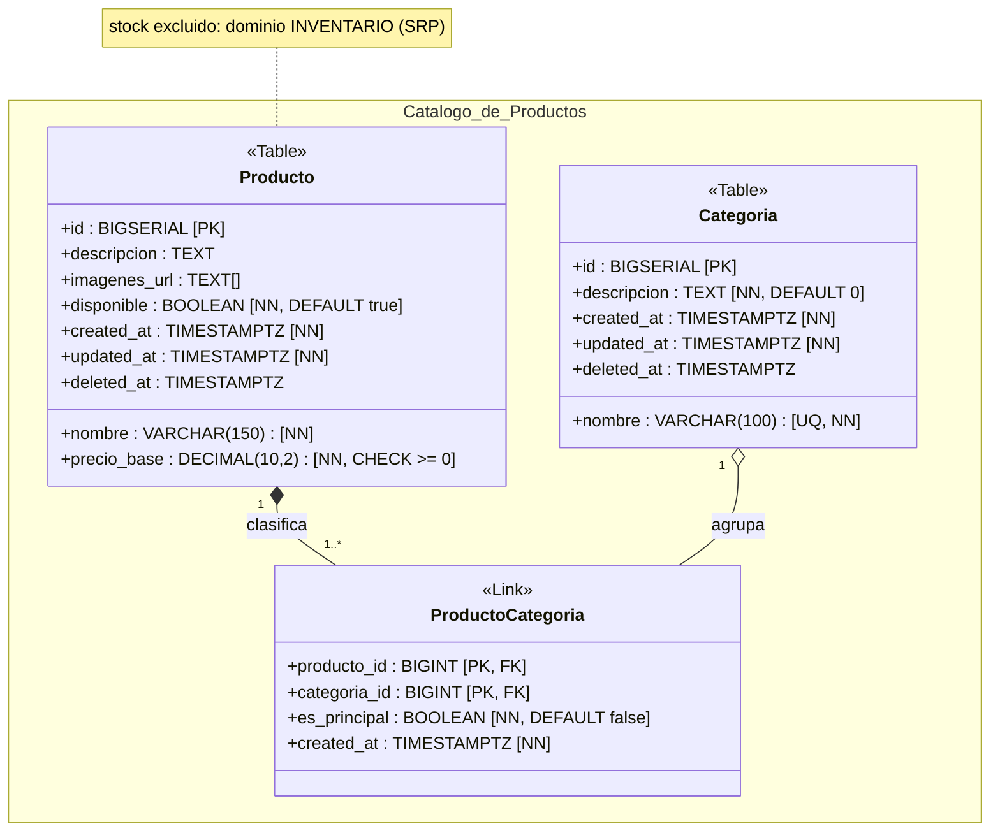
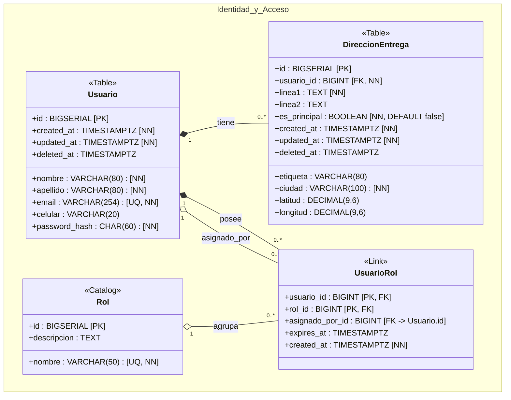
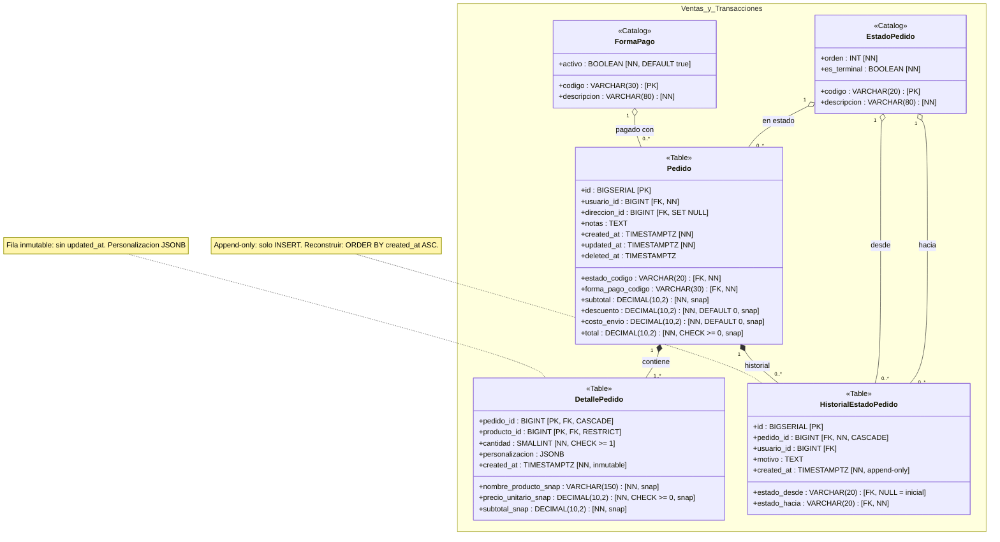
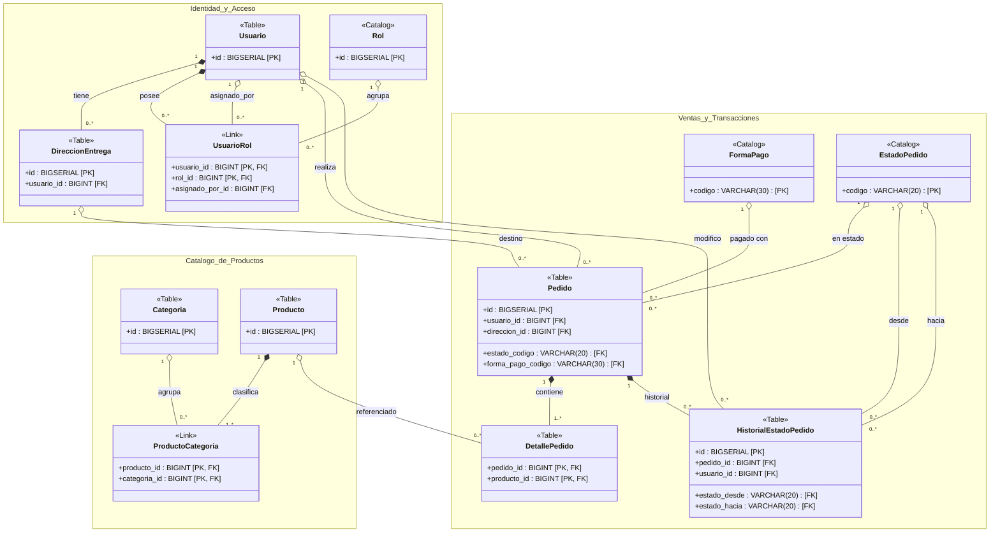

# Modelo de Datos del Sistema de Pedidos de Comida (Food Store)

Este documento contiene la especificación y transcripción completa y legible del diagrama de entidad-relación del sistema (`docs/UML_FOOD_STORE.svg`), modelado en **Mermaid** (`classDiagram`) bajo arquitectura de Tercera Forma Normal (3FN), patrones de auditoría, *soft-delete*, *snapshots* monetarios e inmutabilidad transaccional.

Se presentan diagramas modulares por dominio para lectura directa sin necesidad de zoom, el diagrama de catálogo correspondiente al **Trabajo Práctico 7**, la vista macro de integración inter-dominio y el diagrama integrado completo 1:1.

---

## 1. Convenciones y Notación del Modelo

El modelo implementa el estándar **v3.0 · 3FN · Soft-Delete · Snapshot · Audit Trail · FK explícitas**.

### 1.1 Estereotipos de Entidad

| Estereotipo | Definición | Semántica de Persistencia y Ciclo de Vida |
| :--- | :--- | :--- |
| `<<Table>>` | Entidad de negocio mutable | Tablas transaccionales y maestras con ciclo de vida completo (`INSERT`, `UPDATE`, `deleted_at`). |
| `<<Link>>` | Tabla de asociación N:M | Tabla pivote con clave primaria compuesta y atributos propios de la relación (e.g. `es_principal`, `expires_at`). |
| `<<Catalog>>` | Catálogo de referencia | Parámetros estables del sistema con códigos determinísticos y baja frecuencia de modificación. |

### 1.2 Semántica Relacional

| Notación Mermaid | Tipo de Relación | Semántica en Base de Datos / Cascada |
| :--- | :--- | :--- |
| `*--` | Composición fuerte | Dependencia existencial estricta. `ON DELETE CASCADE`. La entidad secundaria no puede existir sin su padre. |
| `o--` | Agregación débil / Asociación | Referencia débil o compartida. `ON DELETE RESTRICT` o `ON DELETE SET NULL`. Preserva integridad referencial. |

### 1.3 Restricciones y Modificadores de Columna

Para garantizar compatibilidad léxica total con el parser de Mermaid y evitar colisiones con los delimitadores de bloque `{ ... }`, las restricciones se expresan con corchetes `[...]`:

* **`[PK]`**: Primary Key (identificador único o clave compuesta).
* **`[FK]`**: Foreign Key (referencia foránea a otra tabla).
* **`[UQ]`**: Restricción de unicidad (`UNIQUE`).
* **`[NN]`**: Not Null (obligatoriedad a nivel de base de datos).
* **`[DEFAULT <val>]`**: Valor asignado por defecto al insertar.
* **`[CHECK <cond>]`**: Restricción de comprobación a nivel de tupla.
* **`[snap]`**: Snapshot monetario o textual inmutable congelado al momento del pedido.
* **`[inmutable]`**: Registro que no admite modificaciones posteriores (sin columna `updated_at`).
* **`[append-only]`**: Bitácora histórica donde únicamente se ejecutan operaciones `INSERT`.

---

## 2. Dominio 2 — Catálogo de Productos (Alcance TP7)

Este dominio abarca las entidades implementadas en el **Trabajo Práctico 7**: la clasificación de productos en categorías mediante una relación muchos a muchos (`N:M`) con tabla intermedia enriquecida.

### 2.1 Diagrama de Clases (Catálogo de Productos)



### 2.2 Especificaciones del Catálogo
* **Separación de Responsabilidades (SRP):** El control de existencias de inventario (*stock*) no forma parte del catálogo de productos para permitir que el catálogo sirva a múltiples locales o sucursales con inventarios desacoplados.
* **Clave Primaria Compuesta en `ProductoCategoria`:** La clave primaria está formada por el par `(producto_id, categoria_id)`, impidiendo duplicados relacionales.
* **Categoría Principal (`es_principal`):** Permite destacar en interfaces de usuario y navegación jerárquica cuál es la categoría primaria del producto cuando está categorizado en múltiples grupos.
* **Integridad Referencial:** Un producto se compone existencialmente de al menos una categorización (`Producto *-- ProductoCategoria`), mientras que la eliminación o desvinculación de una categoría no destruye físicamente el producto (`Categoria o-- ProductoCategoria`).

---

## 3. Dominio 1 — Identidad & Acceso

Gestiona las cuentas de usuario, el control de acceso basado en roles (RBAC) y la libreta de direcciones de entrega para los envíos.

### 3.1 Diagrama de Clases (Identidad & Acceso)



### 3.2 Especificaciones de Identidad
* **Autenticación Segura:** `password_hash` reserva exactamente 60 caracteres (`CHAR(60)`) para hashes compatibles con BCrypt.
* **Control de Acceso (RBAC con Auditoría y Expiración):** La asignación de roles mediante `UsuarioRol` registra quién autorizó el rol (`asignado_por_id` con referencia foránea a `Usuario.id`) y habilita roles temporales vía `expires_at`.
* **Libreta de Direcciones:** `DireccionEntrega` soporta coordenadas geográficas (`latitud`, `longitud` con precisión `DECIMAL(9,6)`) para cálculo de áreas de cobertura y costo de envío, y soft-delete (`deleted_at`) para no corromper pedidos históricos que referencien la dirección.

---

## 4. Dominio 3 — Ventas & Transacciones

Modela el proceso transaccional de compra, la congelación de precios y nombres al momento de la venta (*snapshots*), las formas de pago, y el historial de cambios de estado del pedido.

### 4.1 Diagrama de Clases (Ventas & Transacciones)



### 4.2 Catálogo de Estados del Pedido (`EstadoPedido`)

| Código | Orden | Descripción | ¿Es Terminal? (`es_terminal`) | Semántica Operativa |
| :--- | :---: | :--- | :---: | :--- |
| `PENDIENTE` | 1 | Pedido ingresado | `false` | Esperando confirmación o validación de pago. |
| `CONFIRMADO` | 2 | Confirmado por el local | `false` | En cola para preparación en cocina. |
| `EN_PREP` | 3 | En preparación | `false` | Pedido elaborándose activamente. |
| `EN_CAMINO` | 4 | En camino al destino | `false` | Con repartidor asignado en trayecto. |
| `ENTREGADO` | 5 | Entregado al cliente | **`true`** | Estado final exitoso; no admite más transiciones. |
| `CANCELADO` | 6 | Cancelado | **`true`** | Estado final nulo/abortado; no admite más transiciones. |

### 4.3 Reglas de Inmutabilidad y Trazabilidad Transaccional

1. **Patrón Snapshot en `DetallePedido`:**
   * Las columnas `nombre_producto_snap`, `precio_unitario_snap` y `subtotal_snap` capturan los valores vigentes al instante de la confirmación del pedido.
   * Modificaciones o incrementos de precios futuros en la entidad `Producto` no alteran el balance histórico contable del pedido.
   * `personalizacion` almacena en formato semiestructurado `JSONB` las modificaciones del cliente (e.g. ingredientes agregados o removidos).
   * La entidad es estrictamente **inmutable**: no posee `updated_at` ni admite sentencias `UPDATE`.
2. **Patrón Append-Only en `HistorialEstadoPedido`:**
   * La tabla opera exclusivamente mediante sentencias `INSERT`. Prohibido `UPDATE` y `DELETE`.
   * En la transición inicial de creación del pedido, `estado_desde` adopta el valor `NULL`.
   * Para reconstruir la línea de tiempo completa del pedido se debe consultar con `ORDER BY created_at ASC`.
   * El servicio de negocio debe verificar que el pedido no se encuentre en un estado con `es_terminal = true` antes de registrar un nuevo cambio de estado.

---

## 5. Vista Macro Inter-Dominio y Diagrama Integrado Completo

### 5.1 Diagrama Macro de Integración (Claves Primarias y Foráneas)

Muestra las 11 entidades y sus 16 relaciones inter-dominio aislando exclusivamente las claves `[PK]` y `[FK]` para visualizar la topología global sin sobrecarga visual:



---

### 5.2 Diagrama Integrado Completo (1:1 con todas las Columnas y Relaciones)

El siguiente diagrama reúne la totalidad de atributos, tipos de datos, restricciones y relaciones de las 11 entidades en un solo lienzo:

```mermaid
classDiagram
    direction TB

    namespace Identidad_y_Acceso {
        class Usuario {
            <<Table>>
            +id : BIGSERIAL [PK]
            +nombre : VARCHAR(80) [NN]
            +apellido : VARCHAR(80) [NN]
            +email : VARCHAR(254) [UQ, NN]
            +celular : VARCHAR(20)
            +password_hash : CHAR(60) [NN]
            +created_at : TIMESTAMPTZ [NN]
            +updated_at : TIMESTAMPTZ [NN]
            +deleted_at : TIMESTAMPTZ
        }

        class Rol {
            <<Catalog>>
            +id : BIGSERIAL [PK]
            +nombre : VARCHAR(50) [UQ, NN]
            +descripcion : TEXT
        }

        class UsuarioRol {
            <<Link>>
            +usuario_id : BIGINT [PK, FK]
            +rol_id : BIGINT [PK, FK]
            +asignado_por_id : BIGINT [FK -> Usuario.id]
            +expires_at : TIMESTAMPTZ
            +created_at : TIMESTAMPTZ [NN]
        }

        class DireccionEntrega {
            <<Table>>
            +id : BIGSERIAL [PK]
            +usuario_id : BIGINT [FK, NN]
            +etiqueta : VARCHAR(80)
            +linea1 : TEXT [NN]
            +linea2 : TEXT
            +ciudad : VARCHAR(100) [NN]
            +latitud : DECIMAL(9,6)
            +longitud : DECIMAL(9,6)
            +es_principal : BOOLEAN [NN, DEFAULT false]
            +created_at : TIMESTAMPTZ [NN]
            +updated_at : TIMESTAMPTZ [NN]
            +deleted_at : TIMESTAMPTZ
        }
    }

    namespace Catalogo_de_Productos {
        class Categoria {
            <<Table>>
            +id : BIGSERIAL [PK]
            +nombre : VARCHAR(100) [UQ, NN]
            +descripcion : TEXT [NN, DEFAULT 0]
            +created_at : TIMESTAMPTZ [NN]
            +updated_at : TIMESTAMPTZ [NN]
            +deleted_at : TIMESTAMPTZ
        }

        class Producto {
            <<Table>>
            +id : BIGSERIAL [PK]
            +nombre : VARCHAR(150) [NN]
            +descripcion : TEXT
            +precio_base : DECIMAL(10,2) [NN, CHECK >= 0]
            +imagenes_url : TEXT[]
            +disponible : BOOLEAN [NN, DEFAULT true]
            +created_at : TIMESTAMPTZ [NN]
            +updated_at : TIMESTAMPTZ [NN]
            +deleted_at : TIMESTAMPTZ
        }

        class ProductoCategoria {
            <<Link>>
            +producto_id : BIGINT [PK, FK]
            +categoria_id : BIGINT [PK, FK]
            +es_principal : BOOLEAN [NN, DEFAULT false]
            +created_at : TIMESTAMPTZ [NN]
        }
    }

    namespace Ventas_y_Transacciones {
        class FormaPago {
            <<Catalog>>
            +codigo : VARCHAR(30) [PK]
            +descripcion : VARCHAR(80) [NN]
            +activo : BOOLEAN [NN, DEFAULT true]
        }

        class EstadoPedido {
            <<Catalog>>
            +codigo : VARCHAR(20) [PK]
            +descripcion : VARCHAR(80) [NN]
            +orden : INT [NN]
            +es_terminal : BOOLEAN [NN]
        }

        class Pedido {
            <<Table>>
            +id : BIGSERIAL [PK]
            +usuario_id : BIGINT [FK, NN]
            +direccion_id : BIGINT [FK, SET NULL]
            +estado_codigo : VARCHAR(20) [FK, NN]
            +forma_pago_codigo : VARCHAR(30) [FK, NN]
            +subtotal : DECIMAL(10,2) [NN, snap]
            +descuento : DECIMAL(10,2) [NN, DEFAULT 0, snap]
            +costo_envio : DECIMAL(10,2) [NN, DEFAULT 0, snap]
            +total : DECIMAL(10,2) [NN, CHECK >= 0, snap]
            +notas : TEXT
            +created_at : TIMESTAMPTZ [NN]
            +updated_at : TIMESTAMPTZ [NN]
            +deleted_at : TIMESTAMPTZ
        }

        class DetallePedido {
            <<Table>>
            +pedido_id : BIGINT [PK, FK, CASCADE]
            +producto_id : BIGINT [PK, FK, RESTRICT]
            +cantidad : SMALLINT [NN, CHECK >= 1]
            +nombre_producto_snap : VARCHAR(150) [NN, snap]
            +precio_unitario_snap : DECIMAL(10,2) [NN, CHECK >= 0, snap]
            +subtotal_snap : DECIMAL(10,2) [NN, snap]
            +personalizacion : JSONB
            +created_at : TIMESTAMPTZ [NN, inmutable]
        }

        class HistorialEstadoPedido {
            <<Table>>
            +id : BIGSERIAL [PK]
            +pedido_id : BIGINT [FK, NN, CASCADE]
            +estado_desde : VARCHAR(20) [FK, NULL = inicial]
            +estado_hacia : VARCHAR(20) [FK, NN]
            +usuario_id : BIGINT [FK]
            +motivo : TEXT
            +created_at : TIMESTAMPTZ [NN, append-only]
        }
    }

    note for Producto "stock excluido: dominio INVENTARIO (SRP)"
    note for DetallePedido "Fila inmutable: sin updated_at. Personalizacion JSONB"
    note for HistorialEstadoPedido "Append-only: solo INSERT. Reconstruir: ORDER BY created_at ASC."

    Usuario "1" *-- "0..*" DireccionEntrega : tiene
    Usuario "1" *-- "0..*" UsuarioRol : posee
    Rol "1" o-- "0..*" UsuarioRol : agrupa
    Usuario "1" o-- "0..*" UsuarioRol : asignado_por

    Producto "1" *-- "1..*" ProductoCategoria : clasifica
    Categoria "1" o-- "0..*" ProductoCategoria : agrupa

    Usuario "1" o-- "0..*" Pedido : realiza
    DireccionEntrega "1" o-- "0..*" Pedido : destino
    EstadoPedido "1" o-- "0..*" Pedido : en estado
    FormaPago "1" o-- "0..*" Pedido : pagado con
    Pedido "1" *-- "1..*" DetallePedido : contiene
    Producto "1" o-- "0..*" DetallePedido : referenciado

    Pedido "1" *-- "0..*" HistorialEstadoPedido : historial
    EstadoPedido "1" o-- "0..*" HistorialEstadoPedido : desde
    EstadoPedido "1" o-- "0..*" HistorialEstadoPedido : hacia
    Usuario "1" o-- "0..*" HistorialEstadoPedido : modifico
```



---

## 6. Código Fuente Original PlantUML (v3.0)

<details>
<summary>Desplegar especificación PlantUML original extraída de docs/UML_FOOD_STORE.svg</summary>

```plantuml
' ══════════════════════════════════════════════════════════════════════
'  SISTEMA DE PEDIDOS DE COMIDA — ERD
'  v3.0 · 3FN · Soft-delete · Snapshot · Audit Trail · FK explicitas
'  Notacion:
'    *-- composicion  -> ON DELETE CASCADE
'    o-- asociacion   -> ON DELETE RESTRICT / SET NULL
'  Estereotipos:
'    <<Table>>   entidad mutable
'    <<Link>>    tabla pivot N:M
'    <<Catalog>> catalogo de referencia
' ══════════════════════════════════════════════════════════════════════

skinparam theme plain
skinparam shadowing false
skinparam classAttributeIconSize 0
skinparam packageStyle rectangle
skinparam linetype ortho
skinparam nodesep 10
skinparam ranksep 10

skinparam class {
    BackgroundColor              #FEFEFE
    BorderColor                  #B0BEC5
    HeaderBackgroundColor        #263238
    HeaderFontColor              #ECEFF1
    HeaderFontStyle              bold
    HeaderFontSize               11
    AttributeFontColor           #37474F
    AttributeFontSize            10
    StereotypeFontColor          #90A4AE
    StereotypeFontSize           8
    FontName                     Courier New
}

skinparam package {
    BackgroundColor              #FAFAFA
    BorderColor                  #90A4AE
    FontColor                    #263238
    FontStyle                    bold
    FontSize                     12
}

skinparam note {
    BackgroundColor              #FFFDE7
    BorderColor                  #F9A825
    FontColor                    #5D4037
    FontSize                     9
}

' ══════════════════════════════════════════════════════════════════════
'  DOMINIO 1 — IDENTIDAD & ACCESO
' ══════════════════════════════════════════════════════════════════════
package "Identidad & Acceso" #EDE7F6 {

    class Usuario <<Table>> {
        .. PK ..
        + id                  : BIGSERIAL         {PK}
        .. Datos personales ..
        + nombre              : VARCHAR(80)        {NN}
        + apellido            : VARCHAR(80)        {NN}
        + email               : VARCHAR(254)       {UQ, NN}
        + celular             : VARCHAR(20)
        + password_hash       : CHAR(60)           {NN}
        .. Audit ..
        + created_at          : TIMESTAMPTZ        {NN}
        + updated_at          : TIMESTAMPTZ        {NN}
        + deleted_at          : TIMESTAMPTZ
    }

    class Rol <<Catalog>> {
        .. PK ..
        + id                  : BIGSERIAL         {PK}
        .. Atributos ..
        + nombre              : VARCHAR(50)        {UQ, NN}
        + descripcion         : TEXT
    }

    class UsuarioRol <<Link>> {
        .. PK compuesta ..
        + usuario_id          : BIGINT            {PK, FK}
        + rol_id              : BIGINT            {PK, FK}
        .. Atributos ..
        + asignado_por_id     : BIGINT            {FK -> Usuario.id}
        + expires_at          : TIMESTAMPTZ
        .. Audit ..
        + created_at          : TIMESTAMPTZ        {NN}
    }

    class DireccionEntrega <<Table>> {
        .. PK ..
        + id                  : BIGSERIAL         {PK}
        .. FK ..
        + usuario_id          : BIGINT            {FK, NN}
        .. Atributos ..
        + etiqueta            : VARCHAR(80)
        + linea1              : TEXT               {NN}
        + linea2              : TEXT
        + ciudad              : VARCHAR(100)       {NN}
        + latitud             : DECIMAL(9,6)
        + longitud            : DECIMAL(9,6)
        + es_principal        : BOOLEAN            {NN, DEFAULT false}
        .. Audit ..
        + created_at          : TIMESTAMPTZ        {NN}
        + updated_at          : TIMESTAMPTZ        {NN}
        + deleted_at          : TIMESTAMPTZ
    }
}

' ══════════════════════════════════════════════════════════════════════
'  DOMINIO 2 — CATALOGO DE PRODUCTOS
' ══════════════════════════════════════════════════════════════════════
package "Catalogo de Productos" #E8F5E9 {

    class Categoria <<Table>> {
        .. PK ..
        + id                  : BIGSERIAL         {PK}
        .. Atributos ..
        + nombre              : VARCHAR(100)       {UQ, NN}
        + descripcion         : TEXT                {NN, DEFAULT 0}
        .. Audit ..
        + created_at          : TIMESTAMPTZ        {NN}
        + updated_at          : TIMESTAMPTZ        {NN}
        + deleted_at          : TIMESTAMPTZ
    }

    class Producto <<Table>> {
        .. PK ..
        + id                  : BIGSERIAL         {PK}
        .. Atributos ..
        + nombre              : VARCHAR(150)       {NN}
        + descripcion         : TEXT
        + precio_base         : DECIMAL(10,2)      {NN, CHECK >= 0}
        + imagenes_url        : TEXT[]
        + disponible          : BOOLEAN            {NN, DEFAULT true}
        .. Audit ..
        + created_at          : TIMESTAMPTZ        {NN}
        + updated_at          : TIMESTAMPTZ        {NN}
        + deleted_at          : TIMESTAMPTZ
    }
    note bottom of Producto
      stock excluido: dominio INVENTARIO (SRP)
    end note

    class ProductoCategoria <<Link>> {
        .. PK compuesta ..
        + producto_id         : BIGINT            {PK, FK}
        + categoria_id        : BIGINT            {PK, FK}
        .. Atributos ..
        + es_principal        : BOOLEAN            {NN, DEFAULT false}
        .. Audit ..
        + created_at          : TIMESTAMPTZ        {NN}
    }

}

' ══════════════════════════════════════════════════════════════════════
'  DOMINIO 3 — VENTAS & TRANSACCIONES
' ══════════════════════════════════════════════════════════════════════
package "Ventas & Transacciones" #FFF3E0 {

    class FormaPago <<Catalog>> {
        .. PK ..
        + codigo              : VARCHAR(30)        {PK}
        .. Atributos ..
        + descripcion         : VARCHAR(80)        {NN}
        + activo              : BOOLEAN            {NN, DEFAULT true}
    }

    class EstadoPedido <<Catalog>> {
        .. PK ..
        + codigo              : VARCHAR(20)        {PK}
        .. Atributos ..
        + descripcion         : VARCHAR(80)        {NN}
        + orden               : INT                {NN}
        + es_terminal         : BOOLEAN            {NN}
    }
    note right of EstadoPedido
      PENDIENTE   orden 1  es_terminal false
      CONFIRMADO  orden 2  es_terminal false
      EN_PREP     orden 3  es_terminal false
      EN_CAMINO   orden 4  es_terminal false
      ENTREGADO   orden 5  es_terminal TRUE
      CANCELADO   orden 6  es_terminal TRUE
    end note

    class Pedido <<Table>> {
        .. PK ..
        + id                  : BIGSERIAL         {PK}
        .. FK ..
        + usuario_id          : BIGINT            {FK, NN}
        + direccion_id        : BIGINT            {FK, SET NULL}
        + estado_codigo       : VARCHAR(20)        {FK, NN}
        + forma_pago_codigo   : VARCHAR(30)        {FK, NN}
        .. Snapshot monetario ..
        + subtotal            : DECIMAL(10,2)      {NN, snap}
        + descuento           : DECIMAL(10,2)      {NN, DEFAULT 0, snap}
        + costo_envio         : DECIMAL(10,2)      {NN, DEFAULT 0, snap}
        + total               : DECIMAL(10,2)      {NN, CHECK >= 0, snap}
        .. Atributos ..
        + notas               : TEXT
        .. Audit ..
        + created_at          : TIMESTAMPTZ        {NN}
        + updated_at          : TIMESTAMPTZ        {NN}
        + deleted_at          : TIMESTAMPTZ
    }

    class DetallePedido <<Table>> {
        .. PK compuesta ..
        + pedido_id                 : BIGINT       {PK, FK, CASCADE}
        + producto_id               : BIGINT       {PK, FK, RESTRICT}
        .. Atributos ..
        + cantidad                  : SMALLINT     {NN, CHECK >= 1}
        .. Snapshot ..
        + nombre_producto_snap      : VARCHAR(150) {NN, snap}
        + precio_unitario_snap      : DECIMAL(10,2){NN, CHECK >= 0, snap}
        + subtotal_snap             : DECIMAL(10,2){NN, snap}
        + personalizacion           : JSONB
        .. Audit ..
        + created_at                : TIMESTAMPTZ  {NN, inmutable}
    }
    note bottom of DetallePedido
      Fila inmutable: sin updated_at.
      personalizacion = JSONB con
      ingredientes removidos/agregados.
    end note

    class HistorialEstadoPedido <<Table>> {
        .. PK ..
        + id                  : BIGSERIAL         {PK}
        .. FK de trazabilidad ..
        + pedido_id           : BIGINT            {FK, NN, CASCADE}
        + estado_desde        : VARCHAR(20)        {FK, NULL = inicial}
        + estado_hacia        : VARCHAR(20)        {FK, NN}
        + usuario_id          : BIGINT            {FK}
        .. Atributos ..
        + motivo              : TEXT
        .. Audit ..
        + created_at          : TIMESTAMPTZ        {NN, append-only}
    }
    note bottom of HistorialEstadoPedido
      Append-only: solo INSERT.
      Nunca UPDATE ni DELETE.
      estado_desde = NULL: transicion inicial.
      Reconstruir: ORDER BY created_at ASC.
      Validar es_terminal antes de INSERT.
    end note
}

' ══════════════════════════════════════════════════════════════════════
'  RELACIONES
' ══════════════════════════════════════════════════════════════════════

' Identidad
Usuario          "1"   *-- "0..*"  DireccionEntrega          : tiene >
Usuario          "1"   *-- "0..*"  UsuarioRol                : posee >
Rol              "1"   o-- "0..*"  UsuarioRol                : agrupa >
Usuario          "1"   o-- "0..*"  UsuarioRol                : asignado_por >

' Catalogo
Producto         "1"   *-- "1..*"  ProductoCategoria         : clasifica >
Categoria        "1"   o-- "0..*"  ProductoCategoria         : agrupa <

' Ventas
Usuario          "1"   o-- "0..*"  Pedido                    : realiza >
DireccionEntrega "1"   o-- "0..*"  Pedido                    : destino >
EstadoPedido     "1"   o-- "0..*"  Pedido                    : en estado <
FormaPago        "1"   o-- "0..*"  Pedido                    : pagado con <
Pedido           "1"   *-- "1..*"  DetallePedido             : contiene >
Producto         "1"   o-- "0..*"  DetallePedido             : referenciado <

' Trazabilidad
Pedido           "1"   *-- "0..*"  HistorialEstadoPedido     : historial >
EstadoPedido     "1"   o-- "0..*"  HistorialEstadoPedido     : desde >
EstadoPedido     "1"   o-- "0..*"  HistorialEstadoPedido     : hacia >
Usuario          "1"   o-- "0..*"  HistorialEstadoPedido     : modifico >
```
</details>
