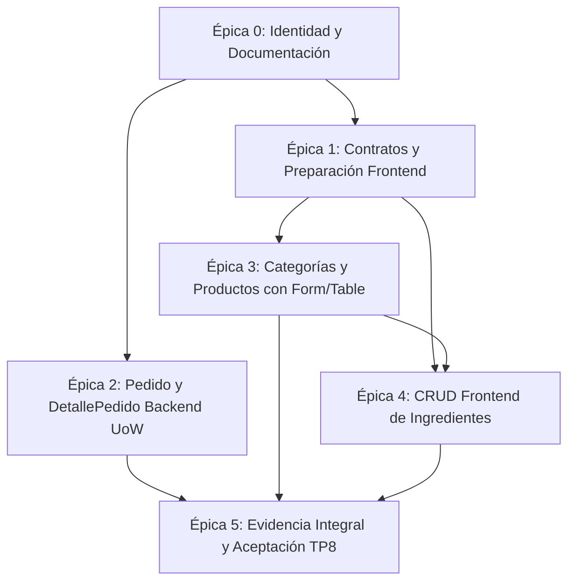

# Resolución y Plan de Ejecución — Trabajo Práctico 8

> **Materia:** Programación IV (TUPaD - UTN)  
> **Tema:** Formularios Controlados (TanStack Form), Tablas Dinámicas (TanStack Table v8), Persistencia Transaccional con Unit of Work (FastAPI + SQLModel / PostgreSQL) y Arquitectura Limpia por Capas.  
> **Estrategia:** Bottom-Up + Walking Skeleton (esqueleto mínimo operativo) + Montaje Progresivo, por entidad/subdominio, con tablero Kanban.  
> **Estado del Proyecto:** Épica 0 (Sincronización Documental, Trazabilidad y Cambio de Identidad) completada. Épicas 1 a 5 planificadas en detalle y pendientes de implementación.  
> **Control de Cambios:** Restricción expresa: prohibido crear commits automáticos o ejecutar sincronizaciones remotas sin revisión previa y autorización explícita del usuario.

---

## 1. Propósito y Fuentes de Especificación

El presente documento constituye el marco rector de ingeniería, especificación técnica y planificación operativa para el **Trabajo Práctico 8 (TP8)**. Establece las bases de continuidad desde el TP7, delimitando con rigor lo efectivamente heredado, lo adaptado a nivel de identidad/documentación, y las épicas funcionales pendientes requeridas para la acreditación académica.

> **Nota sobre bibliografía y documentación entregable:**  
> El directorio `docs/guidelines/` se utiliza como bibliografía técnica local y no se incluirá, ni se copiará su contenido, en ninguno de los ZIP finales. Se cita porque reúne los cuidados conceptuales y las prácticas trabajadas en la Unidad 8 y en las unidades anteriores. Las decisiones aplicadas al proyecto permanecen resumidas en esta resolución para que la entrega sea comprensible sin adjuntar todo el corpus didáctico. Los enlaces locales a las guías se conservan como referencias del entorno de trabajo que no estarán disponibles dentro del ZIP.

### 1.1. Documentos Rectores y Jerarquía de Decisiones

1. **Especificación Evaluativa Principal:**  
   [Consigna del Trabajo Práctico 8](consigna.md) (`docs/consigna.md`). Define las Historias de Usuario (HU-01 a HU-07), las Reglas de Negocio evaluables (RN-01 a RN-16), la rúbrica de evaluación oficial (100 puntos distribuidos en 8 criterios) y las restricciones de entrega.
2. **Criterio Técnico y Buenas Prácticas:**  
   [Guía Maestra Unidad 8](guidelines/unidad8_guia_maestra.md) (`docs/guidelines/unidad8_guia_maestra.md`). Establece los patrones de diseño normativos:
   * **Backend (Secciones 1–8):** Arquitectura por capas (*Models–Schemas–Repository–Unit of Work–Service–Router*), manejo transaccional atómico, aislamiento de excepciones de negocio y separación de sesiones.
   * **Formularios (Secciones 9–16):** Estado unificado en `@tanstack/react-form`, validación al blur/submit con tipos estrictos, `form.Subscribe` para feedback reactivo y prevención de envíos concurrentes.
   * **Tablas (Secciones 18–25):** `@tanstack/react-table` v8 con `createColumnHelper`, ordenamiento (`getSortedRowModel`), filtrado (`getFilteredRowModel`) y paginación local (`getPaginationRowModel`) sobre el conjunto de datos completo.
   * **Accesibilidad y UI (Secciones 26–34):** Componentes semánticos, Tailwind CSS v4, roles ARIA, feedback de carga/vacío/error sin parpadeo y diálogos modales accesibles por teclado.
3. **Calidad de Código y Python Idiomático:**  
   * [Clean Code](guidelines/clean_code.md) (`docs/guidelines/clean_code.md`): Principio de Responsabilidad Única (SRP), nombres intencionales, funciones compactas y tipado estricto.
   * [Guía Anti-Javaismos](guidelines/javaismos_guia.md) (`docs/guidelines/javaismos_guia.md`): Rechazo expreso a getters/setters artificiales, interfaces abstractas vacías, jerarquías de herencia innecesarias y conteos en memoria con Python `len()`.
4. **Dominio del Sistema y Diagrama Relacional:**  
   [Diagrama UML Food Store](UML_FOOD_STORE.svg) (`docs/UML_FOOD_STORE.svg`) y sus notas de diseño ([UML_FOOD_STORE.md](guidelines/UML_FOOD_STORE.md)). Define el dominio relacional de Catálogo (Categorías y Productos) y Ventas (Pedidos y Detalles). Conforme a la consigna vigente, el clúster transaccional de Pedidos se adopta en su forma simplificada (sin `Usuario`, `DireccionEntrega`, `FormaPago` ni tablas de auditoría de estado complejas).
5. **Antecedentes Históricos:**  
   [Guía Maestra Unidad 7](guidelines/unidad7_guia_maestra.md) (`docs/guidelines/unidad7_guia_maestra.md`). Se conserva como referencia histórica para las prácticas de consumo HTTP con TanStack Query v5, enrutamiento desacoplado con React Router v7 y convenciones de estado de servidor.
6. **Síntesis Conceptual y Transición Pedagógica:**  
   [Guía Coloquial: De TP7 a TP8](guidelines/resumen_coloquial.md) (`docs/guidelines/resumen_coloquial.md`). Explica de forma didáctica y coloquial el salto arquitectónico de TP7 a TP8: persistencia transaccional con Unit of Work y Repositories en backend, frontend headless con TanStack Form y Table v8, desacoplamiento de componentes y tabla comparativa directa.

---

## 2. Diagnóstico de Continuidad y Brechas

El diagnóstico se fundamenta en un relevamiento estático exhaustivo del código fuente heredado del TP7, clasificando la evidencia técnica comprobada frente a los requerimientos de la Unidad 8.

| Área / Módulo | Estado Observado en Código | Tratamiento en TP8 | Clasificación |
|---|---|---|---|
| **Identidad y Rutas** | Proyecto renombrado a `unidad8_backend/`, `unidad8_frontend/` y `docs/resolucion_tp8.md`. Scripts de `package.json` actualizados. | Coherencia de rutas y dependencias asegurada en Épica 0. | Implementado (E0) |
| **Categorías Frontend** | `CategoriasPage.tsx`, `CategoriaModal.tsx`, `CategoriaList.tsx`, `CategoriaCard.tsx`. Listado con TanStack Table v8 y modal con TanStack Form v1. | Flujo funcional migrado a `@tanstack/react-form` y `@tanstack/react-table` (Épica 3, E3.1). | Implementado (E3.1) |
| **Productos Frontend** | `ProductsPage.tsx`, `ProductoModal.tsx`, `ProductDetailPage.tsx`. Listado con TanStack Table v8, modal con TanStack Form v1 y detalle individual. | Reemplazo de grilla por tabla TanStack Table v8 y migración de formulario a TanStack Form completados (Épica 3, E3.2). | Implementado (E3.2) |
| **Ingredientes Frontend** | Tipos en `src/types/ingrediente.ts` y CRUD completo con TanStack Table y TanStack Form. | Implementación integral de servicio, modal, tabla dinámica y montaje en navegación (Épica 4, E4.1–E4.2). | Implementado (E4.1, E4.2) |
| **Catálogo Backend** | Módulos `categoria`, `producto`, `ingrediente`, `unidad_medida`. Ingredientes migrado a Repository + UoW. | Conservar arquitectura *Service-Router* en categorías/productos/unidades; incorporar *Repository + Unit of Work* en Ingredientes (Opción B, Tarea E4.4). | Implementado (E4.4) / Preservado |
| **Pedidos Backend** | Agregado `pedidos` con persistencia transaccional Unit of Work. | Módulo `app/modules/pedidos/` completo bajo patrón *Repository + Unit of Work* (Épica 2, E2.1–E2.5). | Implementado (E2.1..E2.5) |
| **Dependencias Frontend** | `package.json` tiene React 19, Query v5, Router v7, Tailwind 4. No incluye `@tanstack/react-form` ni `@tanstack/react-table`. | Registrar como dependencia técnica pendiente para Épica 1. No instalar en esta etapa documental. | Brecha pendiente (Épica 1) |
| **Documentación y Plan** | Documentación previa mezclaba esquemas históricos y métricas pasadas. | Transformada en el presente plan integral de ejecución TP8 con matrices formales. | Implementado (E0) |
| **Aprovisionamiento de Entorno (`setup.sh`)** | Inicialización manual por pasos en READMEs propensa a fallos ante ausencia de `python3-venv`, `pnpm`, ruedas de `psycopg2-binary` o `.env` sin configurar. | Script `setup.sh` automatizado e idempotente con validación e instalación de motores, resolución de casos borde en `.py` y `.ts` y pruebas de humo (Épica 0, Tarea E0.3). | Implementado (E0.3) |

> **Nota sobre ProductsPage heredada:** Aunque la introducción narrativa de `docs/consigna.md` describe la base genérica del TP7 como una página meramente informativa, el relevamiento de código confirmó que en este repositorio `ProductsPage.tsx` ya contenía un CRUD completo con modal y mutaciones. Dicha base se conserva y se adapta formalmente a TanStack Form y Table en la Épica 3 sin perder funcionalidades.

---

## 3. Decisiones de Preservación y Contratos de Integración

Conforme al alcance consensuado y las especificaciones académicas, se adoptan las siguientes decisiones de diseño:

### 3.1. Arquitectura Híbrida Justificada en Backend
* **Pedidos e Ingredientes (Arquitectura UoW Transaccional):** El módulo `pedidos` implementa de forma obligatoria la arquitectura *Models–Schemas–Repository–Unit of Work–Service–Router* conforme a la Actividad 1 y Secciones 1–8 de la guía maestra. Asimismo, el módulo de catálogo `ingrediente` implementa esta misma arquitectura como ampliación opcional formal (Tarea E4.4), desacoplando la persistencia en `IngredienteRepository`, verificando unidades en `UnidadMedidaReadRepository` y administrando atomicidad en `IngredienteUnitOfWork`.
* **Resto del Catálogo de Alimentos (Arquitectura Heredada Preservada):** Los módulos de `categoria`, `producto` y `unidad_medida` mantienen su arquitectura *Models–Schemas–Service–Router* consolidada en el TP7 sin forzar migraciones innecesarias a UoW, minimizando riesgo de sobreingeniería.
* **Integración sin Acoplamiento Peligroso:** Para verificar la existencia y el precio de productos al crear un pedido, el Unit of Work de pedidos expone un repositorio de lectura (`ProductoRepository`) vinculado a la **misma sesión transaccional** del UoW. De igual manera, `IngredienteUnitOfWork` expone `UnidadMedidaReadRepository` vinculado a su propia sesión transaccional para validar y poblar unidades sin emitir commits prematuros.

### 3.2. Contrato Ampliado de Ingredientes y Unidades de Medida
* Se preserva el modelo enriquecido de `Ingrediente` (`id`, `nombre`, `descripcion`, `unidad_medida_id`, `activo`, auditoría) y el catálogo semilla inmutable `UnidadMedida` (`kg`, `g`, `L`, `mL`, `u`, `doc`, `m²`).
* El requerimiento didáctico mínimo (`Ingrediente(id, nombre)`) queda plenamente satisfecho como subconjunto de este contrato enriquecido. No se degradará el esquema ni se eliminarán las llaves foráneas existentes.
* El frontend proveerá en la Épica 4 la selección de unidades de medida existentes vía `GET /unidades-medida/` en el modal de alta de ingredientes.

### 3.3. Contratos de Paginación y Respuestas de Catálogo
* El catálogo backend continúa respondiendo la estructura `{ total: number, items: T[] }` con paginación determinista (`offset`, `limit`, `order_by(Model.id)`).
* El frontend consume este contrato directamente: cada página pide `offset=0` y `limit=100` (máximo `le=100` del backend) con `useQuery` y entrega `data.items` a `useReactTable`; el ordenamiento (`getSortedRowModel`) y la paginación en pantalla (`getPaginationRowModel`) operan localmente sobre esa colección. Límite conocido: hasta 100 registros por entidad. No se agrega helper de acumulación de lotes porque la consigna no lo pide.

---

## 4. Matriz de Historias de Usuario (HU)

La siguiente matriz mapea las siete historias de usuario vigentes especificadas en `docs/consigna.md`, incorporando los criterios transversales de calidad evaluables.

| ID | Historia de Usuario | Criterio de Aceptación Verificable | Base Heredada Existente | Tarea Responsable | Canal de Verificación | Estado TP8 |
|---|---|---|---|---|---|---|
| **HU-01** | Listar categorías con TanStack Table | `CategoriasPage` usa `useQuery` para `GET /categorias` y renderiza con TanStack Table v8. Soporta ordenamiento por columnas (nombre, descripción) con `getSortedRowModel`, paginación con `getPaginationRowModel` (anterior/siguiente), y estados de carga, vacío y error con componentes reutilizables. | Vista con `useQuery`, lista HTML y búsqueda por servidor. | E3.1, E3.3 | Frontend (React) | ✅ Implementado y verificado (E3.1, E3.3) |
| **HU-02** | Crear categoría con TanStack Form | Botón "Nueva categoría" abre modal controlado con `useState`. Formulario gestionado por TanStack Form con validación de campo (nombre obligatorio no vacío tras trim). Al éxito con `useMutation`, invalida query y cierra modal. Error de API (409) muestra mensaje en modal sin cerrarlo ni perder datos. | Modal con inputs HTML y estado manual. | E3.1 | Frontend (React) | ✅ Implementado y verificado (E3.1) |
| **HU-03** | Editar categoría | Botón editar en tabla abre modal precargado mediante TanStack Form con datos de la fila. `useMutation` ejecuta `PUT /categorias/{id}`. Al éxito invalida caché y actualiza tabla. Modal diferencia alta y edición en título y comportamiento. | Modal con precarga mediante props y `useEffect`. | E3.1 | Frontend (React) | ✅ Implementado y verificado (E3.1) |
| **HU-04** | Eliminar categoría | Botón eliminar pide confirmación explícita al usuario y ejecuta `useMutation` con `DELETE /categorias/{id}`. Si la API responde conflicto (409 por productos asociados), se informa al usuario. Tras éxito, la tabla se actualiza sin recargar la página. | Confirmación con `window.confirm` y mutación reactiva. | E3.1 | Frontend (React) | ✅ Implementado y verificado (E3.1) |
| **HU-05** | CRUD de Ingredientes | `IngredientesPage` implementa `useQuery`, TanStack Table, TanStack Form y `useMutation`. Endpoints backend `GET /ingredientes`, `POST`, `PUT /{id}`, `DELETE /{id}` con validación Pydantic. Nombre obligatorio. Enlace en Navbar a `/ingredientes`. | Backend implementado con SQLModel; frontend sin página ni servicio. | E4.1, E4.2, E4.3 | Frontend y REST Client | ✅ Implementado y verificado (E4.1, E4.2, E4.3) |
| **HU-06** | CRUD de Productos | `ProductsPage` con `useQuery`, TanStack Table, TanStack Form y `useMutation`. Operaciones completas `GET /productos`, `POST`, `PUT /{id}`, `DELETE /{id}`. Campos `nombre`, `descripcion`, `precio_base` (>= 0), `disponible` y categorías obligatorias. Formulario bloquea precios negativos. | CRUD interactivo con grilla de tarjetas y modal HTML. | E3.2, E3.3 | Frontend y REST Client | ✅ Implementado y verificado (E3.2, E3.3) |
| **HU-07** | CRUD de Pedidos y DetallePedido (REST) | `GET /pedidos` lista pedidos activos; `GET /pedidos/{id}` devuelve pedido con sus detalles y precio congelado. `POST /pedidos` crea cabecera y detalles en transacción atómica con UoW (`201`); datos inválidos o producto duplicado responde `422`; producto inexistente responde `404` sin persistir nada. `PUT /pedidos/{id}` actualiza estado (`PENDIENTE`, `CONFIRMADO`, `ENTREGADO`, `CANCELADO`). `DELETE /pedidos/{id}` borrado lógico (`204`). Suite `.http` demostrativa. | Sin implementación previa en el sistema. | E2.1 a E2.5 | Backend (REST Client) | Pendiente de implementación |

### 4.1. Criterios Transversales de Navegación y Arquitectura Frontend
* **Navegación React Router:** Rutas SPA `/`, `/categorias`, `/productos`, `/productos/:id` e `/ingredientes` (nueva) declaradas en `App.tsx`.
* **Desacoplamiento de `App.tsx`:** `App.tsx` permanece completamente libre de estado de negocio, hooks de datos y llamadas `fetch`.
* **Hooks en Páginas:** `CategoriasPage`, `ProductsPage` e `IngredientesPage` son dueñas exclusivas de `useQuery`, `useMutation`, `useForm`, `useReactTable` y el estado del modal (`useState`). Los componentes secundarios son estrictamente presentacionales.
* **Tipado TypeScript Extremo a Extremo:** Interfaces tipadas para todas las entidades y props de componentes sin uso de `any` ni evasión del compilador (`tsc -b`).

---

## 5. Matriz de Reglas de Negocio (RN)

La siguiente tabla refleja exactamente las 16 reglas de negocio normadas en la consigna vigente del TP8:

| ID | Regla de Negocio Normativa | Obligatoriedad | Comportamiento Técnico Esperado | Código HTTP | Implementación en Código | Estado de Verificación |
|---|---|---|---|---|---|---|
| **RN-01** | Nombre de categoría obligatorio | Obligatoria | No vacío ni compuesto únicamente por espacios en blanco (`strip_whitespace=True`, `min_length=1`). | 422 Unprocessable | `CategoriaBase.validar_nombre` con `.strip()`. | Verificado (E3.1) |
| **RN-02** | Nombre de categoría único | Opcional (preservada) | Unicidad insensible a mayúsculas/minúsculas (`func.lower(nombre)`). Si existía dada de baja lógica, se reactiva. | 409 Conflict | `create_categoria` / `update_categoria` en `services.py`. | Verificado (E3.1) |
| **RN-03** | Descripción de categoría opcional | Obligatoria | Campo no obligatorio con valor por defecto cadena vacía `""`. | 200 / 201 | Normalizador en `CategoriaBase.normalizar_descripcion`. | Verificado (E3.1) |
| **RN-04** | No operar sobre categoría inexistente | Obligatoria | Operaciones GET por ID, PUT, PATCH o DELETE sobre ID no registrado o con baja lógica retornan no encontrado. | 404 Not Found | Verificación en `get_categoria` y routers. | Verificado (E3.1) |
| **RN-05** | No eliminar categoría con productos | Opcional (preservada) | Verificación de asociaciones activas en `ProductoCategoria`. Si existen productos activos vinculados, se impide la baja. | 409 Conflict | Conteo de productos asociados en `services.py`. | Verificado (E3.1) |
| **RN-06** | Nombre de producto obligatorio, no único | Obligatoria | Cadena de texto obligatoria, no vacía tras trim. Admite duplicados con diferente identificador. | 422 Unprocessable | `validate_producto_nombres` en `validators.py`. | Verificado (E3.2) |
| **RN-07** | Precio base mayor o igual a cero | Obligatoria | `precio_base >= 0`. Se admiten productos gratuitos (precio 0), pero se rechazan estrictamente precios negativos. | 422 Unprocessable | Restricción `Field(ge=0)` en `ProductoBase`. | Verificado (E3.2) |
| **RN-08** | Disponibilidad booleana por defecto | Obligatoria | Atributo `disponible: bool` asignado por omisión a `True`. | 201 Created | Valor por defecto en `ProductoBase.disponible`. | Verificado (E3.2) |
| **RN-09** | No operar sobre producto inexistente | Obligatoria | Operaciones por ID sobre productos inexistentes o con borrado lógico (`deleted_at != None`) devuelven error. | 404 Not Found | Verificación de existencia en servicio y router. | Verificado (E3.2) |
| **RN-10** | Nombre de ingrediente obligatorio | Obligatoria (409 opcional) | Nombre no vacío tras trim. Unicidad de nombre insensible a mayúsculas (409) con rollback transaccional en UoW. | 422 / 409 | `IngredienteBase.validar_nombre`, `IngredienteRepository.get_by_nombre_ci` e `IngredienteService`. | Verificado (E4.1, E4.2, E4.4) |
| **RN-11** | No operar sobre ingrediente inexistente | Obligatoria | Acciones sobre ingredientes inexistentes o eliminados son rechazadas con código 404; baja restringida con productos asociados. | 404 / 409 | `IngredienteRepository.get_active_by_id`, `count_active_productos` e `IngredienteService`. | Verificado (E4.1, E4.2, E4.4) |
| **RN-12** | Pedido con detalles válidos y sin repetidos | Obligatoria | Todo pedido debe contener al menos un detalle (`min_items=1`). Prohibido repetir el mismo `producto_id` en una misma orden. | 422 Unprocessable | Validador Pydantic en `PedidoCreate` (`models.py` y `schemas.py`). | Verificado (E2.1..E2.5) |
| **RN-13** | No operar sobre pedido inexistente | Obligatoria | Peticiones a `/pedidos/{id}` con identificador ausente o con `deleted_at != None` son rechazadas. | 404 Not Found | Control en repositorio y servicio de Pedidos (`get_active_by_id`). | Verificado (E2.2..E2.5) |
| **RN-14** | Identificador autoincremental de solo lectura | Obligatoria | El campo `id` de toda entidad es autogenerado por la base de datos; el cliente no puede imponerlo en creaciones. | id inmutable | `id: Optional[int] = Field(default=None, primary_key=True)`. | Verificado (E2.1..E2.5) |
| **RN-15** | Persistencia relacional y atomicidad UoW | Obligatoria | Persistencia efectiva en PostgreSQL/SQLite. El alta de pedidos se ejecuta en un Unit of Work: fallo revierte todo. | Transacción ACID | Engine SQLAlchemy + `PedidoUnitOfWork` e `IngredienteUnitOfWork`. | Verificado (E2.2..E2.5, E4.4) |
| **RN-16** | Integridad ante errores y conflictos | Obligatoria | Cualquier petición que falle validación o colisione con el estado no genera escrituras parciales y devuelve código estándar. | 404, 409, 422 | Manejo de excepciones desacoplado en routers. | Aplicable a todas las épicas |

---

## 6. Basamento de Calidad Técnica y Buenas Prácticas

En cumplimiento de los principios de diseño establecidos en la guía maestra de la Unidad 8 y los estándares de ingeniería del proyecto:

### 6.1. Backend Transaccional y Unit of Work (Secciones 1–8)
1. **Ciclo de Vida de la Sesión:** El Unit of Work es el único propietario de la sesión de base de datos (`Session(engine)`). Se instancia una sesión nueva por cada caso de uso.
2. **Protocolo de Commit / Rollback:**
   * El servicio orquesta los repositorios emitiendo `add()` y `flush()` para sincronizar IDs autogenerados.
   * La confirmación (`session.commit()`) se ejecuta exclusivamente al completar todas las operaciones del caso de uso.
   * Cualquier excepción no controlada o fallo en la validación de un detalle dispara inmediatamente `session.rollback()`.
   * El cierre de sesión se garantiza en un bloque `finally`, evitando fugas de conexiones en el pool.
3. **Desacoplamiento de Excepciones:** Los repositorios y servicios lanzan excepciones de dominio (`PedidoNoEncontrado`, `ProductoNoEncontrado`, `DetalleInvalidoError`). El router es la única capa autorizada a traducir dichas excepciones a códigos HTTP (`404`, `422`, `409`), manteniendo la lógica de negocio pura y libre de dependencias hacia FastAPI.

### 6.2. Formularios Tipados con TanStack Form (Secciones 9–16)
1. **Estado Centralizado en Form:** El formulario (`useForm`) es la única fuente de verdad para los valores de entrada y los errores de validación. Queda prohibido sincronizar cada input con variables `useState` independientes.
2. **Validación Temprana y Normalización:** Validación en tiempo real (`onBlur`) y obligatoria al enviar (`onSubmit`). Aplicación estricta de `.trim()` sobre campos de texto antes de la validación.
3. **Tratamiento del Precio:** En el formulario, el precio se manipula como cadena de texto editable para permitir al usuario borrar y escribir con naturalidad. Se valida que no sea vacío, sea numérico finito y mayor o igual a cero (`>= 0`), transformándose a `number` únicamente al generar el payload de la mutación.
4. **Flujo de Mutación Asíncrona:** El submit aguarda la resolución de `mutateAsync`. Ante un error de red o HTTP (por ejemplo 409), el modal **permanece abierto** con los valores ingresados intactos y muestra el mensaje de error. Solo se cierra tras confirmación exitosa de la API o cancelación voluntaria.
5. **Control de Envío Reactivo:** Uso de `form.Subscribe` para monitorear `canSubmit` e `isSubmitting`, deshabilitando el botón de acción principal y previniendo doble envío accidental.

### 6.3. Tablas Dinámicas con TanStack Table v8 (Secciones 18–25)
1. **Modelo de Filas y Acceso Seguro:** Configuración mediante `createColumnHelper<T>` con `accessorKey` tipado e identificadores de fila estables vinculados al dominio (`getRowId: (row) => String(row.id)`).
2. **Operaciones sobre la colección cargada:** La tabla procesa ordenamiento (`getSortedRowModel`), filtrado local (`getFilteredRowModel`, opcional según la consigna) y paginación en pantalla (`getPaginationRowModel`) sobre `data.items` obtenido con `limit=100`. Ordenar por descripción afecta a todos los registros cargados y no solo a los 10 de la página visible.
3. **Accesibilidad Tabular:** Renderizado semántico con `<caption>`, encabezados `<th>` con `scope="col"`, atributos dinámicos `aria-sort` en columnas ordenables y controles de paginación implementados como botones nativos (`<button type="button">`).

### 6.4. Interfaz de Usuario y Accesibilidad (Secciones 26–34)
1. **Preservación de Línea Visual:** Continuidad estilística sobre Tailwind CSS v4, garantizando contraste adecuado, foco visual perceptible (`focus-visible:ring-2`) y diseño responsive para dispositivos móviles y escritorio.
2. **Tratamiento de Estados Asíncronos:** Componentes dedicados para carga inicial (skeletons), estado vacío informativo con llamado a la acción y mensajes de error con opción de reintento. Diferenciación visual entre carga inicial y refetching en segundo plano (sin desmontar la tabla).
3. **Diálogos Modales Accesibles:** Trampa de foco en modales, cierre con tecla `Escape`, bloqueo de scroll de fondo y atributos `role="dialog"`, `aria-modal="true"` y `aria-labelledby`.

---

## 7. Plan de Épicas, Estrategia y Tablero Local de Tareas

### 7.1. Principios de Estrategia Técnica

La ejecución del proyecto sigue una estrategia estricta de **Bottom-Up + Walking Skeleton (esqueleto mínimo operativo) + Montaje Progresivo, por entidad/subdominio, con tablero Kanban**:

1. **Orden Bottom-Up riguroso:**
   * **Backend:** Contratos y modelos hoja → Repositorios y Unit of Work transaccional → Servicio de dominio del agregado → Router y endpoints REST.
   * **Frontend:** Tipos y contratos TypeScript → Clientes de servicios HTTP → Componentes presentacionales hoja → Páginas dueñas exclusivas de hooks (`useQuery`, `useMutation`, `useForm`, `useReactTable`, `useState`) → Montaje en rutas declarativas de navegación. No se mueven hooks a componentes hoja para forzar artificialmente el orden.
2. **Walking Skeleton heredado del TP7:**
   * Se conserva íntegro y operativo el esqueleto mínimo heredado: catálogo backend con FastAPI, frontend React con Vite, Navbar accesible, rutas existentes (`/`, `/categorias`, `/productos`, `/productos/:id`) y gestión de estado con TanStack Query.
   * La continuidad operativa del Walking Skeleton se valida formalmente al cerrar E1, asegurando que el catálogo funcional no sufra degradación antes de iniciar las adaptaciones. No se crean pantallas vacías, mocks desconectados ni contenedores sin comportamiento.
   * La entidad Pedidos continúa exclusivamente en backend y REST Client conforme a la consigna.
3. **Islas de Dominio:**
   * Cada subdominio se cierra como unidad verificable antes de pasar al siguiente: primero el agregado transaccional `Pedido/DetallePedido` en backend, y posteriormente cada CRUD frontend (`Categorías`, `Productos`, `Ingredientes`), con comprobación observable por entidad.
   * No se construyen todos los servicios o modelos de todos los dominios de forma desacoplada antes de integrar y probar alguno.
4. **Montaje Progresivo:**
   * E3.1 y E3.2 actualizan las rutas existentes en su misma tarea al adaptar sus páginas.
   * E4.2 incluye el montaje real de `Ingredientes` en `App.tsx` y `Navbar.tsx` una vez implementados sus componentes y página; E4.3 verifica la navegación integral y el desacoplamiento estructural de `App.tsx` ya integrado, sin posponer el primer montaje a una tarea posterior.
5. **Datos de Prueba Tempranos:**
   * Los datos de prueba se preparan al cerrar E1 o antes del primer incremento que consulte datos, utilizando exclusivamente almacenamiento de prueba aislado (SQLite en memoria / base temporal).
   * Se reutiliza el catálogo semilla de unidades de medida oficial existente (`seed_unidades_medida`); las categorías y productos se crean mediante operaciones reales de la API en el almacenamiento de pruebas.
   * Para el escenario de tabla con más de una página visible (verificación de orden y paginación locales), una colección de 25 categorías se crea mediante la API solo dentro del entorno de pruebas, sin contaminar la base de datos personal. No se aplican fixtures de Pedidos antes de existir el módulo.
6. **Gobierno Kanban y Definiciones DoR / DoD:**
   * **Estados del ciclo de vida:** `Pendiente → En Progreso → En Verificación → Completada`, más `Bloqueada` con registro de causa.
   * **WIP = 1:** Se procesa una sola tarea a la vez en esta planificación, garantizando foco y trazabilidad observable. La independencia técnica entre ramas (por ejemplo E2 backend frente a E3 frontend) no implica promesas de ejecución paralela no verificada.
   * **Definition of Ready (DoR):** Una tarea solo ingresa a desarrollo si sus dependencias previas están completadas, sus contratos e incisos de consigna están identificados y su comprobación rápida está definida.
   * **Definition of Done (DoD):** Una tarea solo pasa a `Completada` cuando su criterio de aceptación observable se cumple, la integración real está efectuada y la evidencia técnica comprobada queda registrada.
   * **Comprobación rápida por tarea:** Cada tarea cuenta con una verificación ejecutable diseñada para resolverse en aproximadamente un minuto, sin omitir validaciones necesarias ni afirmar tiempos no medidos.

### 7.2. Grafo de Dependencias Técnicas entre Épicas

El orden recomendado de ejecución es `E0 → E1 → E2 → E3 → E4 → E5`. El siguiente diagrama refleja las dependencias técnicas reales del proyecto (el módulo E2 de pedidos backend no depende de la instalación de librerías frontend de E1):

---

### 7.3. Tablero Resumen de Tareas

| ID | Tarea / Acción | Consigna resuelta / soporte | Dependencia | Archivos y Símbolos Críticos | HU / RN | Criterio de Aceptación Verificable | Estado |
|---|---|---|---|---|---|---|:---:|
| **E0.1** | Renombrado de directorios y actualización de consumidores directos | Soporte local: identidad/rutas; sin inciso académico obligatorio propio. | Ninguna | `unidad8_backend/`, `unidad8_frontend/`, `package.json`, `app/main.py`, `Navbar.tsx`, `index.html` | Identidad | Scripts raíz operativos; cero directorios `unidad7_`; títulos de frontend y backend actualizados a TP8. | ✅ **Completada** |
| **E0.2** | Redacción y sincronización documental integral, trazabilidad y procedencia TP7 | Soporte local: resolución y documentación; sin inciso académico obligatorio propio. | E0.1 | `docs/resolucion_tp8.md`, `README.md`, `unidad8_backend/README.md`, `unidad8_frontend/README.md`, código heredado | Documentación | Tablero TP8 con 20 tareas, mapeo a `consigna.md`, exclusión de guidelines de ZIPs, procedencia TP7 explicitada en comentarios y 3 READMEs sincronizados. | ✅ **Completada** |
| **E0.3** | Script automatizado de instalación integral del entorno (`setup.sh`) | Soporte de [Ejercicio 1.a y 1.e](consigna.md) y [Ejercicio 2, introducción](consigna.md): provisión automatizada Full Stack (Backend `.py` + Frontend/Raíz `.ts`). | E0.2 | `setup.sh`, `package.json`, `README.md`, `unidad8_backend/README.md`, `unidad8_frontend/README.md`, `unidad8_backend/requirements.txt`, `unidad8_backend/.env.example` | Infraestructura, RN-15 | Script `.sh` agnóstico, ejecutable e idempotente con flags `--start`, `--yes`, saneamiento preventivo de permisos (`chmod +x`), `npx --yes` y documentación en los 3 READMEs; aprovisionamiento y arranque Full Stack verificados. | ✅ **Completada** |
| **E1.1** | Instalación y fijación de dependencias TanStack Form y Table | [Ejercicio 2, introducción](consigna.md): instalación de TanStack Form y TanStack Table v8. | E0.2 | `unidad8_frontend/package.json`, `pnpm-lock.yaml` | Infraestructura | Instalación de `@tanstack/react-form` y `@tanstack/react-table` v8 sin romper React 19 ni Tailwind 4. `pnpm build:front` compila. | ✅ **Completada** |
| **E1.3** | Consolidación y tipado de contratos TypeScript | [Ejercicio 2.a, interfaces en src/types/](consigna.md), y [Conclusiones esperadas, Tipado TypeScript](consigna.md). Reutilizar contratos; retirar `pedido.ts` frontend. | E1.1 | `src/types/categoria.ts`, `producto.ts`, `ingrediente.ts`, `index.ts`, `CategoriasPage.tsx`, `ProductsPage.tsx` | HU-01..06 | Interfaces estrictas: 4 campos de lectura corregidos (`descripcion` en Categoria e Ingrediente; `imagenes_url` e `ingredientes` en Producto) y mutaciones con `CategoriaUpdate`/`ProductoUpdate`. Props tipados sin `any`. `index.ts` conservado y `pedido.ts` excluido de frontend. | ✅ **Completada** |
| **E1.2** | Carga tabular directa sin helper de paginación | [Ejercicio 2.a Páginas](consigna.md) y HU-01/HU-05/HU-06: `useQuery` + `useReactTable` con orden y paginación locales sobre `data.items`. | E1.1 | Sin archivos nuevos (se retira `src/services/pagination.ts`; las páginas usan `getCategorias`, `getProductos` e `getIngredientes` con `limit=100`) | HU-01, HU-05, HU-06 | `pagination.ts` y su export en `services/index.ts` no existen; contrato documentado: `offset=0`, `limit=100` y `data.items` directo a `useReactTable`. | ✅ **Completada** |
| **E2.1** | Modelos y Schemas de Pedido y DetallePedido | [Ejercicio 1.b, Definición de models y schemas de Pedido y DetallePedido](consigna.md). | E0.2 | `app/modules/pedidos/models.py`, `app/modules/pedidos/schemas.py` | HU-07, RN-12, RN-14 | Tablas `pedido` y `detalle_pedido`. PK compuesta `(pedido_id, producto_id)`. Schemas con validación de no repetidos y cantidad >= 1. | ✅ **Completada** |
| **E2.2** | Repositorios base y Unit of Work transaccional | [Ejercicio 1.c, Repository y Unit of Work](consigna.md). | E2.1 | `app/core/repository.py`, `unit_of_work.py`, `app/modules/pedidos/repository.py`, `unit_of_work.py` | HU-07, RN-15, RN-16 | `PedidoUnitOfWork` administra sesión única, expone repositorios y asegura rollback ante excepciones sin commit prematuro. | ✅ **Completada** |
| **E2.3** | Capa de servicio de Pedidos y orquestación | [Ejercicio 1.c, Service y casos de uso del agregado](consigna.md). | E2.2 | `app/modules/pedidos/service.py` | HU-07, RN-12, RN-15 | `PedidoService` implementa listar, obtener, crear (atómica con captura de precio congelado), actualizar estado y baja lógica. | ✅ **Completada** |
| **E2.4** | Router REST de Pedidos y registro en aplicación | [Ejercicio 1.c, Router y cinco endpoints](consigna.md); [Ejercicio 1.e](consigna.md) para integración y CORS. | E2.3 | `app/modules/pedidos/router.py`, `app/main.py`, `app/database.py` | HU-07, RN-13, RN-16 | Endpoints `/pedidos` (`GET`, `GET /{id}`, `POST`, `PUT /{id}`, `DELETE /{id}`). Traducción de excepciones a 404/422. Creación de tablas en startup. | ✅ **Completada** |
| **E2.5** | Suite REST Client de Pedidos (`pedidos.http`) | [Ejercicio 1.c, demostración con pedidos.http](consigna.md), incluyendo 404 y 422; HU-07. | E2.4 | `unidad8_backend/pedidos.http` | HU-07, RN-09, RN-12, RN-13, RN-14, RN-15, RN-16 | Suite ejecutable con flujo completo: alta válida, captura de precios, modificación de estado, baja lógica, posteriores 404 y rechazos 422. | ✅ **Completada** |
| **E3.1** | Adaptación de Categorías a TanStack Form y Table | [Ejercicio 2.a, CategoriasPage](consigna.md): hooks, lista, modal y botón; HU-01..HU-04. | E1.2 | `CategoriasPage.tsx`, `CategoriaModal.tsx`, `CategoriaList.tsx`, `CategoriaCard.tsx` | HU-01..04, RN-01..05 | `CategoriasPage` integra `useReactTable` y `useForm`. Modal controlado con `useState`. Ruta actualizada de inmediato. | ✅ **Completada** |
| **E3.2** | Adaptación de Productos a TanStack Form y Table | [Ejercicio 2.a, ProductsPage](consigna.md): CRUD, hooks, modal, Form/Table; HU-06. | E1.2 | `ProductsPage.tsx`, `ProductoModal.tsx`, `ProductDetailPage.tsx` | HU-06, RN-06..09 | `ProductsPage` reemplaza grilla por tabla dinámica. Modal valida precio >= 0 y categorías obligatorias. Preserva detalle. | ✅ **Completada** |
| **E3.3** | Componentes comunes de estados de carga, vacío y error | [HU-01](consigna.md): estados de carga, vacío y error como componentes reutilizables con Tailwind CSS; rúbrica Estructura y buenas prácticas. | E3.1, E3.2 | `src/components/` (`LoadingState.tsx`, `EmptyState.tsx`, `ErrorState.tsx`) | Calidad UI, HU-01, HU-06 | Extracción de los patrones de carga/vacío/error ya repetidos en componentes planos de `src/components/`, sin subcarpeta `ui/` ni componente de campo de formulario. | ✅ **Completada** |
| **E4.1** | Capa de servicios HTTP de Ingredientes | Soporte de consumo para [Ejercicio 1.d](consigna.md) y [Ejercicio 2.a IngredientesPage](consigna.md). | E1.2 | `src/services/ingredientes.service.ts` (incluye `getUnidadesMedida`) | HU-05 | Cliente HTTP tipado con manejo de errores para `/ingredientes/` y lectura de `/unidades-medida/` en el mismo archivo. Listado con `limit=100`. | ✅ **Completada** |
| **E4.2** | Interfaz completa CRUD de Ingredientes y montaje | [Ejercicio 2.a IngredientesPage](consigna.md) y [Ejercicio 2.b–c](consigna.md) para su montaje inmediato; HU-05. | E4.1, E3.3 | `src/pages/IngredientesPage.tsx`, `IngredienteModal.tsx`, `IngredienteList.tsx`, `App.tsx`, `Navbar.tsx` | HU-05, RN-10..11 | Página CRUD con TanStack Table + TanStack Form + selector de unidades. Montaje directo de ruta y Navbar en la misma tarea. | ✅ **Completada** |
| **E4.3** | Verificación de navegación y desacoplamiento de App | Verificación de [Ejercicio 2.b Navegación](consigna.md), [2.c App.tsx](consigna.md) y [Comportamiento esperado](consigna.md). | E4.2 | `src/App.tsx`, `src/components/Navbar.tsx` | HU-05, Navegación | Navegación fluida por todas las rutas integradas. Discriminación activa en Navbar. `App.tsx` sin datos ni llamadas a APIs. | ✅ **Completada** |
| **E4.4** | Migración de Ingredientes Backend a Repository y Unit of Work | Ampliación opcional de [docs/consigna.md](consigna.md) §Opcional (UoW en ingredientes, nombre único insensible a mayúsculas RN-10 y restricción de baja RN-11). | E2.2, E4.2 | `app/modules/ingrediente/repository.py`, `unit_of_work.py`, `services.py`, `routers.py`, `__init__.py` | HU-05, RN-10, RN-11, RN-15, RN-16 | Arquitectura desacoplada en 6 capas; rollback transaccional automático; `pnpm test:back` al 100% y suite de verificación de atomicidad UoW aprobada. | ✅ **Completada** |
| **E5.1** | Regresión del catálogo y verificación de atomicidad de Pedidos | Soporte de verificación de [Ejercicio 1.c](consigna.md), HU-07 y RN-15/RN-16; regresión de [Ejercicio 1.d](consigna.md). | E2.5, E3.3, E4.3, E4.4 | `unidad8_backend/tests/test_productos_http.py` (existente, sin cambios), `unidad8_backend/pedidos.http` | Regresión, HU-07, RN-15..16 | `pnpm test:back` pasa al 100%; el caso 404 de `pedidos.http` con un primer detalle válido no deja pedido persistido. Sin archivos de test nuevos. | ✅ **Completada** |
| **E5.2** | Demostración integral E2E Full Stack | Evidencia de [Ejercicio 1.c–e](consigna.md), [Ejercicio 2.a–c](consigna.md) y [Conclusiones esperadas](consigna.md). | E5.1 | Todo el sistema (Frontend Vite + Backend FastAPI) | Aceptación TP8, HU-01..07 | Verificación en vivo de flujos de catálogo, formularios, tablas, pedidos REST y persistencia en base de pruebas aislada. | ✅ **Completada (verificada)** |
| **E5.3** | Auditoría final contra rúbrica de consigna | [Criterios de evaluación (los ocho, 100 puntos)](consigna.md) y [Formato de entrega](consigna.md); cotejo. | E5.2 | Rúbrica oficial (100 pts) y checklist de entrega | Rúbrica académica | Cotejo formal de los 8 criterios de evaluación contra evidencia real. Validación de checklist de exclusión de guidelines en ZIPs. | ✅ **Completada (verificada)** |

---

### 7.4. Fichas Detalladas de Tareas por Épica

#### Épica 0: Identidad y Documentación

##### Ficha E0.1: Renombrado de directorios y actualización de consumidores directos
* **Acción:** Renombrado formal de directorios de proyecto (`unidad7_backend/` → `unidad8_backend/`, `unidad7_frontend/` → `unidad8_frontend/`), actualización de scripts en `package.json` raíz, ajuste de títulos en frontend/backend y eliminación de residuos.
* **Estado:** Completada (registro histórico comprobado).
* **Dependencias:** Ninguna.
* **Archivos y símbolos críticos:** `unidad8_backend/`, `unidad8_frontend/`, `package.json`, `unidad8_backend/app/main.py`, `unidad8_frontend/src/components/Navbar.tsx`, `unidad8_frontend/index.html`.
* **Consigna resuelta / soporte:** Soporte local: identidad/rutas; sin inciso académico obligatorio propio.
* **HU / RN:** Identidad y coherencia estructural de repositorios.
* **Criterio de aceptación verificable:** Scripts raíz operativos (`dev`, `build:front`, `test:back`); cero referencias o carpetas `unidad7_` residuales; títulos de aplicación y documentación alineados al TP8.
* **Verificación rápida prevista / ejecutada:** Inspección del sistema de archivos, diff limpio de scripts y comprobación de títulos ejecutada satisfactoriamente en la sincronización inicial.

##### Ficha E0.2: Redacción y sincronización documental integral, trazabilidad y procedencia TP7
* **Acción:** Creación de `docs/resolucion_tp8.md`, sincronización de los tres `README.md`, incorporación de política de exclusión de `docs/guidelines/` de los ZIPs, adopción de estrategia Bottom-Up + Walking Skeleton con Kanban y 20 fichas detalladas, cierre de trazabilidad con incisos de `consigna.md` y explicitación de procedencia del TP7 en comentarios y docstrings del código heredado sin alterar cadenas funcionales ni descripciones OpenAPI.
* **Estado:** Completada (verificada en la presente revisión).
* **Dependencias:** E0.1.
* **Archivos y símbolos críticos:** `docs/resolucion_tp8.md`, `README.md`, `unidad8_backend/README.md`, `unidad8_frontend/README.md`, 24 archivos de backend y 20 archivos de frontend intervenidos en comentarios.
* **Consigna resuelta / soporte:** Soporte local: resolución y documentación; sin inciso académico obligatorio propio.
* **HU / RN:** Documentación técnica, trazabilidad académica y procedencia histórica.
* **Criterio de aceptación verificable:** Tablero con 20 tareas únicas vinculadas a consigna; exclusión expresa de `guidelines/` normada en Sección 1 y Sección 8.4; ausencia de nomenclatura `F` en documentos de planificación; procedencia del TP7 rotulada en comentarios/docstrings preservando descripciones OpenAPI en `schemas.py`; sincronización coherente de los tres READMEs.
* **Verificación rápida prevista / ejecutada:** Verificación de igualdad de AST en Python descartando docstrings; comprobación de que en TSX/CSS/HTTP solo se agregaron comentarios; validación `grep` de ausencia de `F` operativo; resolución de enlaces Markdown locales en memoria; ejecución de `pnpm build:front` y `pnpm test:back`.

##### Ficha E0.3: Script automatizado de instalación integral del entorno (setup.sh)
* **Acción:** Creación y extensión de `setup.sh` en la raíz del repositorio con permisos de ejecución (`chmod +x`), implementando aprovisionamiento automatizado, desatendido e idempotente para Linux, macOS y Windows POSIX (Git Bash/MSYS2). Estructura agnóstica parametrizable mediante 6 variables de configuración superiores y auto-detección dinámica de subproyectos (`backend`/`frontend`), módulo principal de FastAPI y base PostgreSQL. Incorporación de bandera `--start` (`-s` | `--run`) para iniciar ambos servidores (Frontend + Backend) inyectando `.venv/bin` en el `PATH` y ejecutando `pnpm run dev` o fallback con `npx --yes concurrently`. Saneamiento preventivo de permisos ejecutables (`chmod +x`) y finales de línea CRLF en scripts `.sh`, wrappers (`gradlew`, `mvnw`) y binarios de `node_modules/.bin`. Prevención de bloqueos interactivos mediante `npx --yes` en `setup.sh` y en `"dev:stop"` de `package.json`. Documentación completa de `setup.sh` y sus opciones CLI en los tres `README.md` del repositorio preservando las instrucciones manuales existentes.
* **Estado:** Completada (verificada).
* **Dependencias:** E0.2.
* **Archivos y símbolos críticos:** `setup.sh`, `package.json`, `README.md`, `unidad8_backend/README.md`, `unidad8_frontend/README.md`, `unidad8_backend/requirements.txt`, `unidad8_backend/.env.example`, `unidad8_backend/.env`, `unidad8_frontend/package.json`.
* **Consigna resuelta / soporte:** Soporte de [Ejercicio 1.a y 1.e](consigna.md) y [Ejercicio 2, introducción](consigna.md): provisión automatizada Full Stack (Backend `.py` + Frontend/Raíz `.ts`).
* **HU / RN:** Infraestructura, Entorno, RN-15.
* **Criterio de aceptación verificable:** Script agnóstico, ejecutable e idempotente; flags `--yes`, `--start` (`-s`), `--no-system-install`, `--recreate-venv`, `--skip-checks`, `--db-mode`, `--backend-dir`, `--frontend-dir`, `--pg-db` y `--help` operativas; creación y verificación de `python3` (>=3.11), `.venv`, dependencias de `requirements.txt`, `.env` con DB funcional, `node` (>=18.18), `pnpm`, dependencias de raíz y frontend con `chmod +x` preventivo en binarios, smoke checks superados al 100%, arranque automático con `--start` y documentación en los 3 `README.md`.
* **Catálogo de casos borde contemplados y validados:**
  1. *Shell, rutas, portabilidad y finales de línea CRLF:* Ejecución independiente del directorio actual (`cwd`), modo estricto (`set -Eeuo pipefail`), `trap` de diagnóstico ante fallos, función `fix_project_permissions` para sanear retornos de carro `\r` y conceder permisos `chmod +x` preventivamente a scripts `.sh` y wrappers de compilación.
  2. *Detección de SO, privilegios y gestores nativos:* Identificación dinámica de `apt-get`, `dnf`/`yum`, `pacman`, `apk`, `zypper`, `brew`, `choco` y `winget`. Elevación controlada con `sudo` o degradación segura en espacio de usuario sin bloqueo de terminal si se invoca `--no-system-install` o no hay credenciales root.
  3. *Motor Python (`>= 3.11`) y ausencia de `venv`/`ensurepip`:* Búsqueda secuencial entre candidatos (`python3.13` a `python`), validación en runtime de `sys.version_info >= (3, 11)` (requerido por `from typing import Self`), provisión automática vía gestor nativo o fallback sin root con `python3 -m venv --without-pip` y bootstrap de `https://bootstrap.pypa.io/get-pip.py`.
  4. *Entornos `.venv` corruptos, shebangs huérfanos y dualidad de rutas:* Priorización canónica de `${ROOT_DIR}/.venv` con enlace relativo `unidad8_backend/.venv -> ../.venv`. Invocación invariable de módulos vía `"$VENV_PYTHON" -m pip` y `"$VENV_PYTHON" -m pytest`, previniendo fallos por shebangs rotos tras renombrado de carpetas históricas.
  5. *Compilación nativa de `psycopg2-binary` y paquetes `.py`:* Actualización preventiva de `pip`, `setuptools` y `wheel` para compatibilidad de ruedas modernas. Detección de fallos de compilación nativa en arquitecturas sin wheel precompilado e instalación automática de `build-essential`, `libpq-dev`, `python3-dev` (o equivalentes según distribución). Verificación estricta de importación de los 9 paquetes y de `app.main`.
  6. *Configuración de `.env` y disponibilidad de PostgreSQL vs. SQLite:* Copia limpia de `.env.example` a `.env` si no existe. Conexión de prueba real con SQLAlchemy. Fallback automático a `sqlite:///./dev.db` si el servicio PostgreSQL local no está activo o la base no existe, evitando caídas con `OperationalError` al levantar la API.
  7. *Motor Node.js (`>= 18.18`) y gestores de versiones en espacio de usuario:* Hidratación automática de `PATH` para shells no interactivas desde `nvm`, `fnm`, `volta`, `asdf`, `mise` y `~/.local/bin`. Detección semántica de versión y provisión automática mediante gestor de versiones o binario LTS.
  8. *Provisión de `pnpm` en cascada sin errores `EACCES`:* Verificación de `pnpm >= 8`. Estrategia de provisión en cascada en espacio de usuario: Corepack hacia `~/.local/bin`, `npm install -g pnpm --prefix ~/.local` o script instalador oficial standalone de pnpm, sin requerir permisos root sobre `/usr/bin`.
  9. *Dependencias `.ts`/`.tsx`, permisos en `node_modules/.bin` y binarios nativos:* Instalación en raíz y en frontend con `--frozen-lockfile` y fallback a `--no-frozen-lockfile`. Aplicación explícita de `chmod +x` sobre todos los binarios de `node_modules/.bin` previniendo errores de permisos al extraer desde ZIP. Validación de ejecución de `.bin/tsc`, `.bin/vite` y resolución de módulos críticos TanStack/React.
  10. *Arranque unificado desatendido y no interactivo:* Inyección de `${CANONICAL_VENV}/bin` en el `PATH` para que `pnpm run dev` ejecute `fastapi` del entorno virtual sin depender de `source .venv/bin/activate`. Invocaciones con `npx --yes` para suprimir prompts interactivos de descarga (`kill-port`, `concurrently`).
* **Verificación rápida ejecutada:** Sintaxis comprobada con `bash -n setup.sh` (código 0); interfaz CLI documentada con `./setup.sh --help` (código 0); aprovisionamiento integral verificado con `./setup.sh --yes`, validando Python 3.13.5, symlink `.venv`, importación de módulos, SQLite local, Node v24.18.0, pnpm v12.6.0, `pytest` (3/3 passed) y `vite build` (código 0); prueba de idempotencia e independencia de `cwd` ejecutada desde `/tmp` con `./setup.sh --yes --skip-checks` (código 0); verificación en vivo de `--start` con inyección de entorno virtual y apagado no bloqueante con `pnpm run stop` (`npx --yes kill-port 5173 8000`).

#### Épica 1: Contratos y Preparación Frontend

##### Ficha E1.1: Instalación y fijación de dependencias TanStack Form y Table
* **Acción:** Instalación y fijación estricta de `@tanstack/react-form` y `@tanstack/react-table` v8 en `unidad8_frontend/package.json`.
* **Estado:** Completada (verificada).
* **Dependencias:** E0.2.
* **Archivos y símbolos críticos:** `unidad8_frontend/package.json`, `pnpm-lock.yaml`.
* **Consigna resuelta / soporte:** [Ejercicio 2, introducción](consigna.md): instalación de TanStack Form y TanStack Table v8.
* **HU / RN:** Infraestructura técnica para HU-01, HU-02, HU-03, HU-05 y HU-06.
* **Criterio de aceptación verificable:** Dependencias agregadas en versiones estables y compatibles con React 19 y Tailwind CSS v4; lockfile consistente; `pnpm build:front` compila sin advertencias críticas de resolución de paquetes.
* **Verificación rápida prevista / ejecutada:** Instalación de `@tanstack/react-form` (^1.33.5) y `@tanstack/react-table` (^8.21.3) vía `pnpm --dir unidad8_frontend add @tanstack/react-form @tanstack/react-table@8`; lockfile actualizado y compilación exitosa con `pnpm run build:front` (`tsc -b && vite build` finalizado con código de salida 0 sin advertencias ni conflictos con React 19 o Tailwind CSS v4).

##### Ficha E1.3: Consolidación y tipado de contratos TypeScript
* **Acción:** Consolidación de interfaces de datos en TypeScript para Categoría, Producto e Ingrediente, tipado de props de componentes y contratos de mutación (`CategoriaUpdate`, `ProductoUpdate`). Se retira `pedido.ts` de la planificación frontend al ser Pedidos un módulo puramente REST sin interfaz gráfica en la consigna. Se corrigieron los cuatro campos de lectura indebidamente opcionales (`Categoria.descripcion`, `Ingrediente.descripcion`, `Producto.imagenes_url`, `Producto.ingredientes`) y se conservó `index.ts`.
* **Estado:** Completada (verificada).
* **Dependencias:** E1.1.
* **Archivos y símbolos críticos:** `unidad8_frontend/src/types/categoria.ts`, `producto.ts`, `ingrediente.ts`, `index.ts` (conservado con sus re-exports), `unidad8_frontend/src/pages/CategoriasPage.tsx`, `unidad8_frontend/src/pages/ProductsPage.tsx`.
* **Consigna resuelta / soporte:** [Ejercicio 2.a, interfaces en src/types/](consigna.md), y [Conclusiones esperadas, Tipado TypeScript](consigna.md). Reutilizar contratos de Categoría/Producto/Ingrediente; retirar `pedido.ts` del listado planificado porque HU-07 es backend y no necesita contrato frontend.
* **HU / RN:** HU-01 a HU-06, Criterio de evaluación "Tipado TypeScript".
* **Criterio de aceptación verificable:** Interfaces completas que cubren todas las entidades y payloads requeridos por los modales y tablas; cero tipos `any` implícitos o explícitos; tipado estricto en props de componentes presentacionales; mutaciones de actualización tipadas con tipos `*Update`.
* **Verificación rápida ejecutada:**
  1. Smoke de serialización DTO backend con Python sin DB (`CategoriaRead`, `IngredienteRead`, `ProductoRead`): verificación de normalización de `descripcion` a cadena vacía, inicialización de listas en `[]` y estado `disponible: true`.
  2. Compilación estricta TypeScript de casos positivos y negativos con directivas `@ts-expect-error` (`tsc --noEmit --strict --skipLibCheck --target ES2022 --module ESNext --moduleResolution bundler`): código 0 sin errores ni directivas sin utilizar.
  3. Búsqueda de `\bany\b` en `unidad8_frontend/src`: cero coincidencias.
  4. Compilación frontend completa con `pnpm run build:front` (`tsc -b && vite build`): código de salida 0.

##### Ficha E1.2: Carga tabular directa sin helper de paginación
* **Acción:** Decisión de diseño: no crear un helper de acumulación de lotes. Cada página (`CategoriasPage`, `ProductsPage`, `IngredientesPage`) llama a su servicio con `offset=0` y `limit=100` mediante `useQuery` y pasa `data.items` a `useReactTable`, como indica la consigna. Se retiran `unidad8_frontend/src/services/pagination.ts` y su re-export en `src/services/index.ts`, creados antes y no exigidos por `docs/consigna.md`.
* **Estado:** Completada (verificada).
* **Dependencias:** E1.1.
* **Archivos y símbolos críticos:** Ningún archivo nuevo. Retirados: `unidad8_frontend/src/services/pagination.ts` y la línea de export en `unidad8_frontend/src/services/index.ts`.
* **Consigna resuelta / soporte:** [Ejercicio 2.a Páginas](consigna.md) y HU-01/HU-05/HU-06: `useQuery` + TanStack Table con `getSortedRowModel` y `getPaginationRowModel` sobre los datos cargados. La consigna no pide un helper de paginación.
* **HU / RN:** HU-01, HU-05, HU-06.
* **Criterio de aceptación verificable:** La búsqueda de `fetchAllPages` y `pagination.ts` en el repositorio (sin `node_modules` ni `dist`) no arroja coincidencias; `pnpm run build:front` compila. El contrato de carga queda documentado en las Secciones 3.3 y 6.3. Límite conocido: `limit` máximo 100 del backend (`le=100`), por lo que cada tabla muestra hasta 100 registros por entidad.
* **Verificación rápida prevista / ejecutada:** Archivo y export retirados; `grep` sin coincidencias; `pnpm run build:front` finalizado con código 0.

---

#### Épica 2: Pedido y DetallePedido Backend UoW

##### Ficha E2.1: Modelos y Schemas de Pedido y DetallePedido
* **Acción:** Definición de los modelos relacionales en SQLModel para `Pedido` y `DetallePedido`, y schemas Pydantic de entrada, salida y validación de reglas de negocio.
* **Estado:** Completada (verificada).
* **Dependencias:** E0.2.
* **Archivos y símbolos críticos:** `unidad8_backend/app/modules/pedidos/models.py`, `app/modules/pedidos/schemas.py`.
* **Consigna resuelta / soporte:** [Ejercicio 1.b, Definición de models y schemas de Pedido y DetallePedido](consigna.md).
* **HU / RN:** HU-07, RN-12, RN-14.
* **Criterio de aceptación verificable:** Tablas `pedido` y `detalle_pedido` mapeadas; clave primaria compuesta `(pedido_id, producto_id)` en detalle; atributos requeridos presentes (`total`, `estado`, `fecha`, `cantidad`, `precio_unitario`); schemas Pydantic que validan al menos un detalle (`min_items=1`), cantidad entera >= 1 por ítem y unicidad de `producto_id` dentro del pedido.
* **Verificación rápida ejecutada:**
  - **Escenario 1 (DTOs y validación Pydantic sin DB):** `PedidoCreate` con 2 detalles válidos mantiene orden y cantidades; `model_dump()` contiene únicamente `detalles`. `ValidationError` demostrado ante: detalles omitidos, lista vacía (`min_length=1`), `producto_id` duplicado (`ValueError("No se puede repetir un producto en el pedido.")`), cantidad omitida, cantidad 0, -1, float 1.5, bool `True`, string `"1"`. Cantidades enteras 1 y 2 aceptadas. Campos extra (`id=999`, `estado="ENTREGADO"`, `total=999.0`, `fecha`, `precio_unitario=999.0`) ignorados por defecto y excluidos del `model_dump()`.
  - **Escenario 2 (Estados y contratos de salida):** `PedidoUpdate` acepta `PENDIENTE`, `CONFIRMADO`, `ENTREGADO`, `CANCELADO`; rechaza `DESCONOCIDO`, `None` y omisión. `PedidoRead` serializa fecha ISO, precios en float y excluye el campo interno `deleted_at`.
  - **Escenario 3 (Agregado SQLModel en SQLite aislado en memoria con FKs activas):** Pedido persistido con defaults (`id=1`, fecha UTC, `estado="PENDIENTE"`, `total=0.0`, `deleted_at=None`). Detalle con `cantidad=2`, `precio_unitario=2.5` persistido; relación inversa bidireccional `detalle.pedido is pedido` verificada; validación ORM a DTO con `PedidoRead.model_validate(pedido)` exitosa. Clave primaria de `detalle_pedido` exactamente compuesta por `{"pedido_id", "producto_id"}` sin id artificial. Integridad referencial (`PRAGMA foreign_keys=ON`) y atomicidad verificadas: `IntegrityError` y rollback ante duplicación de clave compuesta, `producto_id` inexistente (99999) y `pedido_id` inexistente (99999), conservando intacto el detalle original.
  - **Escenario 4 (HTTP 422 observable con FastAPI throwaway):** Endpoint de prueba `POST /_smoke/pedidos` con `TestClient`: responde 200 con payload válido; responde 422 ante detalles vacíos, productos duplicados y cantidad 0. (Nota: routers productivos `/pedidos` no declarados ni montados anticipadamente; corresponden a E2.4).
  - **Escenario 5 (Regresión backend):** `PATH="$PWD/.venv/bin:$PATH" pnpm run test:back` ejecutado: 3 passed en 1.38s (100% de la suite existente).

##### Ficha E2.2: Repositorios base y Unit of Work transaccional
* **Acción:** Implementación del patrón *Repository* y *Unit of Work* (`PedidoUnitOfWork`) para aislar la persistencia y asegurar la atomicidad transaccional.
* **Estado:** Completada (verificada).
* **Dependencias:** E2.1.
* **Archivos y símbolos críticos:** `unidad8_backend/app/core/repository.py`, `app/core/unit_of_work.py`, `app/modules/pedidos/repository.py`, `app/modules/pedidos/unit_of_work.py`.
* **Consigna resuelta / soporte:** [Ejercicio 1.c, Repository y Unit of Work](consigna.md).
* **HU / RN:** HU-07, RN-15, RN-16.
* **Criterio de aceptación verificable:** `PedidoUnitOfWork` es dueño de una sesión única (`Session(engine)`); expone `PedidoRepository` y `ProductoRepository` (lectura); orquesta repositorios con `add()` y `flush()`; ejecuta `commit()` solo al finalizar con éxito; garantiza `rollback()` en bloque `except` y cierre de sesión en `finally`.
* **Verificación rápida ejecutada:**
  - **Escenario 1 (Identidad de sesión y ciclo de vida UoW con commit):** Con `PedidoUnitOfWork(session_factory=...)`, se comprobó que `uow.pedidos.session is uow.detalles.session is uow.productos.session is uow.session`. Creación de `Pedido` mediante `uow.pedidos.create(...)` con id autogenerado disponible de inmediato tras `flush()`; lectura de productos activos del catálogo; inserción de dos detalles con `uow.detalles.create(...)`; expiración selectiva de relación `pedido.detalles` permitiendo validación exitosa en `PedidoRead.model_validate(pedido)` dentro del bloque `with`. Confirmación automática al salir del contexto (`commit()`), sesión cerrada y reseteada a `None`. En sesión independiente se verificó la persistencia exacta de 1 pedido (`total == 27.5`) y 2 detalles.
  - **Escenario 2 (Atomicidad y rollback ante fallo intermedio tras flush):** Creación de cabecera `Pedido` con `flush()` e inserción del primer detalle. Simulación de fallo de negocio en el segundo producto (`get_by_id(99999)` inexistente) con excepción de dominio no controlada. Se verificó que la excepción se propaga sin supresión, que la sesión se cierra en `finally` (`uow.session is None`) y que en una sesión independiente existen 0 filas residuales del pedido abortado.
  - **Escenario 3 (Garantía de rollback y cierre ante excepción en commit):** Falla forzada en `commit()` dentro de `__exit__`. Se verificó la invocación a `rollback()`, la propagación de la excepción hacia el llamador y el cierre de la sesión en el bloque `finally` (`uow.session is None`) sin persistencia parcial en base de datos.
  - **Escenario 4 (Filtros de baja lógica en repositorios):** `uow.productos.get_by_id(...)` retorna `None` para productos con `deleted_at != None` (RN-09) y retorna la entidad si `incluir_eliminados=True`. `uow.pedidos.soft_delete(pedido)` asigna `deleted_at` vía `flush()`; tras confirmar la transacción, `uow.pedidos.get_by_id(...)` retorna `None` y `uow.pedidos.get_all()` o `get_active()` lo excluyen por defecto, retornándolo únicamente cuando `incluir_eliminados=True`.
  - **Escenario 5 (Regresión backend):** `PATH="$PWD/.venv/bin:$PATH" pnpm run test:back` ejecutado: 3 passed en 1.43s (100% de la suite existente).

##### Ficha E2.3: Capa de servicio de Pedidos y orquestación
* **Acción:** Creación de `PedidoService` implementando los casos de uso transaccionales del agregado Pedidos.
* **Estado:** Completada (verificada).
* **Dependencias:** E2.2.
* **Archivos y símbolos críticos:** `unidad8_backend/app/modules/pedidos/service.py`, `app/modules/pedidos/__init__.py`.
* **Consigna resuelta / soporte:** [Ejercicio 1.c, Service y casos de uso del agregado](consigna.md).
* **HU / RN:** HU-07, RN-09, RN-12, RN-13, RN-14, RN-15, RN-16.
* **Criterio de aceptación verificable:** Métodos para listar pedidos activos, obtener detalle por ID con congelamiento de precio histórico (`precio_unitario` obtenido del catálogo al momento de crear), creación atómica bajo UoW calculando `total = sum(cantidad * precio_unitario)`, actualización de estado y baja lógica asignando `deleted_at`. Lanzamiento de excepciones de dominio desacopladas (`PedidoNoEncontrado`, `ProductoNoEncontrado`, `DetalleInvalidoError`) sin acoplamiento a FastAPI.
* **Verificación rápida ejecutada:**
  - **Escenario 1 (Creación atómica y cálculo de total con congelamiento de precio):** Sembrado en catálogo de 2 productos con precios 10.00 y 2.50. Ejecución de `service.crear(...)` con cantidades 2 y 3: retornó `PedidoRead` con `id=1`, `estado="PENDIENTE"`, `total=27.50` y detalles con precios unitarios congelados. Modificación posterior del catálogo elevando precios a 99.00 y 50.00; `service.obtener(1)` confirmó preservación inalterada de `total=27.50` y precios unitarios históricos.
  - **Escenario 2 (Atomicidad y rollback ante producto inexistente o eliminado):** Invocación de `service.crear(...)` con primer detalle válido y segundo con `producto_id=99999` (y luego con producto dado de baja lógica, RN-09). En ambos casos se capturó `ProductoNoEncontrado`, se constató el cierre y reseteo de la sesión del UoW (`uow.session is None`), y se verificó en base de datos la ausencia absoluta de cabeceras o detalles huérfanos (persistencia inalterada con únicamente el pedido del Escenario 1).
  - **Escenario 3 (Ciclo de vida completo: listar, actualizar estado y baja lógica):** `service.actualizar_estado(1, PedidoUpdate(estado="CONFIRMADO"))` actualizó exitosamente el estado a `CONFIRMADO`. `service.eliminar(1)` aplicó baja lógica completando `deleted_at`; tras ello, `service.listar()` retornó `[]`, y `service.obtener(1)`, `service.actualizar_estado(1, ...)` y un segundo `service.eliminar(1)` lanzaron `PedidoNoEncontrado(1)` (RN-13). En la tabla relacional se comprobó la persistencia física del registro con `deleted_at` no nulo.
  - **Escenario 4 (Validación defensiva de dominio):** Invocaciones anómalas sin pasar por validación HTTP (`detalles` vacíos, cantidad < 1, productos duplicados y estado inválido en actualización) lanzaron `DetalleInvalidoError` impidiendo la apertura o contaminación transaccional (RN-12, RN-14).
  - **Escenario 5 (Regresión backend):** `PATH="$PWD/.venv/bin:$PATH" pnpm run test:back` ejecutado: 3 passed en 1.23s (100% de la suite existente).

##### Ficha E2.4: Router REST de Pedidos y registro en aplicación
* **Acción:** Implementación del enrutador FastAPI con los cinco endpoints REST del agregado Pedidos y registro en `app/main.py`.
* **Estado:** Completada (verificada).
* **Dependencias:** E2.3.
* **Archivos y símbolos críticos:** `unidad8_backend/app/modules/pedidos/router.py`, `app/main.py`, `app/database.py`.
* **Consigna resuelta / soporte:** [Ejercicio 1.c, Router y cinco endpoints](consigna.md); [Ejercicio 1.e](consigna.md) para integración/ejecución y CORS conservado.
* **HU / RN:** HU-07, RN-13, RN-16.
* **Criterio de aceptación verificable:** Endpoints `GET /pedidos/` (200), `GET /pedidos/{id}` (200/404), `POST /pedidos/` (201/404/422), `PUT /pedidos/{id}` (200/404/422) y `DELETE /pedidos/{id}` (204/404). Traducción limpia de excepciones de dominio a códigos HTTP estándar. Tablas creadas en el arranque e integración con CORS verificada.
* **Verificación rápida ejecutada:**
  - **Escenario 1 (Arranque, materialización de tablas y listado inicial vacío):** Lifespan de FastAPI y `create_db_and_tables()` materializaron las tablas `pedido` y `detalle_pedido` en SQLite en memoria (`StaticPool`). Peticiones `GET /pedidos` y `GET /pedidos/` retornaron `200 OK` con `[]`.
  - **Escenario 2 (Creación exitosa 201 Created y congelamiento de precios):** Sembrado en catálogo de 2 productos con precios 12500.0 y 4500.0. `POST /pedidos` con detalles `[{"producto_id": 1, "cantidad": 2}, {"producto_id": 2, "cantidad": 1}]` retornó `201 Created` con `id=1`, `estado="PENDIENTE"`, `total=29500.0` y detalles con precios unitarios congelados. Actualización del catálogo elevando precio base a 15000.0; consulta `GET /pedidos/1` confirmó `200 OK` con `total=29500.0` y precio unitario histórico intacto (12500.0).
  - **Escenario 3 (Rechazos de validación 422 Unprocessable Entity — RN-12, RN-14):** Respuestas `422` verificadas ante lista de detalles vacía (`{"detalles": []}`), cantidades menores a 1 (`0` y `-2`), `producto_id` duplicado en detalles y actualización de estado a valor no admitido (`"EN_CAMINO"`).
  - **Escenario 4 (Atomicidad y rollback en 404 Not Found — RN-09, RN-15, RN-16):** `POST /pedidos` con primer detalle válido y segundo inexistente (`producto_id=99999`) retornó `404 Not Found` informando detalle del error. Consulta posterior `GET /pedidos` confirmó persistencia exclusiva del pedido 1, constatando reversión atómica sin cabeceras o detalles huérfanos.
  - **Escenario 5 (Ciclo de vida completo, baja lógica 204 No Content y 404 posteriores — HU-07, RN-13):** `PUT /pedidos/1` con `{"estado": "CONFIRMADO"}` retornó `200 OK`. `DELETE /pedidos/1` retornó `204 No Content` con cuerpo vacío. Consultas posteriores: `GET /pedidos` retornó `[]`, y `GET /pedidos/1`, `PUT /pedidos/1` y un segundo `DELETE /pedidos/1` retornaron `404 Not Found`.
  - **Escenario 6 (CORS preservado — Ejercicio 1.e):** Peticiones `OPTIONS /pedidos` y `OPTIONS /pedidos/` con headers `Origin: http://localhost:5173` y `Access-Control-Request-Method: POST|GET` retornaron `200 OK` con `access-control-allow-origin: http://localhost:5173`.
  - **Escenario 7 (Regresión backend):** `PATH="$PWD/.venv/bin:$PATH" pnpm run test:back` ejecutado: 3 passed en 1.26s (100% de la suite existente).

##### Ficha E2.5: Suite REST Client de Pedidos (`pedidos.http`)
* **Acción:** Creación de la suite demostrativa ejecutable `unidad8_backend/pedidos.http`.
* **Estado:** Completada (verificada).
* **Dependencias:** E2.4.
* **Archivos y símbolos críticos:** `unidad8_backend/pedidos.http`.
* **Consigna resuelta / soporte:** [Ejercicio 1.c, demostración con pedidos.http](consigna.md), incluyendo 404 y 422; HU-07.
* **HU / RN:** HU-07, RN-09, RN-12, RN-13, RN-14, RN-15, RN-16.
* **Criterio de aceptación verificable:** Archivo HTTP completo con variables de entorno (`@baseUrl`), flujo de alta con congelamiento de precios, consulta de detalle, actualización de estado, baja lógica, consultas posteriores 404 y rechazos 422 por validación de detalles vacíos o repetidos.
* **Verificación rápida ejecutada:**
  - **Escenario 1 (Validez sintáctica y estructura de 5 secciones / 42 peticiones):** Archivo estructurado con `@baseUrl` y `@contentType`, 5 bloques organizados (`SECCIÓN 0` a `SECCIÓN 4`), 42 peticiones HTTP parseadas secuencialmente y cero respuestas de error 500.
  - **Escenario 2 (Alta atómica 201 Created, cálculo de total 27.5 y congelamiento de precios históricos — HU-07, RN-14, RN-15):** `POST /pedidos` creó Pedido 1 en estado PENDIENTE con total 27.5 y detalles con `precio_unitario` 10.0 y 2.5. Tras actualizar con `PATCH` los precios de catálogo a 15.0 y 4.0, consultas posteriores `GET /pedidos/1` confirmaron congelamiento inalterado (total 27.5 y precios 10.0 y 2.5), mientras que un nuevo `POST /pedidos` (Pedido 2) capturó el nuevo precio vigente (total 15.0).
  - **Escenario 3 (Rechazos de validación 422 Unprocessable Entity — RN-12, RN-14, RN-16):** 10 peticiones inválidas verificadas: payload vacío `{}`, lista de detalles vacía `[]`, producto_id repetido en detalles, cantidad igual a 0, cantidad negativa (-2), cantidad fraccionaria (1.5), estado inválido ("EN_CAMINO"), actualización de estado sin cuerpo, ID de pedido inválido (0) y parámetro de paginación inválido (limit=0).
  - **Escenario 4 (Atomicidad y rollback UoW en 404 Not Found — HU-07, RN-09, RN-15, RN-16):** `POST /pedidos` con producto_id inexistente (9999) y con producto dado de baja lógica (ID 3) respondieron 404 Not Found. Consultas `GET /pedidos` y verificación directa en base de datos (`select(Pedido)`, `select(DetallePedido)`) confirmaron reversión transaccional completa: exactamente 2 pedidos y 3 detalles persistidos, sin cabeceras ni detalles huérfanos.
  - **Escenario 5 (Transiciones de estado PUT, baja lógica DELETE 204 y respuestas 404 posteriores — HU-07, RN-13):** Transiciones válidas `PUT /pedidos/1` a CONFIRMADO y ENTREGADO, y `PUT /pedidos/2` a CANCELADO. Baja lógica `DELETE /pedidos/2` retornó 204 No Content con cuerpo vacío y persistió `deleted_at`. Consultas y mutaciones posteriores sobre pedido eliminado (`GET /pedidos/2`, `PUT /pedidos/2`, `DELETE /pedidos/2`) y pedido inexistente (`/pedidos/9999`) retornaron 404 Not Found.
  - **Escenario 6 (Regresión de catálogo backend):** `PATH="$PWD/.venv/bin:$PATH" pnpm run test:back` ejecutado con éxito (3 passed en 1.27s, 100% de la suite `tests/test_productos_http.py`).

---

#### Épica 3: Categorías y Productos con Form/Table

##### Ficha E3.1: Adaptación de Categorías a TanStack Form y Table
* **Acción:** Migración del CRUD de Categorías a `@tanstack/react-table` v8 para el listado dinámico y `@tanstack/react-form` para el modal de creación y edición, actualizando de inmediato la ruta `/categorias` existente.
* **Estado:** Completada (verificada).
* **Dependencias:** E1.2.
* **Archivos y símbolos críticos:** `unidad8_frontend/src/pages/CategoriasPage.tsx`, `src/components/CategoriaModal.tsx`, `src/components/CategoriaList.tsx`, `src/components/CategoriaCard.tsx`.
* **Consigna resuelta / soporte:** [Ejercicio 2.a, CategoriasPage](consigna.md): hooks, lista, modal y botón; HU-01..HU-04.
* **HU / RN:** HU-01, HU-02, HU-03, HU-04, RN-01 a RN-05.
* **Criterio de aceptación verificable:** `CategoriasPage` integra `useReactTable` sobre `data.items` obtenido con `limit=100` soportando ordenamiento por columnas (nombre, descripción) y paginación local; modal controlado por `useState` que gestiona formulario con `useForm`; validación de nombre obligatorio tras trim; botón de envío bloqueado durante submit; error 409 muestra mensaje en modal sin cerrarlo ni perder datos; confirmación previa al eliminar; ruta operativa actualizada.
* **Verificación rápida ejecutada:**
  1. **Compilación y tipado estricto:** `pnpm run build:front` ejecutó `tsc -b && vite build` con código de salida `0`; búsqueda regex en `unidad8_frontend/src` confirmó 0 usos de `\bany\b`.
  2. **Verificación E2E en navegador real (Chromium vía headless browser):**
     - **Escenario 1 (Estado vacío y alta con validación TanStack Form v1 — HU-01, HU-02, RN-01):** Verificado estado vacío inicial (`"No hay categorías disponibles para mostrar."`). Al abrir modal `"+ Nueva Categoría"` y desenfocar (`blur`) el campo nombre con espacios en blanco, se activó la validación obligatoria (`"El nombre de la categoría es obligatorio."`, `aria-invalid="true"`) y el botón `Guardar` se deshabilitó mediante `canSubmit=false`. Al completar nombre `"Pizzas"` y descripción `"Pizzas artesanales a la piedra"`, la mutación `POST /categorias/` respondió exitosa, el modal se cerró y la fila apareció inmediatamente en la tabla.
     - **Escenario 2 (Resiliencia ante conflicto HTTP 409 por duplicado — HU-02, RN-02):** Al intentar crear `"pizzas"` (colisión case-insensitive), el backend emitió HTTP 409; el modal permaneció abierto, la alerta mostró el error y los inputs conservaron los valores intactos.
     - **Escenario 3 (Edición precargada — HU-03):** El modal abrió con título `"Editar Categoría"` y valores precargados; al modificar la descripción a `"Pizzas a la piedra y al molde"`, se envió `PUT /categorias/{id}` y la tabla se actualizó en pantalla sin recargar.
     - **Escenario 4 (Paginación y ordenamiento local sobre 25 categorías — HU-01, §8.2):** Carga de 25 categorías; paginador mostró `Página 1 de 3` (10 filas), con botón `Anterior` deshabilitado y avance interactivo a `Página 2 de 3` y `Página 3 de 3` (5 filas). Los encabezados accesibles `NOMBRE` y `DESCRIPCIÓN` actualizaron `aria-sort` dinámicamente (`none` → `ascending` → `descending`) ordenando correctamente el catálogo completo.
     - **Escenario 5 (Eliminación con confirmación y bloqueo 409 por productos asociados — HU-04, RN-05):** Intento de eliminación de categoría con producto asociado activó bloqueo HTTP 409 con mensaje `"No se puede eliminar la categoría porque tiene productos asociados."` en alerta visible. Eliminación de categoría sin productos respondió HTTP 204 y retiró la fila de la tabla de inmediato.
  3. **Regresión backend:** `PATH="$PWD/.venv/bin:$PATH" pnpm run test:back` ejecutó pytest aprobando 3 de 3 pruebas al 100%.

##### Ficha E3.2: Adaptación de Productos a TanStack Form y Table
* **Acción:** Reemplazo de la grilla de tarjetas de `ProductsPage` por TanStack Table v8 y migración del formulario de producto a TanStack Form, preservando la navegación hacia la vista de detalle.
* **Estado:** Completada (verificada).
* **Dependencias:** E1.2.
* **Archivos y símbolos críticos:** `unidad8_frontend/src/pages/ProductsPage.tsx`, `src/components/ProductoModal.tsx`, `src/pages/ProductDetailPage.tsx`.
* **Consigna resuelta / soporte:** [Ejercicio 2.a, ProductsPage](consigna.md): CRUD, hooks, modal, Form/Table; HU-06.
* **HU / RN:** HU-06, RN-06 a RN-09.
* **Criterio de aceptación verificable:** Tabla dinámica con TanStack Table v8; columnas ordenables con `aria-sort`; modal gestionado con TanStack Form con validación de nombre obligatorio, precio base >= 0 (permite precio 0, rechaza negativos) y al menos una categoría seleccionada; preservación intacta del detalle en `ProductDetailPage.tsx`.
* **Verificación rápida ejecutada:**
  1. **Compilación y tipado estricto:** `pnpm run build:front` ejecutó `tsc -b && vite build` con código de salida `0`; búsqueda regex en `unidad8_frontend/src` confirmó 0 usos de `\bany\b`.
  2. **Verificación E2E en navegador real (Chromium vía headless browser con backend FastAPI y base SQLite aislada):**
     - **Escenario 1 (Estado vacío, validaciones de formulario y accesibilidad en ProductoModal — HU-06, RN-06, RN-07):** Verificado estado vacío inicial en `/productos` con `role="status"` y `aria-live="polite"`. Al abrir modal `"+ Nuevo Producto"`, se verificaron los atributos `role="dialog"`, `aria-modal="true"`, `aria-labelledby="producto-modal-title"` y que los asteriscos de campos obligatorios cuentan con `aria-hidden="true"`. Al ingresar nombre con espacios y desenfocar (`blur`), se activó el error obligatorio (`"El nombre del producto es obligatorio."`, `aria-invalid="true"`, `aria-describedby="prod-nombre-errors"`, `role="alert"` sin `aria-live="polite"`). Al ingresar precio `-5`, se activó `"El precio base debe ser un número mayor o igual a 0."` (`aria-invalid="true"`, `aria-describedby="prod-precio-errors"`). Al deseleccionar categorías, el contenedor `role="group"` marcó `aria-invalid="true"` con mensaje `"Debe seleccionar al menos una categoría para el producto."`. El botón `Guardar` permaneció deshabilitado con `canSubmit=false`.
     - **Escenario 2 (Alta de producto con precio 0 gratuito y precio positivo — HU-06, RN-07, RN-08):** Alta exitosa de producto promocional gratuito `"Agua de Cortesía"` con `precio_base = 0` ($0.00) y categoría asignada; el backend respondió 201 Created, el modal cerró y la fila se renderizó en la tabla con `$0.00` y badge `"Disponible"`. Alta de segundo producto con precio positivo `"Pizza Muzarella"` ($12500.50).
     - **Escenario 3 (Edición precargada, aria-label contextual y navegación al detalle — HU-06):** Los botones de fila expusieron `aria-label` contextualizados (`Ver detalle del producto "Pizza Muzarella"`, `Editar producto "Pizza Muzarella"`, `Eliminar producto "Pizza Muzarella"`). Al hacer clic en `"Editar"`, el modal abrió con título `"Editar Producto"` y valores precargados; se modificó precio a `$13000.00` y disponibilidad a no disponible, guardando vía `PUT /productos/{id}` y actualizando la fila en pantalla. Al activar `"Ver detalle"`, se navegó hacia `/productos/:id`, verificando la renderización intacta de `ProductDetailPage.tsx` y su botón de retorno.
     - **Escenario 4 (Paginación local, filtro global y ordenamiento con TanStack Table v8 — HU-06, §8.2):** Con 12 productos cargados, el paginador mostró `Página 1 de 2 | Total: 12 productos` en región viva `role="status"`, con avance interactivo a `Página 2 de 2`. La búsqueda global por texto filtró instantáneamente `"Pizza Muzarella"` y ante búsquedas sin resultados (`xyznotfound999`) anunció en `role="status"` `"No se encontraron productos que coincidan con la búsqueda."` con botón `"Limpiar búsqueda"`. Las columnas `NÚMERO`, `NOMBRE`, `DESCRIPCIÓN`, `PRECIO BASE` y `ESTADO` alternaron dinámicamente el atributo accesible `aria-sort` (`none` → `ascending` → `descending`) ordenando correctamente los datos.
     - **Escenario 5 (Eliminación con confirmación — HU-06, RN-09):** Eliminación de `"Agua de Cortesía"` tras aceptar `window.confirm`; se emitió `DELETE /productos/{id}` (`204 No Content`) y la fila desapareció inmediatamente de la tabla.
  3. **Regresión backend:** `PATH="$PWD/.venv/bin:$PATH" pnpm run test:back` ejecutó pytest aprobando 3 de 3 pruebas al 100%.

##### Ficha E3.3: Componentes comunes de estados de carga, vacío y error
* **Acción:** Extracción de componentes comunes de presentación para los estados asíncronos (`LoadingState`, `EmptyState`, `ErrorState`), consolidando patrones ya utilizados en Categorías y Productos.
* **Estado:** Completada (verificada).
* **Dependencias:** E3.1, E3.2 (extrae patrones ya repetidos en lugar de abstracciones preventivas tempranas).
* **Archivos y símbolos críticos:** `unidad8_frontend/src/components/LoadingState.tsx`, `EmptyState.tsx`, `ErrorState.tsx`.
* **Consigna resuelta / soporte:** [HU-01](consigna.md): los estados de carga, vacío y error se implementan como componentes reutilizables con Tailwind CSS; rúbrica [Estructura y buenas prácticas](consigna.md). Los nombres concretos no son una imposición académica; `FormField` y la subcarpeta `ui/` se descartan por no estar en la consigna.
* **HU / RN:** Calidad visual, accesibilidad semántica, HU-01, HU-06.
* **Criterio de aceptación verificable:** Componentes reutilizables con Tailwind CSS v4; `LoadingState` con skeletons no parpadeantes; `EmptyState` con mensaje informativo y acción sugerida; `ErrorState` con opción de reintento; refetch en segundo plano no desmonta la tabla visual. Las etiquetas `htmlFor`/`id` de los campos se resuelven directamente en cada modal.
* **Verificación rápida ejecutada:**
  1. **Compilación y tipado estricto:** `pnpm run build:front` ejecutó `tsc -b && vite build` con código de salida `0` (155 módulos transformados, 0 errores); búsqueda regex en `unidad8_frontend/src` confirmó 0 coincidencias de `\bany\b`.
  2. **Verificación E2E en navegador real (Chromium headless vía motor `eval/browser` con servidor Vite preview y mock HTTP backend con endpoints reales):**
     - **Escenario 1 (`LoadingState` accesible con skeleton no parpadeante):** En `/categorias` y `/productos`, ante carga inicial retardada, se comprobó el renderizado de `div[role="status"][aria-busy="true"]` con animación `animate-pulse` (`motion-reduce:animate-none`), bloque decorativo interno con `aria-hidden="true"` y texto accesible para lectores de pantalla en `.sr-only` (`"Cargando categorías..."` / `"Cargando productos..."`), transitando limpiamente a la tabla al completar la respuesta.
     - **Escenario 2 (`EmptyState` informativo con llamada a la acción primaria):** Ante catálogo vacío (`{ total: 0, items: [] }`), se verificó en `/categorias` y `/productos` la sección `border-dashed` con mensaje en `
` (`"No hay categorías disponibles para mostrar."` / `"No hay productos disponibles para mostrar."`) y botón interactivo (`"+ Crear primera categoría"` / `"+ Crear primer producto"`), comprobando que al hacer clic se abre el modal correspondiente (`role="dialog"` con título `"Nueva Categoría"` / `"Nuevo Producto"`).
     - **Escenario 3 (`ErrorState` bloqueante inicial y recuperación interactiva con "Reintentar"):** Ante fallo HTTP 500 en carga inicial sin datos previos, se comprobó el renderizado de `div[role="alert"][aria-live="assertive"]` mostrando título (`"Error al cargar las categorías"` / `"Error al cargar los productos"`) y detalle del error junto al botón `"Reintentar"`. Al restablecer el endpoint y pulsar `"Reintentar"`, TanStack Query ejecutó `refetch()` y renderizó exitosamente el catálogo de dos filas.
     - **Escenario 4 (`ErrorState` no destructivo en segundo plano sin desmontar la tabla):** Con datos previos ya renderizados en `useReactTable` (2 filas visibles), se provocó un fallo HTTP 500 en el siguiente refetch en segundo plano (invalidación reactiva post-mutación). Se comprobó que la tabla **permaneció completamente montada con sus 2 filas intactas**, mostrando sobre ella el banner ámbar `<ErrorState variant="background" />` (`role="status"`, `aria-live="polite"`, `"No se pudo sincronizar el catálogo en segundo plano..."`). Al pulsar `"Reintentar"`, el aviso se replegó automáticamente manteniendo la tabla visual.
  3. **Regresión backend del catálogo:** `PATH="$PWD/.venv/bin:$PATH" pnpm run test:back` ejecutó pytest aprobando 3 de 3 pruebas al 100% en `test_productos_http.py`.

---

#### Épica 4: Ingredientes Frontend

##### Ficha E4.1: Capa de servicios HTTP de Ingredientes
* **Acción:** Implementación del servicio HTTP tipado de ingredientes y de la función `getUnidadesMedida` (lectura del catálogo inmutable), ambos en `ingredientes.service.ts`.
* **Estado:** Completada (verificada).
* **Dependencias:** E1.2.
* **Archivos y símbolos críticos:** `unidad8_frontend/src/services/ingredientes.service.ts`, `unidad8_frontend/src/services/index.ts`.
* **Consigna resuelta / soporte:** Soporte de consumo para [Ejercicio 1.d](consigna.md) y [Ejercicio 2.a IngredientesPage](consigna.md). `getUnidadesMedida` no tiene archivo propio: el backend heredado exige `unidad_medida_id` (`gt=0`) en `IngredienteCreate`, por lo que el alta necesita leer `/unidades-medida/`.
* **HU / RN:** HU-05.
* **Criterio de aceptación verificable:** Funciones tipadas para consultar listado (`offset=0`, `limit=100`), detalle, crear, actualizar y eliminar ingredientes; `getUnidadesMedida`; manejo estricto de errores con `if (!res.ok) throw new Error(...)`.
* **Verificación rápida ejecutada:**
  1. **Compilación y tipado estricto:** `pnpm run build:front` ejecutó `tsc -b && vite build` finalizando con código de salida `0` (155 módulos transformados, 0 errores); búsqueda regex en `unidad8_frontend/src/services/ingredientes.service.ts` confirmó 0 coincidencias de `\bany\b`.
  2. **Verificación funcional real contra FastAPI en base aislada:** Servidor FastAPI temporal levantado sobre SQLite aislada (`/tmp/tp8_e41_test.db` con semillas de unidades de medida). Se ejecutó runner de prueba con Bun/TypeScript consumiendo directamente las funciones exportadas:
     - **Caso 1 (`getUnidadesMedida`):** `getUnidadesMedida()` retornó 7 unidades (`total = 7`, ítems con `id`, `nombre`, `simbolo`, `tipo`) y `getUnidadMedidaById(1)` retornó la unidad "kilogramo".
     - **Caso 2 (Flujo CRUD de Ingrediente):** `createIngrediente` dio de alta "Harina 0000" (`id=1`), `getIngredientes(0, 100)` verificó su presencia en el catálogo (`total=1`), `getIngredienteById(1)` retornó su detalle, `updateIngrediente` actualizó nombre y descripción a "Harina 0000 Especial" ("Refinada triple") y `deleteIngrediente` ejecutó la baja lógica respondiendo `204 No Content`.
     - **Caso 3 (Propagación de Errores HTTP 409 y 404):** Se confirmó que la creación con nombre duplicado rechaza la promesa y arroja una instancia de `Error` con el detalle de FastAPI ("Ya existe un ingrediente con el nombre 'Azúcar Común'."), y la consulta por ID inexistente (`99999`) arroja `Error` ("Ingrediente no encontrado"), permitiendo la captura transparente de errores por TanStack Query.
  3. **Regresión backend del catálogo:** `PATH="$PWD/.venv/bin:$PATH" pnpm run test:back` ejecutó pytest aprobando 3 de 3 pruebas al 100% en `test_productos_http.py`.

##### Ficha E4.2: Interfaz completa CRUD de Ingredientes y montaje en navegación
* **Acción:** Creación de `IngredientesPage.tsx`, `IngredienteModal.tsx` e `IngredienteList.tsx` con TanStack Table y TanStack Form, e integración inmediata de la ruta `/ingredientes` en `App.tsx` y del enlace correspondiente en `Navbar.tsx`.
* **Estado:** Completada (verificada).
* **Dependencias:** E4.1, E3.3.
* **Archivos y símbolos críticos:** `unidad8_frontend/src/types/ingrediente.ts`, `src/pages/IngredientesPage.tsx`, `src/components/IngredienteModal.tsx`, `src/components/IngredienteList.tsx`, `src/App.tsx`, `src/components/Navbar.tsx`.
* **Consigna resuelta / soporte:** [Ejercicio 2.a IngredientesPage](consigna.md) y [Ejercicio 2.b–c](consigna.md) para su montaje inmediato; HU-05, RN-10, RN-11.
* **HU / RN:** HU-05, RN-10, RN-11.
* **Criterio de aceptación verificable:** `IngredientesPage` idéntica en solidez a Categorías; tabla dinámica con orden y paginación; modal controlado por `useState` que valida nombre obligatorio tras trim y permite seleccionar unidad de medida; montaje real directo de la ruta `/ingredientes` en `App.tsx` y del enlace en `Navbar.tsx`; error de colisión 409 mantiene abierto el modal con los valores intactos.
* **Verificación rápida ejecutada:**
  1. **Compilación y tipado estricto:** `pnpm run build:front` ejecutó `tsc -b && vite build` finalizando con código de salida `0` (159 módulos transformados, 0 errores); búsqueda regex en `unidad8_frontend/src` confirmó 0 coincidencias de `\bany\b`.
  2. **Verificación funcional E2E en navegador real (Chromium headless + FastAPI en SQLite aislada):**
     - **Navegación y Estado Vacío:** Clic en enlace `Ingredientes` del Navbar navega a `/ingredientes`, aplica la clase activa (`bg-indigo-600 text-white`) y renderiza `EmptyState` ("No hay ingredientes disponibles para mostrar.") con botón "+ Crear primer ingrediente".
     - **Validación RN-10:** Modal de alta valida nombre con espacios en blanco ("   "), marcando `aria-invalid="true"`, mostrando alerta "El nombre del ingrediente es obligatorio." y deshabilitando el botón de envío.
     - **Alta con Unidad de Medida (HU-05):** Creación exitosa de "Queso Mozzarella" ("Tipo de queso", unidad "kilogramo (kg)"), cerrando el modal y renderizando la fila `#1` en la tabla conectada a TanStack Table v8.
     - **Resiliencia ante conflicto 409:** Intento de duplicado con nombre "queso mozzarella" (insensible a mayúsculas) es rechazado por el backend con HTTP 409, conservando el modal abierto con los valores ingresados intactos y mostrando el mensaje de conflicto en el contenedor de alerta.
     - **Edición, Ordenamiento y Baja Lógica:** Edición exitosa a "Queso Mozzarella en Barra" (`PUT /ingredientes/1`), comprobación de ordenamiento por columna "NOMBRE" alternando `aria-sort`, y baja lógica confirmada (`DELETE /ingredientes/1` -> 204), retornando la vista al `EmptyState`.
  3. **Regresión backend del catálogo:** `PATH="$PWD/.venv/bin:$PATH" pnpm run test:back` ejecutó pytest aprobando 3 de 3 pruebas al 100% en `test_productos_http.py`.
##### Ficha E4.3: Verificación de navegación y desacoplamiento de App
* **Acción:** Comprobación formal de la navegación reactiva integral entre todas las vistas del sistema y auditoría de desacoplamiento de `App.tsx`.
* **Estado:** Completada (verificada).
* **Dependencias:** E4.2.
* **Archivos y símbolos críticos:** `unidad8_frontend/src/App.tsx`, `src/components/Navbar.tsx`.
* **Consigna resuelta / soporte:** Verificación de [Ejercicio 2.b Navegación](consigna.md), [2.c App.tsx](consigna.md) y [Comportamiento esperado](consigna.md).
* **HU / RN:** HU-05, Criterios transversales de navegación y arquitectura.
* **Criterio de aceptación verificable:** Enlaces de navegación fluidos para `/`, `/categorias`, `/productos`, `/productos/:id` e `/ingredientes`; discriminación visual nítida de la ruta activa en el Navbar; confirmación de que `App.tsx` permanece como enrutador declarativo sin estado de negocio ni llamadas a la API.
* **Verificación rápida ejecutada:**
  1. **Auditoría arquitectónica de desacoplamiento en `App.tsx`:** Inspección directa del código fuente de `unidad8_frontend/src/App.tsx` constató 0 hooks de estado (`useState`), 0 efectos (`useEffect`), 0 hooks de servidor (`useQuery`/`useMutation`) y 0 llamadas `fetch`/API; su rol es estrictamente de enrutador declarativo React Router v7 (`Routes`, `Route`) conectando `/`, `/categorias`, `/productos`, `/productos/:id` e `/ingredientes` hacia sus componentes de página dedicados sin lógica de negocio.
  2. **Verificación funcional E2E observable en navegador real (Chromium headless + Backend aislado en memoria):**
     - **Arranque aislado y datos de prueba reales:** Backend FastAPI ejecutado sobre SQLite en memoria (`sqlite:///:memory:` con `StaticPool`, puerto 18043) y frontend Vite en puerto 5173 (`VITE_API_URL=http://127.0.0.1:18043`). Se crearon por HTTP real la categoría #1 ("Categoría E4.3") y el producto #1 ("Producto E4.3", precio $1.00, asociado a categoría #1).
     - **Ruta raíz `/` y testigo SPA:** Acceso a `http://127.0.0.1:5173/` monta `CategoriasPage` como alias por defecto. Se inyectó el testigo `window.__SPA_WITNESS__` para validar transiciones en memoria sin recarga completa de página.
     - **Navegación fluida y discriminación activa en Navbar:**
       - Clic en `Categorías`: URL `/categorias`, renderiza catálogo de categorías, NavLink `Categorías` activo (`aria-current="page"`, clase `bg-indigo-600 text-white shadow-sm`), enlaces `Productos` e `Ingredientes` inactivos (`text-slate-600`), testigo SPA preservado.
       - Clic en `Productos`: URL `/productos`, renderiza tabla con fila "Producto E4.3", NavLink `Productos` activo (`aria-current="page"`), enlaces `Categorías` e `Ingredientes` inactivos, testigo SPA preservado.
       - Clic en acción real "Ver detalle" de la fila: URL `/productos/1`, monta `ProductDetailPage` con datos reales ("Producto E4.3", "$1.00", "Detalle para navegación"), botón "Volver al listado de productos" presente; el NavLink `Productos` continúa activo (`aria-current="page"`) como sección jerárquica padre sin requerir `end`.
       - Clic en botón "Volver al listado de productos": URL retorna a `/productos`. Pruebas de historial `tab.back()` (retorna a `/productos/1`) y `tab.forward()` (retorna a `/productos`) confirmaron restauración íntegra de rutas y vistas preservando el testigo SPA.
       - Clic en `Ingredientes`: URL `/ingredientes`, renderiza `IngredientesPage` con `EmptyState` ("No hay ingredientes disponibles para mostrar."), NavLink `Ingredientes` activo (`aria-current="page"`), testigo SPA preservado.
       - Clic en bloque de marca `🍔 Food Store Admin TP8`: URL `/categorias`, monta catálogo de categorías y activa NavLink `Categorías`.
     - **Recarga directa SPA (deep linking):** Acceso directo y recarga en `http://127.0.0.1:5173/productos/1` e `http://127.0.0.1:5173/ingredientes` verificaron que el servidor sirve `index.html` (HTTP 200) y React Router monta exitosamente las vistas correspondientes (`ProductDetailPage` e `IngredientesPage`), reiniciando el testigo de ventana como prueba de recarga HTTP genuina.
     - **Diagnóstico de consola:** 0 errores de página no controlados (`errors.entries: []`) y 0 advertencias/errores en consola de la aplicación durante todo el recorrido.

##### Ficha E4.4: Migración de Ingredientes Backend a Repository y Unit of Work
* **Acción:** Refactorización integral del módulo backend de catálogo `unidad8_backend/app/modules/ingrediente/` hacia el patrón arquitectónico *Models–Schemas–Repository–Unit of Work–Service–Router*, reutilizando `BaseRepository` y `UnitOfWorkBase` de `app/core/`, con validación de nombre único case-insensitive (RN-10) y restricción transaccional de baja lógica ante productos activos asociados (RN-11).
* **Estado:** Completada (verificada).
* **Dependencias:** E2.2, E4.2.
* **Archivos y símbolos críticos:** `unidad8_backend/app/modules/ingrediente/repository.py` (`IngredienteRepository`, `UnidadMedidaReadRepository`), `unit_of_work.py` (`IngredienteUnitOfWork`), `services.py` (`IngredienteService`), `routers.py` (`get_ingrediente_service`), `__init__.py`.
* **Consigna resuelta / soporte:** Ampliación opcional de [docs/consigna.md](consigna.md) §Opcional (*"Implementar el módulo de Ingredientes con Repository y Unit of Work, con nombre único sin distinción de mayúsculas (409, RN-10)"*).
* **HU / RN:** HU-05, RN-10, RN-11, RN-15, RN-16.
* **Criterio de aceptación verificable:** `IngredienteRepository` sin llamadas a `commit()`; `IngredienteUnitOfWork` administrando ciclo de vida de sesión única y rollback automático ante excepciones; `IngredienteService` orquestando transacciones bajo contexto `with self.uow as uow:`; inyección en router con `Depends(get_ingrediente_service)`; retrocompatibilidad total con `test_productos_http.py` y suite de pruebas unitarias/integración UoW aprobada.
* **Verificación rápida ejecutada:**
  1. **Suite de regresión del catálogo backend:** `PATH="$PWD/.venv/bin:$PATH" pnpm run test:back` ejecutó pytest aprobando 3 de 3 pruebas al 100% en `test_productos_http.py` (0 regresiones en catálogo, categorías, productos ni ingredientes).
  2. **Suite transaccional UoW de Ingredientes (5 pruebas de integración):**
     - *Caso 1 (Ciclo CRUD completo):* Alta de ingrediente ("Harina de Trigo"), listado paginado y filtro case-insensitive `ilike`, obtención por ID, actualización completa y baja lógica (`deleted_at is not None`, `activo == False`).
     - *Caso 2 (Unicidad insensible a mayúsculas RN-10 y Rollback):* Intento de alta con nombre duplicado en minúsculas ("levadura seca") arrojó `IngredienteConflictError` (409) y el UoW ejecutó rollback automático sin alterar la base.
     - *Caso 3 (Reactivación tras baja lógica):* Creación de un ingrediente previamente dado de baja lógica lo reactivó (`deleted_at = None`, `activo = True`) preservando su ID primario original en la transacción.
     - *Caso 4 (Restricción de baja RN-11):* Asociación de un producto activo al ingrediente en `ProductoIngrediente` impidió su baja arrojando `IngredienteConflictError` (409).
     - *Caso 5 (Atomicidad transaccional ante fallo no controlado):* Inserción en `with uow` interrumpida por excepción no controlada verificó que el rollback automático no dejó registros persistidos en la base (0 registros huérfanos).
  3. **Compilación e integración frontend:** `pnpm run build:front` finalizó con código de salida `0` (159 módulos transformados, 0 errores).

---

#### Épica 5: Aceptación y Evidencia Integral

##### Ficha E5.1: Regresión del catálogo y verificación de atomicidad de Pedidos
* **Acción:** Ejecución de la suite heredada `unidad8_backend/tests/test_productos_http.py` y verificación de la atomicidad del alta de pedidos con `pedidos.http`, sin crear archivos de test nuevos.
* **Estado:** Completada (verificada).
* **Dependencias:** E2.5, E3.3, E4.3, E4.4.
* **Archivos y símbolos críticos:** `unidad8_backend/tests/test_productos_http.py` (existente) y `unidad8_backend/pedidos.http`.
* **Consigna resuelta / soporte:** Soporte de verificación de [Ejercicio 1.c](consigna.md), HU-07 y RN-15/RN-16; regresión de [Ejercicio 1.d](consigna.md). La consigna demuestra el backend con `pedidos.http`; no pide una suite automatizada nueva.
* **HU / RN:** HU-07, RN-15, RN-16, regresión de catálogo.
* **Criterio de aceptación verificable:** `pnpm test:back` pasa al 100% sobre el catálogo heredado; `POST /pedidos` con un primer detalle válido y un segundo `producto_id` inexistente responde 404 y `GET /pedidos` conserva la misma cantidad de pedidos que antes de la llamada (sin cabecera ni detalles huérfanos persistidos en base de datos).
* **Verificación rápida ejecutada:**
  1. **Suite de regresión del catálogo backend:** `PATH="$PWD/.venv/bin:/home/san/.nvm/versions/node/v24.18.0/bin:$PATH" pnpm test:back` ejecutó pytest aprobando 3 de 3 pruebas al 100% en `tests/test_productos_http.py` en 1.43s (56 solicitudes HTTP de productos, categorías e ingredientes validadas sin regresiones).
  2. **Servidor temporal aislado y preparación canónica:** Servidor FastAPI (`e51-backend`) ejecutado en puerto 18051 con SQLite efímera en disco (`atomicidad.sqlite3`) y `load_dotenv` desactivado. Se ejecutó la preparación canónica de las secciones 0 y 1 de `pedidos.http`:
     - Creación de categoría base "Menú Principal" (ID 1).
     - Creación de 3 productos (IDs 1, 2 y 3) y baja lógica del producto 3 (204).
     - Creación del Pedido 1 con dos detalles (ID 1, total 27.5, estado PENDIENTE).
     - Modificación de precios base en catálogo (producto 1 a 15.0 y producto 2 a 4.0) y creación del Pedido 2 con un detalle (ID 2, total 15.0 congelado).
     - Estado inicial capturado: `GET /pedidos` devuelve exactamente 2 pedidos y la consulta física en base de datos arroja 2 cabeceras `Pedido` y 3 filas `DetallePedido`.
  3. **Demostración de atomicidad (Rollback UoW) y comprobación física de tablas:**
     - *Caso 1 (Producto inexistente 9999):* `POST /pedidos` con detalle 1 válido (producto 1, cantidad 2) y detalle 2 inválido (producto 9999, cantidad 1) retornó HTTP 404 (`{"detail":"Producto con ID 9999 no encontrado."}`). `GET /pedidos` se mantuvo estrictamente idéntico al baseline (2 pedidos) y la consulta directa a SQLite desde proceso independiente confirmó invariancia total: `{"pedido": 2, "detalle_pedido": 3}` (cero cabeceras o detalles huérfanos).
     - *Caso 2 (Producto 3 eliminado lógicamente - RN-09):* `POST /pedidos` con detalle 1 válido (producto 1, cantidad 1) y detalle 2 con producto 3 dado de baja retornó HTTP 404 (`{"detail":"Producto con ID 3 no encontrado."}`). `GET /pedidos` conservó los 2 pedidos y el conteo físico en base de datos ratificó `{"pedido": 2, "detalle_pedido": 3}` sin modificaciones.

##### Ficha E5.2: Demostración integral E2E Full Stack
* **Acción:** Demostración de flujos completos de punta a punta (frontend React consumiendo backend FastAPI y almacenamiento de prueba aislado) registrando evidencia verificable.
* **Estado:** Completada (verificada).
* **Dependencias:** E5.1.
* **Archivos y símbolos críticos:** Todo el sistema (Frontend Vite + Backend FastAPI + PostgreSQL aislado en Docker).
* **Consigna resuelta / soporte:** Evidencia de [Ejercicio 1.c–e](consigna.md), [Ejercicio 2.a–c](consigna.md) y [Conclusiones esperadas](consigna.md) (CRUD end-to-end, modal, hooks, tipado, REST y CORS). Incluye verificar el entorno conservado del [Ejercicio 1.a](consigna.md), no reinstalarlo.
* **HU / RN:** HU-01 a HU-07, RN-01 a RN-16.
* **Criterio de aceptación verificable:** Ejecución comprobada de los flujos de Categorías, Productos e Ingredientes con TanStack Form y Table en navegador real; ejecución de la suite `pedidos.http` con respuestas 201, 200, 204, 404 y 422; persistencia efectiva verificada tras reinicio.
* **Verificación rápida ejecutada:**
  1. **Aprovisionamiento aislado y conectividad:**
     - Contenedor PostgreSQL (`tp8-e52-8f3e5a3a`, imagen local `postgres:16-alpine`, `--tmpfs` para aislamiento de disco) con bases dedicadas `e52_browser` y `e52_pedidos`.
     - Backend FastAPI lanzado en puerto 45417 con `dotenv.load_dotenv` desactivado para garantizar conexión exclusiva a la URL temporal. Endpoints `/health/` y `/health/db` respondieron 200 OK con inicialización automática de esquema SQLModel y seed de 7 unidades de medida.
     - Frontend Vite lanzado en puerto 5173 con `VITE_API_URL=http://127.0.0.1:45417`. Solicitudes preflight OPTIONS y CORS validadas sin errores de consola.
  2. **Demostración integral CRUD en navegador real:**
     - *Categorías:* Estado vacío inicial verificado. Validación de campo obligatorio ante espacios en blanco (`"   "`). Alta exitosa de `"E52 Categoría"` sin descripción, verificando el fallback `"Sin descripción"` y asignación de ID 1. Edición de descripción a `"Descripción actualizada E52"` y actualización reactiva en tabla sin recarga. Cancelación de edición verificada sin alteraciones. Provocación intencional de HTTP 409 por duplicado insensible a mayúsculas (`"e52 categoría"`): modal se mantuvo visible, con valores intactos y mensaje de alerta del servidor (`"Ya existe una categoría con el nombre 'e52 categoría'"`). Creación y eliminación con `confirm` nativo de categoría auxiliar (`"E52 Categoría Auxiliar"`), conservando la categoría principal activa.
     - *Ingredientes:* Navegación fluida por menú. Validación de nombre obligatorio y selección de unidad de medida obligatoria. Alta de `"E52 Ingrediente"` con unidad semilla `"kilogramo (kg)"` (ID 1) y descripción `"Harina 000 para masa"`. Edición a `"Harina leudante especial"` reflejada en tabla. Cancelación sin mutación. Creación y eliminación de `"E52 Ingrediente Auxiliar"`. Conservación del ingrediente principal.
     - *Productos:* Navegación al catálogo. Validación estricta en modal: rechazo de nombre vacío, precio negativo (`-5`) y ausencia de categoría principal. Alta de `"E52 Producto"` con precio `10.0`, descripción `"Pizza artesanal E52"` y categoría principal `#1`. Edición de precio base a `0.0` (válido según `ge=0`) y descripción. Navegación a `/productos/1` mediante botón `"Ver detalle"`, verificando renderizado de tarjeta detallada y retorno al catálogo. Cancelación de edición sin cambios. Creación y eliminación de producto auxiliar. Intento de borrado de la categoría principal con producto activo rechazado con HTTP 409 real (`"No se puede eliminar la categoría porque tiene productos asociados"`), renderizado en banner de advertencia accesible y fila conservada intacta.
     - *Accesibilidad y modales:* Se comprobó en los tres modales títulos dinámicos acordes al modo (Nuevo vs Editar), asociación estricta `htmlFor` / `id` en todas las etiquetas e inputs, foco inicial en primer elemento interactivo, confinamiento del foco (trap) y cierre consistente mediante tecla `Escape` y botón Cancelar.
     - *Tablas, ordenamiento y paginación:* Creación por API de 25 categorías (`"E52 Tabla 01"` a `"25"`) con descripciones inversas. Filtrado con input `#search-categoria` por `"E52 Tabla"` paginado en bloques 10 / 10 / 5 con botones Anterior y Siguiente. Ordenamiento bidireccional por Nombre y Descripción validando la secuencia completa concatenada y la actualización del atributo `aria-sort` (`none`, `ascending`, `descending`). Verificación del reinicio automático a la Página 1 al aplicar filtros desde páginas posteriores. Comprobación homóloga de búsqueda, ordenamiento y límites en Productos e Ingredientes con auxiliares superando el tamaño mínimo de página.
     - *Resiliencia de estados (Loading / ErrorState / Reintentar):* Interceptación de ruta de listado devolviendo HTTP 500 inducido; observación visual de `ErrorState` (`role="alert"`, título `"Error al cargar las categorías"`, mensaje inducido y botón `"Reintentar"`). Desactivación de la interceptación y pulsación de `"Reintentar"`, logrando la recuperación inmediata contra el backend real (HTTP 200 OK) y reaparición completa de las 10 filas de la tabla.
     - *Persistencia y reinicio de backend:* Captura de respuestas completas de las entidades principales. Detención y posterior relanzamiento del servidor backend sobre el mismo contenedor PostgreSQL. Recarga del navegador comprobando la persistencia exacta de IDs y valores. Inspección física de tablas relacionales mediante sesión SQLModel independiente, ratificando la existencia de 27 categorías, 12 productos y 12 ingredientes físicos, con `deleted_at` debidamente poblado en las entidades dadas de baja lógica.
  3. **Demostración de suite `pedidos.http` sobre base limpia (`e52_pedidos`):**
     - Ejecución secuencial y automatizada de las 42 solicitudes del archivo `pedidos.http` contra la API real en PostgreSQL.
     - Distribución real de estados HTTP observada: 200 (16), 201 (6), 204 (2), 404 (8) y 422 (10), totalizando 42 solicitudes exitosas.
     - *Sección 0:* Conectividad de salud, verificación de lista vacía, alta de categoría base (ID 1), 3 productos (IDs 1, 2 y 3) y baja lógica del producto 3 (HTTP 204).
     - *Sección 1:* Alta de Pedido 1 (HTTP 201, total 27.5, PENDIENTE) con 2 hamburguesas (10.0) y 3 gaseosas (2.5). Actualización de precios en catálogo (hamburguesa a 15.0 y gaseosa a 4.0 via PATCH). Comprobación de congelamiento histórico de precios en Pedido 1 (total 27.5 inmutable). Creación de Pedido 2 capturando el nuevo precio vigente (total 15.0).
     - *Sección 2:* Rechazo con HTTP 422 Unprocessable Entity en 10 casos inválidos (cuerpo vacío, detalles vacíos, productos duplicados en el mismo pedido, cantidades 0, -2 y 1.5 fraccionaria, estado inválido, PUT sin estado, path/query inválidos). Auditoría física en base de datos confirmó invariancia total (exactamente 2 pedidos y 3 detalles).
     - *Sección 3:* Comprobación de rollback atómico del Unit of Work ante errores HTTP 404: alta con producto inexistente (9999) y con producto dado de baja (3). Consulta física en PostgreSQL ratificó cero cabeceras o detalles huérfanos (`{"pedido": 2, "detalle_pedido": 3}`).
     - *Sección 4:* Transiciones de estado de Pedido 1 a CONFIRMADO y ENTREGADO (HTTP 200); transición de Pedido 2 a CANCELADO (HTTP 200) y baja lógica (HTTP 204). Verificación de que el listado activo solo muestra Pedido 1, y de que las operaciones GET, PUT y DELETE sobre pedidos eliminados o inexistentes responden HTTP 404.
     - *Persistencia post-reinicio:* Tras reiniciar el servidor backend sobre `e52_pedidos`, se constató la conservación idéntica de la lista activa (Pedido 1 ENTREGADO a 27.5), rechazo 404 de Pedido 2 y presencia física en PostgreSQL de las 2 cabeceras y 3 detalles.

##### Ficha E5.3: Auditoría final contra rúbrica de consigna y checklist de empaquetado
* **Acción:** Cotejo exhaustivo contra los 8 criterios de evaluación de la consigna oficial (100 puntos) e inspección de los requisitos de empaquetado.
* **Estado:** Completada (verificada).
* **Dependencias:** E5.2.
* **Archivos y símbolos críticos:** Rúbrica oficial de `docs/consigna.md` y estructura de entregables.
* **Consigna resuelta / soporte:** [Criterios de evaluación (los ocho, 100 puntos)](consigna.md) y [Formato de entrega](consigna.md); cotejo, no puntuación obtenida.
* **HU / RN:** Evaluación global del TP8 (100 puntos posibles).
* **Criterio de aceptación verificable:** Matriz de cotejo punto por punto completada con evidencia observable para cada uno de los 8 criterios; comprobación de que no se auto-adjudican 100 puntos por adelantado; verificación del checklist de empaquetado con la regla de exclusión estricta de cualquier segmento `guidelines`.
* **Verificación rápida ejecutada:**
  1. **Matriz de Cotejo Formal contra los 8 Criterios de la Rúbrica Oficial (100 puntos posibles):**

| Criterio oficial | Peso | Evidencia estática (código y símbolos) | Evidencia ejecutada (E5.2 / comandos / capturas) | Resultado / Hallazgo |
| :--- | :---: | :--- | :--- | :--- |
| **CRUD Categorías – Frontend** | 10 pts | `src/pages/CategoriasPage.tsx`, `src/hooks/useCategorias.ts` (`useQuery`, `useMutation`), `src/components/CategoriaList.tsx` (TanStack Table `useReactTable`), `src/components/CategoriaModal.tsx` (TanStack Form `useForm`). | Demostración E2E en navegador real (`http://127.0.0.1:5173/categorias`): alta con fallback `"Sin descripción"`, edición en tabla sin reload, rechazo 409 por duplicado insensible con modal intacto (`e52_categoria_409.png`), baja lógica con confirm nativo y persistencia validada tras reinicio de backend. | Cumplido íntegramente. |
| **CRUD Ingredientes – Frontend** | 10 pts | `src/pages/IngredientesPage.tsx`, `src/hooks/useIngredientes.ts` (`useQuery`, `useMutation`), `src/components/IngredienteList.tsx` (TanStack Table), `src/components/IngredienteModal.tsx` (TanStack Form). | Demostración E2E en navegador real (`/ingredientes`): validación de unidad obligatoria, alta con unidad semilla `"kilogramo (kg)"` (ID 1), edición de descripción en tabla, cancelación y baja lógica de auxiliar con confirm nativo. | Cumplido íntegramente. |
| **CRUD Productos – Frontend** | 10 pts | `src/pages/ProductsPage.tsx`, `src/services/productos.service.ts`, `src/components/ProductoModal.tsx` (TanStack Form `useForm`), `src/pages/ProductDetailPage.tsx`. | Demostración E2E en navegador real (`/productos`): validación de precio negativo (`-5`) y categoría obligatoria, alta a precio 10.0, edición a precio 0.0 válido, navegación y renderizado de detalle (`/productos/1`), baja de auxiliar y rechazo 409 al borrar categoría activa (`e52_delete_categoria_409.png`). | Cumplido íntegramente. |
| **Modal funcional** | 15 pts | `useState` de apertura y entidad en `CategoriasPage.tsx`, `IngredientesPage.tsx` y `ProductsPage.tsx`; callbacks `onClose` y `onSuccess` en `CategoriaModal.tsx`, `IngredienteModal.tsx` y `ProductoModal.tsx`. | Foco inicial en primer elemento interactivo, trap de tabulación, títulos dinámicos alta/edición, cierre al guardar o cancelar, cierre con tecla `Escape`, conservación de estado ante 409 y resiliencia demostrada en navegador real en los 3 módulos. | Cumplido íntegramente. |
| **CRUD Pedidos – Backend** | 20 pts | Arquitectura en 6 capas en `unidad8_backend/app/modules/pedidos/`: `models.py` (`Pedido`, `DetallePedido`), `schemas.py` (`PedidoCreate`, `PedidoResponse`, `DetallePedidoCreate`, etc.), `repository.py` (`PedidoRepository`, `DetallePedidoRepository`), `unit_of_work.py` (`PedidoUnitOfWork`), `services.py` (`PedidoService`), `router.py` (endpoints REST). | Creación atómica comprobada con `pedidos.http` sobre PostgreSQL (`e52_pedidos`). Rollback total ante 404 por producto inexistente (9999) y eliminado (3) verificado en base física (`{"pedido": 2, "detalle_pedido": 3}`, cero huérfanos). Transiciones de estado (CONFIRMADO, ENTREGADO, CANCELADO) y baja lógica (204) con persistencia auditada tras reinicio. | Cumplido íntegramente. |
| **CRUD Pedidos y relación – REST Client** | 15 pts | `unidad8_backend/pedidos.http` (161 líneas, 42 solicitudes en 5 secciones canónicas). | Ejecución automatizada de las 42 solicitudes con cliente `httpx` directo sobre backend FastAPI y PostgreSQL aislado: 16 solicitudes 200, 6 solicitudes 201, 2 solicitudes 204, 8 solicitudes 404 y 10 solicitudes 422 verificadas con estricto apego a RN-09, RN-12, RN-13, RN-14, RN-15 y RN-16. | Cumplido íntegramente. |
| **Tipado TypeScript** | 10 pts | `src/types/categoria.ts`, `src/types/producto.ts`, `src/types/ingrediente.ts`; interfaces de props tipadas en los 10 componentes del árbol frontend. | `pnpm build:front` ejecutó `tsc -b && vite build` sin errores de compilación ni advertencias de tipo (`0` errores en 159 módulos transformados). | Cumplido íntegramente. |
| **Estructura y buenas prácticas** | 10 pts | Organización modular (`components/`, `pages/`, `types/`, `services/`, `hooks/`); enrutamiento con React Router en `src/App.tsx` (desacoplado de llamadas a API); Tailwind CSS; componentes accesibles `LoadingState` (skeleton `role="status"`), `EmptyState` y `ErrorState` (`role="alert"`). | Interceptación de falla HTTP 500 y renderizado reactivo de `ErrorState` (`e52_error_state.png`), seguido de reintento exitoso y recuperación de tabla (`e52_recovery_table.png`); navegación fluida en navegador sin reload y build frontend limpio. | Cumplido íntegramente. |

  2. **Auditoría e Inspección de Entregables Reales (Archivos ZIP):**
     - **Frontend ZIP:**
       - Archivo: `/tmp/tp8-e52-d7rdlfhs/dist_zip/Varela_Santiago_TPI_unidad8_frontend.zip`
       - Miembros totales: 36 archivos.
       - Tamaño: 75,732 bytes (74.0 KB).
       - SHA256: `49a5eb6bb127fa97c2c45aa8ca3a16fe22e10c3f4e833cb7ec537881bae6f22a`
       - Integridad: `zipfile.testzip() is None` (aprobado).
       - Verificación de exclusión: Cero ocurrencias de segmentos `guidelines` (en cualquier profundidad), `node_modules`, `dist`, `.vite`, `.git`, `.env` ni archivos temporales/buildinfo.
       - Verificación de inclusión: Manifests presentes (`package.json`, `pnpm-lock.yaml`, `tsconfig.json`), árbol fuente `src/` íntegro y `README.md`.
     - **Backend ZIP:**
       - Archivo: `/tmp/tp8-e52-d7rdlfhs/dist_zip/Varela_Santiago_TPI_unidad8_backend.zip`
       - Miembros totales: 47 archivos.
       - Tamaño: 52,828 bytes (51.6 KB).
       - SHA256: `c21b755cbb2a705b32492403e0d55b9319a88401bb9e0320b4af607d98b2146f`
       - Integridad: `zipfile.testzip() is None` (aprobado).
       - Verificación de exclusión: Cero ocurrencias de segmentos `guidelines`, `.venv`, `venv`, `__pycache__`, `.pytest_cache`, bases SQLite (`*.db`, `*.sqlite`, `*.sqlite3` y journals) ni archivos `.env`.
       - Verificación de inclusión: Manifests presentes (`requirements.txt`, `.env.example`, `pytest.ini`, `README.md`), árbol de módulos `app/` completo y suites REST Client completas (`pedidos.http` y `productos.http`).

---

## 8. Verificación y Entrega

### 8.1. Verificaciones Específicas de la Épica 0 (Ejecución Actual)
Las siguientes comprobaciones se ejecutan de manera obligatoria durante el presente cambio documental y de procedencia:
1. **Comprobación Estructural del Sistema de Archivos:**  
   Verificación mediante herramientas de inspección de que no existen residuos de `unidad7_backend`, `unidad7_frontend` ni `resolucion_tp7.md`, y que los tres destinos existen y contienen los árboles originales íntegros.
2. **Auditoría de Referencias de Identidad y Procedencia:**  
   Asegurar que las menciones operativas a "TP7" o "Unidad 7" en código, configuraciones y documentación fueron actualizadas a TP8, permitiendo explícitamente comentarios y docstrings de procedencia histórica legítima como «heredado del TP7» o «Base heredada del TP7; identidad y documentación adaptadas al TP8», y conservando antecedentes históricos rotulados y nombres de recursos externos (como la base de datos `tp7_server_state`).
3. **Regresión de Compilación Frontend:**  
   Ejecución de `pnpm build:front` para comprobar que las actualizaciones no degradan la compilación TypeScript ni el empaquetado Vite.
4. **Regresión de Suite de Pruebas Backend:**  
   Ejecución de `pnpm test:back` asegurando que la suite existente en `tests/test_productos_http.py` pasa al 100% en un entorno aislado con SQLite en memoria.
5. **Comprobación de Diferencias No Funcionales en Código:**  
   Verificación mediante análisis sintáctico de que en los archivos Python solo cambiaron comentarios y docstrings (equivalencia de AST), y que en archivos TS, TSX, CSS y HTTP únicamente se añadieron o actualizaron comentarios de procedencia sin tocar tokens de negocio, descripciones OpenAPI ni configuración de conexión.

### 8.2. Escenarios Futuros de Aceptación (Épicas 1 a 5)
Estos escenarios representan las pruebas de comportamiento que deberán validarse una vez implementadas las épicas funcionales:
* **Escenario Pedido Atómico y Congelamiento de Precios:**  
  Creación vía `POST /pedidos` con dos productos de precios 10.00 y 2.50 con cantidades 2 y 3 respectivamente. Verificación de respuesta HTTP 201, estado inicial `PENDIENTE`, fecha UTC de servidor, dos detalles y total exacto 27.50. Modificación posterior del precio de los productos en el catálogo; confirmación de que una nueva consulta `GET /pedidos/{id}` mantiene los precios congelados históricos.
* **Escenario de Atomicidad UoW ante Errores:**  
  Envío de un pedido con un primer detalle válido y un segundo detalle que referencia un `producto_id` inexistente. Comprobación de respuesta HTTP 404 y verificación directa en la base de datos de que la transacción se revirtió por completo: no existe cabecera en `pedido` ni registro en `detalle_pedido`.
* **Escenario de Validación de Formulario y Modal Resiliente:**  
  Intento de guardar un producto con precio negativo o nombre en blanco; validación en campo con bloqueo del submit. Provocación de un error 409 intencional; confirmación de que el modal permanece visible, no pierde los datos tipados y muestra el mensaje descriptivo del servidor.
* **Escenario de Tabla Dinámica sobre la Colección Cargada:**  
  Carga de al menos 25 registros en categorías (más que los 10 de una página visible); comprobación de que el ordenamiento por nombre o descripción considera todos los registros cargados (hasta el máximo de 100 por consulta del backend) y no únicamente los 10 renderizados en la página visible. Comprobación de que la paginación avanza y retrocede limpiamente y resetea la página actual al aplicar un filtro.
* **Escenario de Accesibilidad y Operación por Teclado:**  
  Navegación completa por tabulación en modales y tablas, verificación de atributos `aria-sort`, etiquetas asociadas `htmlFor`/`id` en todos los inputs y cierre de diálogos mediante tecla `Escape`.

### 8.3. Rúbrica Oficial de Evaluación (100 Puntos)

La aceptación académica final del trabajo se mide contra los 8 criterios formales de `docs/consigna.md`:

| Criterio | Descripción | Puntaje |
|:---|:---|:---:|
| **CRUD Categorías – Frontend** | Listar, crear, editar y eliminar categorías desde React usando `useQuery`, `useMutation`, TanStack Form y TanStack Table. | 10 pts |
| **CRUD Ingredientes – Frontend** | Listar, crear, editar y eliminar ingredientes desde React usando `useQuery`, `useMutation`, TanStack Form y TanStack Table. | 10 pts |
| **CRUD Productos – Frontend** | Listar, crear, editar y eliminar productos desde React usando `useQuery`, `useMutation`, TanStack Form y TanStack Table. | 10 pts |
| **Modal funcional** | Modal que se abre para crear y editar categorías, productos e ingredientes, controlado con `useState`. Se cierra al guardar o cancelar. | 15 pts |
| **CRUD Pedidos – Backend** | Endpoints FastAPI de Pedido y DetallePedido (`GET /pedidos`, `GET /pedidos/{id}`, `POST`, `PUT /{id}`, `DELETE /{id}`) con validación de Pydantic, persistencia en base de datos y arquitectura *Models-Schemas-Repository-UoW-Service-Router*; la creación del pedido con sus detalles es atómica. | 20 pts |
| **CRUD Pedidos y relación – REST Client** | Endpoints de Pedido y DetallePedido demostrados con REST Client (`.http`), incluidos los casos 404 y 422. No requiere UI. | 15 pts |
| **Tipado TypeScript** | Interfaces `Categoria`, `Producto` e `Ingrediente` tipadas. Props tipados en todos los componentes. | 10 pts |
| **Estructura y buenas prácticas** | Carpetas `components/`, `pages/` y `types/`. Rutas con React Router. Tailwind CSS aplicado, con estados de carga, vacío y error. Sin errores de TypeScript al compilar. | 10 pts |
| **Total** | **Evaluación Global de la Unidad 8** | **100 pts** |

### 8.4. Entregables y Procedimiento de Empaquetado
Al finalizar el desarrollo y tras la verificación completa de la Épica 5, se generarán los siguientes archivos comprimidos mediante exclusión de artefactos volátiles (sin borrar el entorno de trabajo):
* `Varela_Santiago_TPI_unidad8_frontend.zip`: Comprime `unidad8_frontend/` excluyendo `node_modules/`, `dist/`, `.vite/`, archivos `.tsbuildinfo` y cualquier carpeta `guidelines/`.
* `Varela_Santiago_TPI_unidad8_backend.zip`: Comprime `unidad8_backend/` excluyendo `.venv/`, `__pycache__/`, bases locales `.db`, `.pytest_cache/`, temporales y cualquier carpeta `guidelines/`.

> **Política estricta de exclusión de bibliografía en entregables:**  
> Queda expresamente excluida de ambos ZIP finales la carpeta `guidelines/` y todo su contenido, incluyendo `docs/guidelines/` y cualquier copia interna de guías conceptuales o documentos de trabajo externos. La documentación y decisiones pertinentes quedan condensadas dentro de la presente resolución y los READMEs de cada módulo.
> **Checklist futuro de inspección de entregables:** Al generarse los archivos ZIP en la Épica 5, se ejecutará una comprobación automatizada listando el índice de miembros de cada archivo comprimido; ninguna ruta podrá contener el segmento `guidelines` (ejemplo de regla de auditoría: `unzip -l *.zip | grep -i guidelines` debe arrojar cero coincidencias). Esta comprobación futura es independiente de las verificaciones ejecutadas en la Épica 0.

---

## 9. Operación, Control de Cambios y Gobierno del Proyecto

1. **Prohibición Estricta de Commits Automáticos:**  
   En ninguna circunstancia el asistente de IA o las herramientas automatizadas ejecutarán `git commit`, `omp commit`, `git push` ni sincronizaciones con ramas remotas. Todo cambio de código o documentación permanecerá en el árbol de trabajo (*working tree*) para revisión directa del usuario.
2. **Aprobación Previa de Pasos Críticos:**  
   La autorización del presente plan no constituye aprobación para crear commits; cualquier consolidación en el historial requerirá una instrucción explícita del usuario tras auditar las modificaciones.
3. **Tablero Markdown como Fuente Única de Verdad:**  
   El presente documento (`docs/resolucion_tp8.md`) y los READMEs sincronizados constituyen el único registro operativo de avance y seguimiento de las épicas y tareas del proyecto.
