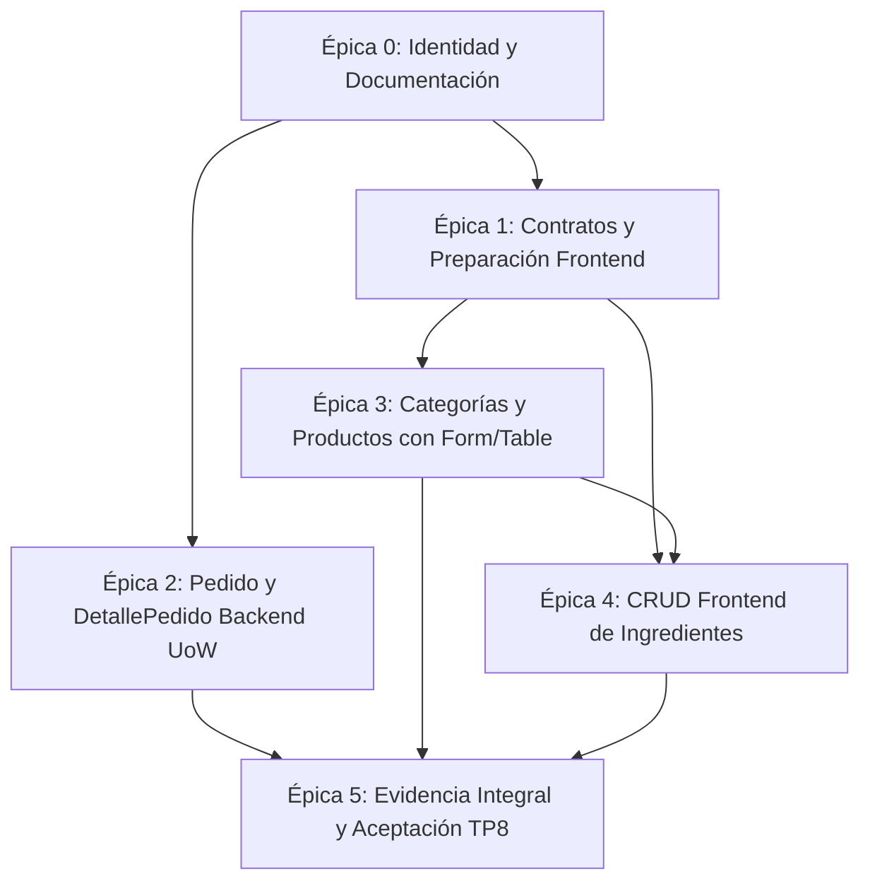

# Resolución y Plan de Ejecución — Trabajo Práctico 8

> **Materia:** Programación IV (TUPaD - UTN)  
> **Tema:** Formularios Controlados (TanStack Form), Tablas Dinámicas (TanStack Table v8), Persistencia Transaccional con Unit of Work (FastAPI + SQLModel / PostgreSQL) y Arquitectura Limpia por Capas.  
> **Estrategia:** Bottom-Up + Walking Skeleton (esqueleto mínimo operativo) + Montaje Progresivo, por entidad/subdominio, con tablero Kanban.  
> **Estado del Proyecto:** Épica 0 (Sincronización Documental, Trazabilidad y Cambio de Identidad) completada. Épicas 1 a 5 planificadas en detalle y pendientes de implementación.  
> **Control de Cambios:** Restricción expresa: prohibido crear commits automáticos o ejecutar sincronizaciones remotas sin revisión previa y autorización explícita del usuario.

---

## 1. Propósito y Fuentes de Especificación

El presente documento constituye el marco rector de ingeniería, especificación técnica y planificación operativa para el **Trabajo Práctico 8 (TP8)**. Establece las bases de continuidad desde el TP7, delimitando con rigor lo efectivamente heredado, lo adaptado a nivel de identidad/documentación, y las épicas funcionales pendientes requeridas para la acreditación académica.

> **Nota sobre bibliografía y documentación entregable:**  
> El directorio `docs/guidelines/` se utiliza como bibliografía técnica local y no se incluirá, ni se copiará su contenido, en ninguno de los ZIP finales. Se cita porque reúne los cuidados conceptuales y las prácticas trabajadas en la Unidad 8 y en las unidades anteriores. Las decisiones aplicadas al proyecto permanecen resumidas en esta resolución para que la entrega sea comprensible sin adjuntar todo el corpus didáctico. Los enlaces locales a las guías se conservan como referencias del entorno de trabajo que no estarán disponibles dentro del ZIP.

### 1.1. Documentos Rectores y Jerarquía de Decisiones

1. **Especificación Evaluativa Principal:**  
   [Consigna del Trabajo Práctico 8](consigna.md) (`docs/consigna.md`). Define las Historias de Usuario (HU-01 a HU-07), las Reglas de Negocio evaluables (RN-01 a RN-16), la rúbrica de evaluación oficial (100 puntos distribuidos en 8 criterios) y las restricciones de entrega.
2. **Criterio Técnico y Buenas Prácticas:**  
   [Guía Maestra Unidad 8](guidelines/unidad8_guia_maestra.md) (`docs/guidelines/unidad8_guia_maestra.md`). Establece los patrones de diseño normativos:
   * **Backend (§§1–8):** Arquitectura por capas (*Models–Schemas–Repository–Unit of Work–Service–Router*), manejo transaccional atómico, aislamiento de excepciones de negocio y separación de sesiones.
   * **Formularios (§§9–16):** Estado unificado en `@tanstack/react-form`, validación al blur/submit con tipos estrictos, `form.Subscribe` para feedback reactivo y prevención de envíos concurrentes.
   * **Tablas (§§18–25):** `@tanstack/react-table` v8 con `createColumnHelper`, ordenamiento (`getSortedRowModel`), filtrado (`getFilteredRowModel`) y paginación local (`getPaginationRowModel`) sobre el conjunto de datos completo.
   * **Accesibilidad y UI (§§26–34):** Componentes semánticos, Tailwind CSS v4, roles ARIA, feedback de carga/vacío/error sin parpadeo y diálogos modales accesibles por teclado.
3. **Calidad de Código y Python Idiomático:**  
   * [Clean Code](guidelines/clean_code.md) (`docs/guidelines/clean_code.md`): Principio de Responsabilidad Única (SRP), nombres intencionales, funciones compactas y tipado estricto.
   * [Guía Anti-Javaismos](guidelines/javaismos_guia.md) (`docs/guidelines/javaismos_guia.md`): Rechazo expreso a getters/setters artificiales, interfaces abstractas vacías, jerarquías de herencia innecesarias y conteos en memoria con Python `len()`.
4. **Dominio del Sistema y Diagrama Relacional:**  
   [Diagrama UML Food Store](UML_FOOD_STORE.svg) (`docs/UML_FOOD_STORE.svg`) y sus notas de diseño ([UML_FOOD_STORE.md](guidelines/UML_FOOD_STORE.md)). Define el dominio relacional de Catálogo (Categorías y Productos) y Ventas (Pedidos y Detalles). Conforme a la consigna vigente, el clúster transaccional de Pedidos se adopta en su forma simplificada (sin `Usuario`, `DireccionEntrega`, `FormaPago` ni tablas de auditoría de estado complejas).
5. **Antecedentes Históricos:**  
   [Guía Maestra Unidad 7](guidelines/unidad7_guia_maestra.md) (`docs/guidelines/unidad7_guia_maestra.md`). Se conserva como referencia histórica para las prácticas de consumo HTTP con TanStack Query v5, enrutamiento desacoplado con React Router v7 y convenciones de estado de servidor.

---

## 2. Diagnóstico de Continuidad y Brechas

El diagnóstico se fundamenta en un relevamiento estático exhaustivo del código fuente heredado del TP7, clasificando la evidencia técnica comprobada frente a los requerimientos de la Unidad 8.

| Área / Módulo | Estado Observado en Código | Tratamiento en TP8 | Clasificación |
|---|---|---|---|
| **Identidad y Rutas** | Proyecto renombrado a `unidad8_backend/`, `unidad8_frontend/` y `docs/resolucion_tp8.md`. Scripts de `package.json` actualizados. | Coherencia de rutas y dependencias asegurada en Épica 0. | Implementado (E0) |
| **Categorías Frontend** | `CategoriasPage.tsx`, `CategoriaModal.tsx`, `CategoriaList.tsx`, `CategoriaCard.tsx`. Consume `useQuery`, modales con `useState` y estado local. | Conservar flujo funcional; migrar a `@tanstack/react-form` y `@tanstack/react-table` (Épica 3). | Heredado — pendiente de adaptación |
| **Productos Frontend** | `ProductsPage.tsx`, `ProductoModal.tsx`, `ProductDetailPage.tsx`. CRUD interactivo funcional con selección de categorías. | Reemplazar grilla de tarjetas por tabla TanStack Table v8; migrar formulario a TanStack Form (Épica 3). | Heredado — pendiente de adaptación |
| **Ingredientes Frontend** | Tipos en `src/types/ingrediente.ts` y visualización pasiva en `ProductDetailPage.tsx`. No existe página CRUD ni servicio. | Planificar e implementar servicio `ingredientes.service.ts`, `IngredientesPage.tsx`, modal y tabla (Épica 4). | Brecha pendiente (Épica 4) |
| **Catálogo Backend** | Módulos `categoria`, `producto`, `ingrediente`, `unidad_medida`. Servicios reciben `Session` y confirman escrituras. | Conservar arquitectura *Service-Router* probada. No forzar migración innecesaria a UoW en catálogo. | Heredado — preservado |
| **Pedidos Backend** | No existen modelos, schemas, UoW, servicios ni endpoints de pedidos en el backend. | Construir módulo `app/modules/pedidos/` completo bajo patrón *Repository + Unit of Work* transaccional (Épica 2). | Brecha pendiente (Épica 2) |
| **Dependencias Frontend** | `package.json` tiene React 19, Query v5, Router v7, Tailwind 4. No incluye `@tanstack/react-form` ni `@tanstack/react-table`. | Registrar como dependencia técnica pendiente para Épica 1. No instalar en esta etapa documental. | Brecha pendiente (Épica 1) |
| **Documentación y Plan** | Documentación previa mezclaba esquemas históricos y métricas pasadas. | Transformada en el presente plan integral de ejecución TP8 con matrices formales. | Implementado (E0) |

> **Nota sobre ProductsPage heredada:** Aunque la introducción narrativa de `docs/consigna.md` describe la base genérica del TP7 como una página meramente informativa, el relevamiento de código confirmó que en este repositorio `ProductsPage.tsx` ya contenía un CRUD completo con modal y mutaciones. Dicha base se conserva y se adapta formalmente a TanStack Form y Table en la Épica 3 sin perder funcionalidades.

---

## 3. Decisiones de Preservación y Contratos de Integración

Conforme al alcance consensuado y las especificaciones académicas, se adoptan las siguientes decisiones de diseño:

### 3.1. Arquitectura Híbrida Justificada en Backend
* **Pedidos (Nueva Arquitectura UoW):** El módulo `pedidos` implementará de forma obligatoria y estricta la arquitectura *Models–Schemas–Repository–Unit of Work–Service–Router* conforme a la Actividad 1 y §§1–8 de la guía maestra.
* **Catálogo de Alimentos (Arquitectura Heredada Preservada):** Los módulos de `categoria`, `producto`, `ingrediente` y `unidad_medida` mantienen su arquitectura *Models–Schemas–Service–Router* consolidada en el TP7. No se refactorizan innecesariamente a Repository/UoW, minimizando riesgo de regresión y sobreingeniería.
* **Integración sin Acoplamiento Peligroso:** Para verificar la existencia y el precio de productos al crear un pedido, el Unit of Work expondrá un repositorio de lectura (`ProductoRepository`) vinculado a la **misma sesión transaccional** del UoW. Se prohíbe taxativamente invocar servicios heredados que ejecuten `session.commit()` internamente, preservando la atomicidad absoluta de la transacción.

### 3.2. Contrato Ampliado de Ingredientes y Unidades de Medida
* Se preserva el modelo enriquecido de `Ingrediente` (`id`, `nombre`, `descripcion`, `unidad_medida_id`, `activo`, auditoría) y el catálogo semilla inmutable `UnidadMedida` (`kg`, `g`, `L`, `mL`, `u`, `doc`, `m²`).
* El requerimiento didáctico mínimo (`Ingrediente(id, nombre)`) queda plenamente satisfecho como subconjunto de este contrato enriquecido. No se degradará el esquema ni se eliminarán las llaves foráneas existentes.
* El frontend proveerá en la Épica 4 la selección de unidades de medida existentes vía `GET /unidades-medida/` en el modal de alta de ingredientes.

### 3.3. Contratos de Paginación y Respuestas de Catálogo
* El catálogo backend continúa respondiendo la estructura `{ total: number, items: T[] }` con paginación determinista (`offset`, `limit`, `order_by(Model.id)`).
* El frontend mantendrá compatibilidad con este contrato y empleará un helper secuencial (`fetchAllPages`, planificado en E1.2) para alimentar las tablas cliente con el conjunto total de datos, satisfaciendo los requisitos de ordenamiento y filtrado global exigidos por la rúbrica.

---

## 4. Matriz de Historias de Usuario (HU)

La siguiente matriz mapea las siete historias de usuario vigentes especificadas en `docs/consigna.md`, incorporando los criterios transversales de calidad evaluables.

| ID | Historia de Usuario | Criterio de Aceptación Verificable | Base Heredada Existente | Tarea Responsable | Canal de Verificación | Estado TP8 |
|---|---|---|---|---|---|---|
| **HU-01** | Listar categorías con TanStack Table | `CategoriasPage` usa `useQuery` para `GET /categorias` y renderiza con TanStack Table v8. Soporta ordenamiento por columnas (nombre, descripción) con `getSortedRowModel`, paginación con `getPaginationRowModel` (anterior/siguiente), y estados de carga, vacío y error con componentes reutilizables. | Vista con `useQuery`, lista HTML y búsqueda por servidor. | E3.1, E3.3 | Frontend (React) | Heredado — pendiente de adaptación |
| **HU-02** | Crear categoría con TanStack Form | Botón "Nueva categoría" abre modal controlado con `useState`. Formulario gestionado por TanStack Form con validación de campo (nombre obligatorio no vacío tras trim). Al éxito con `useMutation`, invalida query y cierra modal. Error de API (409) muestra mensaje en modal sin cerrarlo ni perder datos. | Modal con inputs HTML y estado manual. | E3.1 | Frontend (React) | Heredado — pendiente de adaptación |
| **HU-03** | Editar categoría | Botón editar en tabla abre modal precargado mediante TanStack Form con datos de la fila. `useMutation` ejecuta `PUT /categorias/{id}`. Al éxito invalida caché y actualiza tabla. Modal diferencia alta y edición en título y comportamiento. | Modal con precarga mediante props y `useEffect`. | E3.1 | Frontend (React) | Heredado — pendiente de adaptación |
| **HU-04** | Eliminar categoría | Botón eliminar pide confirmación explícita al usuario y ejecuta `useMutation` con `DELETE /categorias/{id}`. Si la API responde conflicto (409 por productos asociados), se informa al usuario. Tras éxito, la tabla se actualiza sin recargar la página. | Confirmación con `window.confirm` y mutación reactiva. | E3.1 | Frontend (React) | Heredado — pendiente de adaptación |
| **HU-05** | CRUD de Ingredientes | `IngredientesPage` implementa `useQuery`, TanStack Table, TanStack Form y `useMutation`. Endpoints backend `GET /ingredientes`, `POST`, `PUT /{id}`, `DELETE /{id}` con validación Pydantic. Nombre obligatorio. Enlace en Navbar a `/ingredientes`. | Backend implementado con SQLModel; frontend sin página ni servicio. | E4.1, E4.2, E4.3 | Frontend y REST Client | Heredado en backend / Pendiente en frontend |
| **HU-06** | CRUD de Productos | `ProductsPage` con `useQuery`, TanStack Table, TanStack Form y `useMutation`. Operaciones completas `GET /productos`, `POST`, `PUT /{id}`, `DELETE /{id}`. Campos `nombre`, `descripcion`, `precio_base` (>= 0), `disponible` y categorías obligatorias. Formulario bloquea precios negativos. | CRUD interactivo con grilla de tarjetas y modal HTML. | E3.2, E3.3 | Frontend y REST Client | Heredado — pendiente de adaptación |
| **HU-07** | CRUD de Pedidos y DetallePedido (REST) | `GET /pedidos` lista pedidos activos; `GET /pedidos/{id}` devuelve pedido con sus detalles y precio congelado. `POST /pedidos` crea cabecera y detalles en transacción atómica con UoW (`201`); datos inválidos o producto duplicado responde `422`; producto inexistente responde `404` sin persistir nada. `PUT /pedidos/{id}` actualiza estado (`PENDIENTE`, `CONFIRMADO`, `ENTREGADO`, `CANCELADO`). `DELETE /pedidos/{id}` borrado lógico (`204`). Suite `.http` demostrativa. | Sin implementación previa en el sistema. | E2.1 a E2.5 | Backend (REST Client) | Pendiente de implementación |

### 4.1. Criterios Transversales de Navegación y Arquitectura Frontend
* **Navegación React Router:** Rutas SPA `/`, `/categorias`, `/productos`, `/productos/:id` e `/ingredientes` (nueva) declaradas en `App.tsx`.
* **Desacoplamiento de `App.tsx`:** `App.tsx` permanece completamente libre de estado de negocio, hooks de datos y llamadas `fetch`.
* **Hooks en Páginas:** `CategoriasPage`, `ProductsPage` e `IngredientesPage` son dueñas exclusivas de `useQuery`, `useMutation`, `useForm`, `useReactTable` y el estado del modal (`useState`). Los componentes secundarios son estrictamente presentacionales.
* **Tipado TypeScript Extremo a Extremo:** Interfaces tipadas para todas las entidades y props de componentes sin uso de `any` ni evasión del compilador (`tsc -b`).

---

## 5. Matriz de Reglas de Negocio (RN)

La siguiente tabla refleja exactamente las 16 reglas de negocio normadas en la consigna vigente del TP8:

| ID | Regla de Negocio Normativa | Obligatoriedad | Comportamiento Técnico Esperado | Código HTTP | Implementación en Código | Estado de Verificación |
|---|---|---|---|---|---|---|
| **RN-01** | Nombre de categoría obligatorio | Obligatoria | No vacío ni compuesto únicamente por espacios en blanco (`strip_whitespace=True`, `min_length=1`). | 422 Unprocessable | `CategoriaBase.validar_nombre` con `.strip()`. | Heredado — pendiente de regresión |
| **RN-02** | Nombre de categoría único | Opcional (preservada) | Unicidad insensible a mayúsculas/minúsculas (`func.lower(nombre)`). Si existía dada de baja lógica, se reactiva. | 409 Conflict | `create_categoria` / `update_categoria` en `services.py`. | Heredado — pendiente de regresión |
| **RN-03** | Descripción de categoría opcional | Obligatoria | Campo no obligatorio con valor por defecto cadena vacía `""`. | 200 / 201 | Normalizador en `CategoriaBase.normalizar_descripcion`. | Heredado — pendiente de regresión |
| **RN-04** | No operar sobre categoría inexistente | Obligatoria | Operaciones GET por ID, PUT, PATCH o DELETE sobre ID no registrado o con baja lógica retornan no encontrado. | 404 Not Found | Verificación en `get_categoria` y routers. | Heredado — pendiente de regresión |
| **RN-05** | No eliminar categoría con productos | Opcional (preservada) | Verificación de asociaciones activas en `ProductoCategoria`. Si existen productos activos vinculados, se impide la baja. | 409 Conflict | Conteo de productos asociados en `services.py`. | Heredado — pendiente de regresión |
| **RN-06** | Nombre de producto obligatorio, no único | Obligatoria | Cadena de texto obligatoria, no vacía tras trim. Admite duplicados con diferente identificador. | 422 Unprocessable | `validate_producto_nombres` en `validators.py`. | Heredado — pendiente de regresión |
| **RN-07** | Precio base mayor o igual a cero | Obligatoria | `precio_base >= 0`. Se admiten productos gratuitos (precio 0), pero se rechazan estrictamente precios negativos. | 422 Unprocessable | Restricción `Field(ge=0)` en `ProductoBase`. | Heredado — pendiente de regresión |
| **RN-08** | Disponibilidad booleana por defecto | Obligatoria | Atributo `disponible: bool` asignado por omisión a `True`. | 201 Created | Valor por defecto en `ProductoBase.disponible`. | Heredado — pendiente de regresión |
| **RN-09** | No operar sobre producto inexistente | Obligatoria | Operaciones por ID sobre productos inexistentes o con borrado lógico (`deleted_at != None`) devuelven error. | 404 Not Found | Verificación de existencia en servicio y router. | Heredado — pendiente de regresión |
| **RN-10** | Nombre de ingrediente obligatorio | Obligatoria (409 opcional) | Nombre no vacío tras trim. Se preserva la validación de unicidad de nombre (409) ya implementada. | 422 / 409 | `IngredienteBase.validar_nombre` y servicio backend. | Heredado — pendiente de regresión |
| **RN-11** | No operar sobre ingrediente inexistente | Obligatoria | Acciones sobre ingredientes inexistentes o eliminados son rechazadas con código 404. | 404 Not Found | Verificación en `get_ingrediente` de `services.py`. | Heredado — pendiente de regresión |
| **RN-12** | Pedido con detalles válidos y sin repetidos | Obligatoria | Todo pedido debe contener al menos un detalle (`min_items=1`). Prohibido repetir el mismo `producto_id` en una misma orden. | 422 Unprocessable | Validador Pydantic en `PedidoCreate` (Épica 2). | Pendiente de implementación |
| **RN-13** | No operar sobre pedido inexistente | Obligatoria | Peticiones a `/pedidos/{id}` con identificador ausente o con `deleted_at != None` son rechazadas. | 404 Not Found | Control en repositorio y servicio de Pedidos (Épica 2). | Pendiente de implementación |
| **RN-14** | Identificador autoincremental de solo lectura | Obligatoria | El campo `id` de toda entidad es autogenerado por la base de datos; el cliente no puede imponerlo en creaciones. | id inmutable | `id: Optional[int] = Field(default=None, primary_key=True)`. | Heredado en catálogo / Pendiente en pedidos |
| **RN-15** | Persistencia relacional y atomicidad UoW | Obligatoria | Persistencia efectiva en PostgreSQL/SQLite. El alta de pedidos se ejecuta en un Unit of Work: fallo revierte todo. | Transacción ACID | Engine SQLAlchemy + `PedidoUnitOfWork` (Épica 2). | Pendiente en Pedidos |
| **RN-16** | Integridad ante errores y conflictos | Obligatoria | Cualquier petición que falle validación o colisione con el estado no genera escrituras parciales y devuelve código estándar. | 404, 409, 422 | Manejo de excepciones desacoplado en routers. | Aplicable a todas las épicas |

---

## 6. Basamento de Calidad Técnica y Buenas Prácticas

En cumplimiento de los principios de diseño establecidos en la guía maestra de la Unidad 8 y los estándares de ingeniería del proyecto:

### 6.1. Backend Transaccional y Unit of Work (§§1–8)
1. **Ciclo de Vida de la Sesión:** El Unit of Work es el único propietario de la sesión de base de datos (`Session(engine)`). Se instancia una sesión nueva por cada caso de uso.
2. **Protocolo de Commit / Rollback:**
   * El servicio orquesta los repositorios emitiendo `add()` y `flush()` para sincronizar IDs autogenerados.
   * La confirmación (`session.commit()`) se ejecuta exclusivamente al completar todas las operaciones del caso de uso.
   * Cualquier excepción no controlada o fallo en la validación de un detalle dispara inmediatamente `session.rollback()`.
   * El cierre de sesión se garantiza en un bloque `finally`, evitando fugas de conexiones en el pool.
3. **Desacoplamiento de Excepciones:** Los repositorios y servicios lanzan excepciones de dominio (`PedidoNoEncontrado`, `ProductoNoEncontrado`, `DetalleInvalidoError`). El router es la única capa autorizada a traducir dichas excepciones a códigos HTTP (`404`, `422`, `409`), manteniendo la lógica de negocio pura y libre de dependencias hacia FastAPI.

### 6.2. Formularios Tipados con TanStack Form (§§9–16)
1. **Estado Centralizado en Form:** El formulario (`useForm`) es la única fuente de verdad para los valores de entrada y los errores de validación. Queda prohibido sincronizar cada input con variables `useState` independientes.
2. **Validación Temprana y Normalización:** Validación en tiempo real (`onBlur`) y obligatoria al enviar (`onSubmit`). Aplicación estricta de `.trim()` sobre campos de texto antes de la validación.
3. **Tratamiento del Precio:** En el formulario, el precio se manipula como cadena de texto editable para permitir al usuario borrar y escribir con naturalidad. Se valida que no sea vacío, sea numérico finito y mayor o igual a cero (`>= 0`), transformándose a `number` únicamente al generar el payload de la mutación.
4. **Flujo de Mutación Asíncrona:** El submit aguarda la resolución de `mutateAsync`. Ante un error de red o HTTP (por ejemplo 409), el modal **permanece abierto** con los valores ingresados intactos y muestra el mensaje de error. Solo se cierra tras confirmación exitosa de la API o cancelación voluntaria.
5. **Control de Envío Reactivo:** Uso de `form.Subscribe` para monitorear `canSubmit` e `isSubmitting`, deshabilitando el botón de acción principal y previniendo doble envío accidental.

### 6.3. Tablas Dinámicas con TanStack Table v8 (§§18–25)
1. **Modelo de Filas y Acceso Seguro:** Configuración mediante `createColumnHelper<T>` con `accessorKey` tipado e identificadores de fila estables vinculados al dominio (`getRowId: (row) => String(row.id)`).
2. **Operaciones sobre el Conjunto Total:** La tabla procesa ordenamiento (`getSortedRowModel`), filtrado local (`getFilteredRowModel`) y paginación en pantalla (`getPaginationRowModel`) sobre el lote completo consultado mediante el helper `fetchAllPages`. Esto garantiza que ordenar por descripción o buscar por nombre afecte a todos los registros del sistema y no solo a una página remota aislada.
3. **Accesibilidad Tabular:** Renderizado semántico con `<caption>`, encabezados `<th>` con `scope="col"`, atributos dinámicos `aria-sort` en columnas ordenables y controles de paginación implementados como botones nativos (`<button type="button">`).

### 6.4. Interfaz de Usuario y Accesibilidad (§§26–34)
1. **Preservación de Línea Visual:** Continuidad estilística sobre Tailwind CSS v4, garantizando contraste adecuado, foco visual perceptible (`focus-visible:ring-2`) y diseño responsive para dispositivos móviles y escritorio.
2. **Tratamiento de Estados Asíncronos:** Componentes dedicados para carga inicial (skeletons), estado vacío informativo con llamado a la acción y mensajes de error con opción de reintento. Diferenciación visual entre carga inicial y refetching en segundo plano (sin desmontar la tabla).
3. **Diálogos Modales Accesibles:** Trampa de foco en modales, cierre con tecla `Escape`, bloqueo de scroll de fondo y atributos `role="dialog"`, `aria-modal="true"` y `aria-labelledby`.

---

## 7. Plan de Épicas, Estrategia y Tablero Local de Tareas

### 7.1. Principios de Estrategia Técnica

La ejecución del proyecto sigue una estrategia estricta de **Bottom-Up + Walking Skeleton (esqueleto mínimo operativo) + Montaje Progresivo, por entidad/subdominio, con tablero Kanban**:

1. **Orden Bottom-Up riguroso:**
   * **Backend:** Contratos y modelos hoja → Repositorios y Unit of Work transaccional → Servicio de dominio del agregado → Router y endpoints REST.
   * **Frontend:** Tipos y contratos TypeScript → Clientes de servicios HTTP → Componentes presentacionales hoja → Páginas dueñas exclusivas de hooks (`useQuery`, `useMutation`, `useForm`, `useReactTable`, `useState`) → Montaje en rutas declarativas de navegación. No se mueven hooks a componentes hoja para forzar artificialmente el orden.
2. **Walking Skeleton heredado del TP7:**
   * Se conserva íntegro y operativo el esqueleto mínimo heredado: catálogo backend con FastAPI, frontend React con Vite, Navbar accesible, rutas existentes (`/`, `/categorias`, `/productos`, `/productos/:id`) y gestión de estado con TanStack Query.
   * La continuidad operativa del Walking Skeleton se valida formalmente al cerrar E1, asegurando que el catálogo funcional no sufra degradación antes de iniciar las adaptaciones. No se crean pantallas vacías, mocks desconectados ni contenedores sin comportamiento.
   * La entidad Pedidos continúa exclusivamente en backend y REST Client conforme a la consigna.
3. **Islas de Dominio:**
   * Cada subdominio se cierra como unidad verificable antes de pasar al siguiente: primero el agregado transaccional `Pedido/DetallePedido` en backend, y posteriormente cada CRUD frontend (`Categorías`, `Productos`, `Ingredientes`), con comprobación observable por entidad.
   * No se construyen todos los servicios o modelos de todos los dominios de forma desacoplada antes de integrar y probar alguno.
4. **Montaje Progresivo:**
   * E3.1 y E3.2 actualizan las rutas existentes en su misma tarea al adaptar sus páginas.
   * E4.2 incluye el montaje real de `Ingredientes` en `App.tsx` y `Navbar.tsx` una vez implementados sus componentes y página; E4.3 verifica la navegación integral y el desacoplamiento estructural de `App.tsx` ya integrado, sin posponer el primer montaje a una tarea posterior.
5. **Datos de Prueba Tempranos:**
   * Los datos de prueba se preparan al cerrar E1 o antes del primer incremento que consulte datos, utilizando exclusivamente almacenamiento de prueba aislado (SQLite en memoria / base temporal).
   * Se reutiliza el catálogo semilla de unidades de medida oficial existente (`seed_unidades_medida`); las categorías y productos se crean mediante operaciones reales de la API en el almacenamiento de pruebas.
   * Para el escenario de carga de más de 100 registros en categorías (verificación de tabla completa), la colección de 101 filas se genera programáticamente solo dentro del entorno de pruebas, sin contaminar la base de datos personal. No se aplican fixtures de Pedidos antes de existir el módulo.
6. **Gobierno Kanban y Definiciones DoR / DoD:**
   * **Estados del ciclo de vida:** `Pendiente → En Progreso → En Verificación → Completada`, más `Bloqueada` con registro de causa.
   * **WIP = 1:** Se procesa una sola tarea a la vez en esta planificación, garantizando foco y trazabilidad observable. La independencia técnica entre ramas (por ejemplo E2 backend frente a E3 frontend) no implica promesas de ejecución paralela no verificada.
   * **Definition of Ready (DoR):** Una tarea solo ingresa a desarrollo si sus dependencias previas están completadas, sus contratos e incisos de consigna están identificados y su comprobación rápida está definida.
   * **Definition of Done (DoD):** Una tarea solo pasa a `Completada` cuando su criterio de aceptación observable se cumple, la integración real está efectuada y la evidencia técnica comprobada queda registrada.
   * **Comprobación rápida por tarea:** Cada tarea cuenta con una verificación ejecutable diseñada para resolverse en aproximadamente un minuto, sin omitir validaciones necesarias ni afirmar tiempos no medidos.

### 7.2. Grafo de Dependencias Técnicas entre Épicas

El orden recomendado de ejecución es `E0 → E1 → E2 → E3 → E4 → E5`. El siguiente diagrama refleja las dependencias técnicas reales del proyecto (el módulo E2 de pedidos backend no depende de la instalación de librerías frontend de E1):

---

### 7.3. Tablero Resumen de Tareas

| ID | Tarea / Acción | Consigna resuelta / soporte | Dependencia | Archivos y Símbolos Críticos | HU / RN | Criterio de Aceptación Verificable | Estado |
|---|---|---|---|---|---|---|:---:|
| **E0.1** | Renombrado de directorios y actualización de consumidores directos | Soporte local: identidad/rutas; sin inciso académico obligatorio propio. | Ninguna | `unidad8_backend/`, `unidad8_frontend/`, `package.json`, `app/main.py`, `Navbar.tsx`, `index.html` | Identidad | Scripts raíz operativos; cero directorios `unidad7_`; títulos de frontend y backend actualizados a TP8. | ✅ **Completada** |
| **E0.2** | Redacción y sincronización documental integral, trazabilidad y procedencia TP7 | Soporte local: resolución y documentación; sin inciso académico obligatorio propio. | E0.1 | `docs/resolucion_tp8.md`, `README.md`, `unidad8_backend/README.md`, `unidad8_frontend/README.md`, código heredado | Documentación | Tablero TP8 con 19 tareas, mapeo a `consigna.md`, exclusión de guidelines de ZIPs, procedencia TP7 explicitada en comentarios y 3 READMEs sincronizados. | ✅ **Completada** |
| **E1.1** | Instalación y fijación de dependencias TanStack Form y Table | [Ejercicio 2, introducción](consigna.md): instalación de TanStack Form y TanStack Table v8. | E0.2 | `unidad8_frontend/package.json`, `pnpm-lock.yaml` | Infraestructura | Instalación de `@tanstack/react-form` y `@tanstack/react-table` v8 sin romper React 19 ni Tailwind 4. `pnpm build:front` compila. | ✅ **Completada** |
| **E1.3** | Consolidación y tipado de contratos TypeScript | [Ejercicio 2.a, interfaces en src/types/](consigna.md), y [Conclusiones esperadas, Tipado TypeScript](consigna.md). Reutilizar contratos; retirar `pedido.ts` frontend. | E1.1 | `src/types/categoria.ts`, `producto.ts`, `ingrediente.ts`, `index.ts` | HU-01..06 | Interfaces estrictas para entidades de catálogo y payloads de mutación. Props tipados sin `any`. `pedido.ts` excluido de frontend. | ⏳ **Pendiente** |
| **E1.2** | Implementación de helper `fetchAllPages` para carga tabular | Soporte local para [Ejercicio 2.a Páginas](consigna.md) y HU-01/HU-05/HU-06: reunir datos para orden/paginación locales. | E1.3 | `unidad8_frontend/src/services/pagination.ts` | HU-01, HU-05, HU-06 | Función secuencial que acumula lotes paginados hasta totalizar la colección. Falla ante inconsistencias y retorna array plano. | ⏳ **Pendiente** |
| **E2.1** | Modelos y Schemas de Pedido y DetallePedido | [Ejercicio 1.b, Definición de models y schemas de Pedido y DetallePedido](consigna.md). | E0.2 | `app/modules/pedidos/models.py`, `app/modules/pedidos/schemas.py` | HU-07, RN-12, RN-14 | Tablas `pedido` y `detalle_pedido`. PK compuesta `(pedido_id, producto_id)`. Schemas con validación de no repetidos y cantidad >= 1. | ⏳ **Pendiente** |
| **E2.2** | Repositorios base y Unit of Work transaccional | [Ejercicio 1.c, Repository y Unit of Work](consigna.md). | E2.1 | `app/core/repository.py`, `unit_of_work.py`, `app/modules/pedidos/repository.py`, `unit_of_work.py` | HU-07, RN-15, RN-16 | `PedidoUnitOfWork` administra sesión única, expone repositorios y asegura rollback ante excepciones sin commit prematuro. | ⏳ **Pendiente** |
| **E2.3** | Capa de servicio de Pedidos y orquestación | [Ejercicio 1.c, Service y casos de uso del agregado](consigna.md). | E2.2 | `app/modules/pedidos/service.py` | HU-07, RN-12, RN-15 | `PedidoService` implementa listar, obtener, crear (atómica con captura de precio congelado), actualizar estado y baja lógica. | ⏳ **Pendiente** |
| **E2.4** | Router REST de Pedidos y registro en aplicación | [Ejercicio 1.c, Router y cinco endpoints](consigna.md); [Ejercicio 1.e](consigna.md) para integración y CORS. | E2.3 | `app/modules/pedidos/router.py`, `app/main.py`, `app/database.py` | HU-07, RN-13, RN-16 | Endpoints `/pedidos` (`GET`, `GET /{id}`, `POST`, `PUT /{id}`, `DELETE /{id}`). Traducción de excepciones a 404/422. Creación de tablas en startup. | ⏳ **Pendiente** |
| **E2.5** | Suite REST Client de Pedidos (`pedidos.http`) | [Ejercicio 1.c, demostración con pedidos.http](consigna.md), incluyendo 404 y 422; HU-07. | E2.4 | `unidad8_backend/pedidos.http` | HU-07, RN-12, RN-13, RN-16 | Suite ejecutable con flujo completo: alta válida, captura de precios, modificación de estado, baja lógica, posteriores 404 y rechazos 422. | ⏳ **Pendiente** |
| **E3.1** | Adaptación de Categorías a TanStack Form y Table | [Ejercicio 2.a, CategoriasPage](consigna.md): hooks, lista, modal y botón; HU-01..HU-04. | E1.2 | `CategoriasPage.tsx`, `CategoriaModal.tsx`, `CategoriaList.tsx`, `CategoriaCard.tsx` | HU-01..04, RN-01..05 | `CategoriasPage` integra `useReactTable` y `useForm`. Modal controlado con `useState`. Ruta actualizada de inmediato. | ⏳ **Pendiente** |
| **E3.2** | Adaptación de Productos a TanStack Form y Table | [Ejercicio 2.a, ProductsPage](consigna.md): CRUD, hooks, modal, Form/Table; HU-06. | E1.2 | `ProductsPage.tsx`, `ProductoModal.tsx`, `ProductDetailPage.tsx` | HU-06, RN-06..09 | `ProductsPage` reemplaza grilla por tabla dinámica. Modal valida precio >= 0 y categorías obligatorias. Preserva detalle. | ⏳ **Pendiente** |
| **E3.3** | Componentes comunes de UI y accesibilidad | [HU-01](consigna.md), componentes reutilizables; [Conclusiones esperadas](consigna.md); rúbrica Estructura y buenas prácticas. | E3.1, E3.2 | `src/components/ui/` (`LoadingState`, `EmptyState`, `ErrorState`, `FormField`) | Calidad UI, HU-01, HU-06 | Extracción de patrones de UI comunes ya repetidos para estados de carga/vacío/error y campos accesibles sin parpadeo. | ⏳ **Pendiente** |
| **E4.1** | Capa de servicios HTTP de Ingredientes y Unidades | Soporte de consumo para [Ejercicio 1.d](consigna.md) y [Ejercicio 2.a IngredientesPage](consigna.md); unidades es contrato heredado. | E1.2 | `src/services/ingredientes.service.ts`, `src/services/unidades.service.ts` | HU-05 | Clientes HTTP tipados con manejo de errores para `/ingredientes/` y catálogo de `/unidades-medida/`. Integración con `fetchAllPages`. | ⏳ **Pendiente** |
| **E4.2** | Interfaz completa CRUD de Ingredientes y montaje | [Ejercicio 2.a IngredientesPage](consigna.md) y [Ejercicio 2.b–c](consigna.md) para su montaje inmediato; HU-05. | E4.1, E3.3 | `src/pages/IngredientesPage.tsx`, `IngredienteModal.tsx`, `IngredienteList.tsx`, `App.tsx`, `Navbar.tsx` | HU-05, RN-10..11 | Página CRUD con TanStack Table + TanStack Form + selector de unidades. Montaje directo de ruta y Navbar en la misma tarea. | ⏳ **Pendiente** |
| **E4.3** | Verificación de navegación y desacoplamiento de App | Verificación de [Ejercicio 2.b Navegación](consigna.md), [2.c App.tsx](consigna.md) y [Comportamiento esperado](consigna.md). | E4.2 | `src/App.tsx`, `src/components/Navbar.tsx` | HU-05, Navegación | Navegación fluida por todas las rutas integradas. Discriminación activa en Navbar. `App.tsx` sin datos ni llamadas a APIs. | ⏳ **Pendiente** |
| **E5.1** | Pruebas automatizadas de integración y regresión | Soporte de verificación de [Ejercicio 1.c](consigna.md), HU-07 y RN-15/RN-16; regresión de [Ejercicio 1.d](consigna.md). | E2.5, E3.3, E4.3 | `unidad8_backend/tests/` | Regresión, HU-07, RN-15..16 | Pruebas de rollback de UoW en SQLite en memoria; validación de no regresión en catálogo heredado. | ⏳ **Pendiente** |
| **E5.2** | Demostración integral E2E Full Stack | Evidencia de [Ejercicio 1.c–e](consigna.md), [Ejercicio 2.a–c](consigna.md) y [Conclusiones esperadas](consigna.md). | E5.1 | Todo el sistema (Frontend Vite + Backend FastAPI) | Aceptación TP8, HU-01..07 | Verificación en vivo de flujos de catálogo, formularios, tablas, pedidos REST y persistencia en base de pruebas aislada. | ⏳ **Pendiente** |
| **E5.3** | Auditoría final contra rúbrica de consigna | [Criterios de evaluación (los ocho, 100 puntos)](consigna.md) y [Formato de entrega](consigna.md); cotejo. | E5.2 | Rúbrica oficial (100 pts) y checklist de entrega | Rúbrica académica | Cotejo formal de los 8 criterios de evaluación contra evidencia real. Validación de checklist de exclusión de guidelines en ZIPs. | ⏳ **Pendiente** |

---

### 7.4. Fichas Detalladas de Tareas por Épica

#### Épica 0: Identidad y Documentación

##### Ficha E0.1: Renombrado de directorios y actualización de consumidores directos
* **Acción:** Renombrado formal de directorios de proyecto (`unidad7_backend/` → `unidad8_backend/`, `unidad7_frontend/` → `unidad8_frontend/`), actualización de scripts en `package.json` raíz, ajuste de títulos en frontend/backend y eliminación de residuos.
* **Estado:** Completada (registro histórico comprobado).
* **Dependencias:** Ninguna.
* **Archivos y símbolos críticos:** `unidad8_backend/`, `unidad8_frontend/`, `package.json`, `unidad8_backend/app/main.py`, `unidad8_frontend/src/components/Navbar.tsx`, `unidad8_frontend/index.html`.
* **Consigna resuelta / soporte:** Soporte local: identidad/rutas; sin inciso académico obligatorio propio.
* **HU / RN:** Identidad y coherencia estructural de repositorios.
* **Criterio de aceptación verificable:** Scripts raíz operativos (`dev`, `build:front`, `test:back`); cero referencias o carpetas `unidad7_` residuales; títulos de aplicación y documentación alineados al TP8.
* **Verificación rápida prevista / ejecutada:** Inspección del sistema de archivos, diff limpio de scripts y comprobación de títulos ejecutada satisfactoriamente en la sincronización inicial.

##### Ficha E0.2: Redacción y sincronización documental integral, trazabilidad y procedencia TP7
* **Acción:** Creación de `docs/resolucion_tp8.md`, sincronización de los tres `README.md`, incorporación de política de exclusión de `docs/guidelines/` de los ZIPs, adopción de estrategia Bottom-Up + Walking Skeleton con Kanban y 19 fichas detalladas, cierre de trazabilidad con incisos de `consigna.md` y explicitación de procedencia del TP7 en comentarios y docstrings del código heredado sin alterar cadenas funcionales ni descripciones OpenAPI.
* **Estado:** Completada (verificada en la presente revisión).
* **Dependencias:** E0.1.
* **Archivos y símbolos críticos:** `docs/resolucion_tp8.md`, `README.md`, `unidad8_backend/README.md`, `unidad8_frontend/README.md`, 24 archivos de backend y 20 archivos de frontend intervenidos en comentarios.
* **Consigna resuelta / soporte:** Soporte local: resolución y documentación; sin inciso académico obligatorio propio.
* **HU / RN:** Documentación técnica, trazabilidad académica y procedencia histórica.
* **Criterio de aceptación verificable:** Tablero con 19 tareas únicas vinculadas a consigna; exclusión expresa de `guidelines/` normada en §1 y §8.4; ausencia de nomenclatura `F` en documentos de planificación; procedencia del TP7 rotulada en comentarios/docstrings preservando descripciones OpenAPI en `schemas.py`; sincronización coherente de los tres READMEs.
* **Verificación rápida prevista / ejecutada:** Verificación de igualdad de AST en Python descartando docstrings; comprobación de que en TSX/CSS/HTTP solo se agregaron comentarios; validación `grep` de ausencia de `F` operativo; resolución de enlaces Markdown locales en memoria; ejecución de `pnpm build:front` y `pnpm test:back`.

---

#### Épica 1: Contratos y Preparación Frontend

##### Ficha E1.1: Instalación y fijación de dependencias TanStack Form y Table
* **Acción:** Instalación y fijación estricta de `@tanstack/react-form` y `@tanstack/react-table` v8 en `unidad8_frontend/package.json`.
* **Estado:** Completada (verificada).
* **Dependencias:** E0.2.
* **Archivos y símbolos críticos:** `unidad8_frontend/package.json`, `pnpm-lock.yaml`.
* **Consigna resuelta / soporte:** [Ejercicio 2, introducción](consigna.md): instalación de TanStack Form y TanStack Table v8.
* **HU / RN:** Infraestructura técnica para HU-01, HU-02, HU-03, HU-05 y HU-06.
* **Criterio de aceptación verificable:** Dependencias agregadas en versiones estables y compatibles con React 19 y Tailwind CSS v4; lockfile consistente; `pnpm build:front` compila sin advertencias críticas de resolución de paquetes.
* **Verificación rápida prevista / ejecutada:** Instalación de `@tanstack/react-form` (^1.33.5) y `@tanstack/react-table` (^8.21.3) vía `pnpm --dir unidad8_frontend add @tanstack/react-form @tanstack/react-table@8`; lockfile actualizado y compilación exitosa con `pnpm run build:front` (`tsc -b && vite build` finalizado con código de salida 0 sin advertencias ni conflictos con React 19 o Tailwind CSS v4).

##### Ficha E1.3: Consolidación y tipado de contratos TypeScript
* **Acción:** Consolidación de interfaces de datos en TypeScript para Categoría, Producto e Ingrediente, tipado de props de componentes y contratos de mutación. Se retira `pedido.ts` de la planificación frontend al ser Pedidos un módulo puramente REST sin interfaz gráfica en la consigna.
* **Estado:** Pendiente.
* **Dependencias:** E1.1.
* **Archivos y símbolos críticos:** `unidad8_frontend/src/types/categoria.ts`, `producto.ts`, `ingrediente.ts`, `index.ts`.
* **Consigna resuelta / soporte:** [Ejercicio 2.a, interfaces en src/types/](consigna.md), y [Conclusiones esperadas, Tipado TypeScript](consigna.md). Reutilizar contratos de Categoría/Producto/Ingrediente; retirar `pedido.ts` del listado planificado porque HU-07 es backend y no necesita contrato frontend.
* **HU / RN:** HU-01 a HU-06, Criterio de evaluación "Tipado TypeScript".
* **Criterio de aceptación verificable:** Interfaces completas que cubren todas las entidades y payloads requeridos por los modales y tablas; cero tipos `any` implícitos o explícitos; tipado estricto en props de componentes presentacionales.
* **Verificación rápida prevista:** Comprobación de tipos con compilador TypeScript (`pnpm typecheck` o `tsc -b`) confirmando compatibilidad con los tipos existentes sin errores de compilación.  
  *Implementación y verificación: no realizadas; evidencia pendiente.*

##### Ficha E1.2: Implementación de helper `fetchAllPages` para carga tabular
* **Acción:** Implementación de la función utilitaria `fetchAllPages` en `unidad8_frontend/src/services/pagination.ts` para acumular secuencialmente todas las páginas de un endpoint del catálogo y entregar un array plano a TanStack Table.
* **Estado:** Pendiente.
* **Dependencias:** E1.3 (consume los contratos y tipos del catálogo).
* **Archivos y símbolos críticos:** `unidad8_frontend/src/services/pagination.ts`.
* **Consigna resuelta / soporte:** Soporte local para [Ejercicio 2.a Páginas](consigna.md) y HU-01/HU-05/HU-06: reunir datos para orden/paginación locales. El helper no está impuesto literalmente por la consigna.
* **HU / RN:** HU-01, HU-05, HU-06; soporte a los requisitos de ordenamiento y filtrado global sobre la colección total.
* **Criterio de aceptación verificable:** Paginación determinista en bucle que acumula lotes respetando el contrato `{ total, items }`; detención ante colección completa; fallo rápido con excepción explícita si la API devuelve un lote vacío prematuro o si el total muta durante la recolección, evitando colecciones parciales corruptas.
* **Verificación rápida prevista:** Prueba unitaria o throwaway con 3 escenarios: 1) `total=0, items=[]` retorna `[]`; 2) 101 filas simuladas en dos lotes retornan el conjunto íntegro de 101 elementos; 3) lote vacío prematuro o total cambiante arroja error inmediato sin devolver datos parciales.  
  *Implementación y verificación: no realizadas; evidencia pendiente.*

---

#### Épica 2: Pedido y DetallePedido Backend UoW

##### Ficha E2.1: Modelos y Schemas de Pedido y DetallePedido
* **Acción:** Definición de los modelos relacionales en SQLModel para `Pedido` y `DetallePedido`, y schemas Pydantic de entrada, salida y validación de reglas de negocio.
* **Estado:** Pendiente.
* **Dependencias:** E0.2.
* **Archivos y símbolos críticos:** `unidad8_backend/app/modules/pedidos/models.py`, `app/modules/pedidos/schemas.py`.
* **Consigna resuelta / soporte:** [Ejercicio 1.b, Definición de models y schemas de Pedido y DetallePedido](consigna.md).
* **HU / RN:** HU-07, RN-12, RN-14.
* **Criterio de aceptación verificable:** Tablas `pedido` y `detalle_pedido` mapeadas; clave primaria compuesta `(pedido_id, producto_id)` en detalle; atributos requeridos presentes (`total`, `estado`, `fecha`, `cantidad`, `precio_unitario`); schemas Pydantic que validan al menos un detalle (`min_items=1`), cantidad entera >= 1 por ítem y unicidad de `producto_id` dentro del pedido.
* **Verificación rápida prevista:** Suite de pruebas unitarias de validación Pydantic: rechazo de payload con lista de detalles vacía (HTTP 422), rechazo de `producto_id` duplicados en el mismo pedido, rechazo de cantidad 0 y aceptación de cantidad 1 o superior.  
  *Implementación y verificación: no realizadas; evidencia pendiente.*

##### Ficha E2.2: Repositorios base y Unit of Work transaccional
* **Acción:** Implementación del patrón *Repository* y *Unit of Work* (`PedidoUnitOfWork`) para aislar la persistencia y asegurar la atomicidad transaccional.
* **Estado:** Pendiente.
* **Dependencias:** E2.1.
* **Archivos y símbolos críticos:** `unidad8_backend/app/core/repository.py`, `app/core/unit_of_work.py`, `app/modules/pedidos/repository.py`, `app/modules/pedidos/unit_of_work.py`.
* **Consigna resuelta / soporte:** [Ejercicio 1.c, Repository y Unit of Work](consigna.md).
* **HU / RN:** HU-07, RN-15, RN-16.
* **Criterio de aceptación verificable:** `PedidoUnitOfWork` es dueño de una sesión única (`Session(engine)`); expone `PedidoRepository` y `ProductoRepository` (lectura); orquesta repositorios con `add()` y `flush()`; ejecuta `commit()` solo al finalizar con éxito; garantiza `rollback()` en bloque `except` y cierre de sesión en `finally`.
* **Verificación rápida prevista:** Test automatizado de aislamiento: inserción de cabecera con `flush()`, simulación de excepción en el segundo detalle y verificación mediante nueva sesión de que no se persistió ninguna fila en `pedido` ni en `detalle_pedido`.  
  *Implementación y verificación: no realizadas; evidencia pendiente.*

##### Ficha E2.3: Capa de servicio de Pedidos y orquestación
* **Acción:** Creación de `PedidoService` implementando los casos de uso transaccionales del agregado Pedidos.
* **Estado:** Pendiente.
* **Dependencias:** E2.2.
* **Archivos y símbolos críticos:** `unidad8_backend/app/modules/pedidos/service.py`.
* **Consigna resuelta / soporte:** [Ejercicio 1.c, Service y casos de uso del agregado](consigna.md).
* **HU / RN:** HU-07, RN-12, RN-15.
* **Criterio de aceptación verificable:** Métodos para listar pedidos activos, obtener detalle por ID con congelamiento de precio histórico (`precio_unitario` obtenido del catálogo al momento de crear), creación atómica bajo UoW calculando `total = sum(cantidad * precio_unitario)`, actualización de estado y baja lógica asignando `deleted_at`. Lanzamiento de excepciones de dominio desacopladas.
* **Verificación rápida prevista:** Caso de uso con dos productos de catálogo a precio 10.00 y 2.50 con cantidades 2 y 3: cálculo exacto de total = 27.50, estado `PENDIENTE` y detalles congelados verificados por aserción.  
  *Implementación y verificación: no realizadas; evidencia pendiente.*

##### Ficha E2.4: Router REST de Pedidos y registro en aplicación
* **Acción:** Implementación del enrutador FastAPI con los cinco endpoints REST del agregado Pedidos y registro en `app/main.py`.
* **Estado:** Pendiente.
* **Dependencias:** E2.3.
* **Archivos y símbolos críticos:** `unidad8_backend/app/modules/pedidos/router.py`, `app/main.py`, `app/database.py`.
* **Consigna resuelta / soporte:** [Ejercicio 1.c, Router y cinco endpoints](consigna.md); [Ejercicio 1.e](consigna.md) para integración/ejecución y CORS conservado.
* **HU / RN:** HU-07, RN-13, RN-16.
* **Criterio de aceptación verificable:** Endpoints `GET /pedidos/` (200), `GET /pedidos/{id}` (200/404), `POST /pedidos/` (201/404/422), `PUT /pedidos/{id}` (200/404/422) y `DELETE /pedidos/{id}` (204/404). Traducción limpia de excepciones de dominio a códigos HTTP estándar. Tablas creadas en el arranque e integración con CORS verificada.
* **Verificación rápida prevista:** Smoke test con `TestClient`: llamada a `POST` retorna 201, `GET /{id}` retorna 200 con detalles, `PUT` modifica estado a `CONFIRMADO`, `DELETE` retorna 204 y posterior `GET /{id}` retorna 404.  
  *Implementación y verificación: no realizadas; evidencia pendiente.*

##### Ficha E2.5: Suite REST Client de Pedidos (`pedidos.http`)
* **Acción:** Creación de la suite demostrativa ejecutable `unidad8_backend/pedidos.http`.
* **Estado:** Pendiente.
* **Dependencias:** E2.4.
* **Archivos y símbolos críticos:** `unidad8_backend/pedidos.http`.
* **Consigna resuelta / soporte:** [Ejercicio 1.c, demostración con pedidos.http](consigna.md), incluyendo 404 y 422; HU-07.
* **HU / RN:** HU-07, RN-12, RN-13, RN-16.
* **Criterio de aceptación verificable:** Archivo HTTP completo con variables de entorno (`@baseUrl`), flujo de alta con congelamiento de precios, consulta de detalle, actualización de estado, baja lógica, consultas posteriores 404 y rechazos 422 por validación de detalles vacíos o repetidos.
* **Verificación rápida prevista:** Ejecución integral del archivo `.http` con REST Client / pytest runner verificando respuestas 201, 200, 204, 404 y 422 con variables dinámicas de respuestas.  
  *Implementación y verificación: no realizadas; evidencia pendiente.*

---

#### Épica 3: Categorías y Productos con Form/Table

##### Ficha E3.1: Adaptación de Categorías a TanStack Form y Table
* **Acción:** Migración del CRUD de Categorías a `@tanstack/react-table` v8 para el listado dinámico y `@tanstack/react-form` para el modal de creación y edición, actualizando de inmediato la ruta `/categorias` existente.
* **Estado:** Pendiente.
* **Dependencias:** E1.2.
* **Archivos y símbolos críticos:** `unidad8_frontend/src/pages/CategoriasPage.tsx`, `src/components/CategoriaModal.tsx`, `src/components/CategoriaList.tsx`, `src/components/CategoriaCard.tsx`.
* **Consigna resuelta / soporte:** [Ejercicio 2.a, CategoriasPage](consigna.md): hooks, lista, modal y botón; HU-01..HU-04.
* **HU / RN:** HU-01, HU-02, HU-03, HU-04, RN-01 a RN-05.
* **Criterio de aceptación verificable:** `CategoriasPage` integra `useReactTable` sobre datos de `fetchAllPages` soportando ordenamiento por columnas (nombre, descripción) y paginación local; modal controlado por `useState` que gestiona formulario con `useForm`; validación de nombre obligatorio tras trim; botón de envío bloqueado durante submit; error 409 muestra mensaje en modal sin cerrarlo ni perder datos; confirmación previa al eliminar; ruta operativa actualizada.
* **Verificación rápida prevista:** Categorías ordenables por nombre y descripción en la tabla dinámica; modal de creación rechaza campo vacío al blur/submit y cierra tras mutación exitosa; edición precarga valores; baja pide confirmación.  
  *Implementación y verificación: no realizadas; evidencia pendiente.*

##### Ficha E3.2: Adaptación de Productos a TanStack Form y Table
* **Acción:** Reemplazo de la grilla de tarjetas de `ProductsPage` por TanStack Table v8 y migración del formulario de producto a TanStack Form, preservando la navegación hacia la vista de detalle.
* **Estado:** Pendiente.
* **Dependencias:** E1.2.
* **Archivos y símbolos críticos:** `unidad8_frontend/src/pages/ProductsPage.tsx`, `src/components/ProductoModal.tsx`, `src/pages/ProductDetailPage.tsx`.
* **Consigna resuelta / soporte:** [Ejercicio 2.a, ProductsPage](consigna.md): CRUD, hooks, modal, Form/Table; HU-06.
* **HU / RN:** HU-06, RN-06 a RN-09.
* **Criterio de aceptación verificable:** Tabla dinámica con TanStack Table v8; columnas ordenables con `aria-sort`; modal gestionado con TanStack Form con validación de nombre obligatorio, precio base >= 0 (permite precio 0, rechaza negativos) y al menos una categoría seleccionada; preservación intacta del detalle en `ProductDetailPage.tsx`.
* **Verificación rápida prevista:** Guardado de producto con precio base 0 aceptado; precio negativo bloqueado en formulario; tabla permite ordenar y paginar; navegación hacia `/productos/:id` conserva la ficha de detalle sin alteraciones.  
  *Implementación y verificación: no realizadas; evidencia pendiente.*

##### Ficha E3.3: Componentes comunes de UI y accesibilidad
* **Acción:** Extracción de componentes comunes de presentación para estados asíncronos (`LoadingState`, `EmptyState`, `ErrorState`) y campos de formulario accesibles (`FormField`), consolidando patrones ya utilizados en Categorías y Productos.
* **Estado:** Pendiente.
* **Dependencias:** E3.1, E3.2 (extrae patrones ya repetidos en lugar de abstracciones preventivas tempranas).
* **Archivos y símbolos críticos:** `unidad8_frontend/src/components/ui/LoadingState.tsx`, `EmptyState.tsx`, `ErrorState.tsx`, `FormField.tsx`.
* **Consigna resuelta / soporte:** [HU-01](consigna.md), componentes reutilizables de carga/vacío/error; [Conclusiones esperadas, Hooks aplicados correctamente](consigna.md); rúbrica [Estructura y buenas prácticas](consigna.md). No presentar nombres concretos de componentes como imposición académica.
* **HU / RN:** Calidad visual, accesibilidad semántica, HU-01, HU-06.
* **Criterio de aceptación verificable:** Componentes reutilizables con Tailwind CSS v4; `LoadingState` con skeletons no parpadeantes; `EmptyState` con mensaje informativo y acción sugerida; `ErrorState` con opción de reintento; refetch en segundo plano no desmonta la tabla visual; campos de formulario con etiquetas asociadas `htmlFor`/`id`.
* **Verificación rápida prevista:** Renderizado y reutilización de estados de carga, vacío y error en Categorías y Productos sin retirar datos visuales ante fallo de refetch en segundo plano.  
  *Implementación y verificación: no realizadas; evidencia pendiente.*

---

#### Épica 4: Ingredientes Frontend

##### Ficha E4.1: Capa de servicios HTTP de Ingredientes y Unidades
* **Acción:** Implementación de los servicios HTTP tipados para la gestión de ingredientes y la lectura del catálogo inmutable de unidades de medida.
* **Estado:** Pendiente.
* **Dependencias:** E1.2.
* **Archivos y símbolos críticos:** `unidad8_frontend/src/services/ingredientes.service.ts`, `src/services/unidades.service.ts`.
* **Consigna resuelta / soporte:** Soporte de consumo para [Ejercicio 1.d](consigna.md) y [Ejercicio 2.a IngredientesPage](consigna.md); unidades de medida es contrato ampliado heredado del TP7, no obligación del modelo mínimo.
* **HU / RN:** HU-05.
* **Criterio de aceptación verificable:** Funciones tipadas para consultar listado, detalle, crear, actualizar y eliminar ingredientes; función para consultar unidades de medida; manejo estricto de errores con `if (!res.ok) throw new Error(...)`; integración con `fetchAllPages`.
* **Verificación rápida prevista:** Consulta real tipada de ingredientes y unidades; comprobación de que el error 404/409 arroja `Error` capturable por TanStack Query.  
  *Implementación y verificación: no realizadas; evidencia pendiente.*

##### Ficha E4.2: Interfaz completa CRUD de Ingredientes y montaje en navegación
* **Acción:** Creación de `IngredientesPage.tsx`, `IngredienteModal.tsx` e `IngredienteList.tsx` con TanStack Table y TanStack Form, e integración inmediata de la ruta `/ingredientes` en `App.tsx` y del enlace correspondiente en `Navbar.tsx`.
* **Estado:** Pendiente.
* **Dependencias:** E4.1, E3.3.
* **Archivos y símbolos críticos:** `unidad8_frontend/src/pages/IngredientesPage.tsx`, `src/components/IngredienteModal.tsx`, `src/components/IngredienteList.tsx`, `src/App.tsx`, `src/components/Navbar.tsx`.
* **Consigna resuelta / soporte:** [Ejercicio 2.a IngredientesPage](consigna.md) y [Ejercicio 2.b–c](consigna.md) para su montaje inmediato; HU-05.
* **HU / RN:** HU-05, RN-10, RN-11.
* **Criterio de aceptación verificable:** `IngredientesPage` idéntica en solidez a Categorías; tabla dinámica con orden y paginación; modal controlado por `useState` que valida nombre obligatorio tras trim y permite seleccionar unidad de medida; montaje real directo de la ruta `/ingredientes` en `App.tsx` y del enlace en `Navbar.tsx`; error de colisión 409 mantiene abierto el modal con los valores intactos.
* **Verificación rápida prevista:** Alta de ingrediente con unidad válida y comprobación de ruta montada directamente en `/ingredientes`; error de unicidad mantiene el modal abierto con los valores intactos.  
  *Implementación y verificación: no realizadas; evidencia pendiente.*

##### Ficha E4.3: Verificación de navegación y desacoplamiento de App
* **Acción:** Comprobación formal de la navegación reactiva integral entre todas las vistas del sistema y auditoría de desacoplamiento de `App.tsx`.
* **Estado:** Pendiente.
* **Dependencias:** E4.2.
* **Archivos y símbolos críticos:** `unidad8_frontend/src/App.tsx`, `src/components/Navbar.tsx`.
* **Consigna resuelta / soporte:** Verificación de [Ejercicio 2.b Navegación](consigna.md), [2.c App.tsx](consigna.md) y [Comportamiento esperado](consigna.md).
* **HU / RN:** HU-05, Criterios transversales de navegación y arquitectura.
* **Criterio de aceptación verificable:** Enlaces de navegación fluidos para `/`, `/categorias`, `/productos`, `/productos/:id` e `/ingredientes`; discriminación visual nítida de la ruta activa en el Navbar; confirmación de que `App.tsx` permanece como enrutador declarativo sin estado de negocio ni llamadas a la API.
* **Verificación rápida prevista:** Navegación por las rutas existentes y la nueva ruta `/ingredientes`; comprobación de resaltado activo y verificación de que `App.tsx` no contiene hooks de estado ni efectos de datos.  
  *Implementación y verificación: no realizadas; evidencia pendiente.*

---

#### Épica 5: Aceptación y Evidencia Integral

##### Ficha E5.1: Pruebas automatizadas de integración y regresión
* **Acción:** Implementación y ejecución de la suite de pruebas automatizadas en `unidad8_backend/tests/` cubriendo la atomicidad del UoW en SQLite en memoria y la no regresión del catálogo heredado.
* **Estado:** Pendiente.
* **Dependencias:** E2.5, E3.3, E4.3.
* **Archivos y símbolos críticos:** `unidad8_backend/tests/test_pedidos_uow.py`, `unidad8_backend/tests/test_productos_http.py`.
* **Consigna resuelta / soporte:** Soporte de verificación de [Ejercicio 1.c](consigna.md), HU-07 y RN-15/RN-16; regresión de [Ejercicio 1.d](consigna.md). La suite automatizada es decisión técnica local.
* **HU / RN:** HU-07, RN-15, RN-16, regresión de catálogo.
* **Criterio de aceptación verificable:** Tests automatizados que validan rollback completo de transacción ante excepciones en creación de pedido; comprobación de que el fallo de commit no persiste cabecera ni detalles; paso al 100% de la suite de regresión del catálogo heredado.
* **Verificación rápida prevista:** Ejecución de `pytest` con reporte de rollback efectivo, fallo forzado de commit y paso al 100% de la suite de regresión del catálogo.  
  *Implementación y verificación: no realizadas; evidencia pendiente.*

##### Ficha E5.2: Demostración integral E2E Full Stack
* **Acción:** Demostración de flujos completos de punta a punta (frontend React consumiendo backend FastAPI y almacenamiento de prueba aislado) registrando evidencia verificable.
* **Estado:** Pendiente.
* **Dependencias:** E5.1.
* **Archivos y símbolos críticos:** Todo el sistema (Frontend Vite + Backend FastAPI + Base de pruebas).
* **Consigna resuelta / soporte:** Evidencia de [Ejercicio 1.c–e](consigna.md), [Ejercicio 2.a–c](consigna.md) y [Conclusiones esperadas](consigna.md) (CRUD end-to-end, modal, hooks, tipado, REST y CORS). Incluye verificar el entorno conservado del [Ejercicio 1.a](consigna.md), no reinstalarlo.
* **HU / RN:** HU-01 a HU-07, RN-01 a RN-16.
* **Criterio de aceptación verificable:** Ejecución comprobada de los flujos de Categorías, Productos e Ingredientes con TanStack Form y Table en navegador; ejecución de la suite `pedidos.http` con respuestas 201, 200, 204, 404 y 422; persistencia efectiva verificada.
* **Verificación rápida prevista:** Ejecución secuencial de los escenarios E2E documentados sobre entorno aislado con registros y logs de ejecución completos.  
  *Implementación y verificación: no realizadas; evidencia pendiente.*

##### Ficha E5.3: Auditoría final contra rúbrica de consigna y checklist de empaquetado
* **Acción:** Cotejo exhaustivo contra los 8 criterios de evaluación de la consigna oficial (100 puntos) e inspección de los requisitos de empaquetado.
* **Estado:** Pendiente.
* **Dependencias:** E5.2.
* **Archivos y símbolos críticos:** Rúbrica oficial de `docs/consigna.md` y estructura de entregables.
* **Consigna resuelta / soporte:** [Criterios de evaluación (los ocho, 100 puntos)](consigna.md) y [Formato de entrega](consigna.md); cotejo, no puntuación obtenida.
* **HU / RN:** Evaluación global del TP8 (100 puntos).
* **Criterio de aceptación verificable:** Matriz de cotejo punto por punto completada con evidencia observable para cada uno de los 8 criterios; comprobación de que no se auto-adjudican 100 puntos por adelantado; verificación del checklist de empaquetado con la regla de exclusión estricta de cualquier segmento `guidelines`.
* **Verificación rápida prevista:** Matriz de cotejo criterio por criterio con enlace a su evidencia, y verificación de reglas de exclusión de miembros en archivos comprimidos.  
  *Implementación y verificación: no realizadas; evidencia pendiente.*

---

## 8. Verificación y Entrega

### 8.1. Verificaciones Específicas de la Épica 0 (Ejecución Actual)
Las siguientes comprobaciones se ejecutan de manera obligatoria durante el presente cambio documental y de procedencia:
1. **Comprobación Estructural del Sistema de Archivos:**  
   Verificación mediante herramientas de inspección de que no existen residuos de `unidad7_backend`, `unidad7_frontend` ni `resolucion_tp7.md`, y que los tres destinos existen y contienen los árboles originales íntegros.
2. **Auditoría de Referencias de Identidad y Procedencia:**  
   Asegurar que las menciones operativas a "TP7" o "Unidad 7" en código, configuraciones y documentación fueron actualizadas a TP8, permitiendo explícitamente comentarios y docstrings de procedencia histórica legítima como «heredado del TP7» o «Base heredada del TP7; identidad y documentación adaptadas al TP8», y conservando antecedentes históricos rotulados y nombres de recursos externos (como la base de datos `tp7_server_state`).
3. **Regresión de Compilación Frontend:**  
   Ejecución de `pnpm build:front` para comprobar que las actualizaciones no degradan la compilación TypeScript ni el empaquetado Vite.
4. **Regresión de Suite de Pruebas Backend:**  
   Ejecución de `pnpm test:back` asegurando que la suite existente en `tests/test_productos_http.py` pasa al 100% en un entorno aislado con SQLite en memoria.
5. **Comprobación de Diferencias No Funcionales en Código:**  
   Verificación mediante análisis sintáctico de que en los archivos Python solo cambiaron comentarios y docstrings (equivalencia de AST), y que en archivos TS, TSX, CSS y HTTP únicamente se añadieron o actualizaron comentarios de procedencia sin tocar tokens de negocio, descripciones OpenAPI ni configuración de conexión.

### 8.2. Escenarios Futuros de Aceptación (Épicas 1 a 5)
Estos escenarios representan las pruebas de comportamiento que deberán validarse una vez implementadas las épicas funcionales:
* **Escenario Pedido Atómico y Congelamiento de Precios:**  
  Creación vía `POST /pedidos` con dos productos de precios 10.00 y 2.50 con cantidades 2 y 3 respectivamente. Verificación de respuesta HTTP 201, estado inicial `PENDIENTE`, fecha UTC de servidor, dos detalles y total exacto 27.50. Modificación posterior del precio de los productos en el catálogo; confirmación de que una nueva consulta `GET /pedidos/{id}` mantiene los precios congelados históricos.
* **Escenario de Atomicidad UoW ante Errores:**  
  Envío de un pedido con un primer detalle válido y un segundo detalle que referencia un `producto_id` inexistente. Comprobación de respuesta HTTP 404 y verificación directa en la base de datos de que la transacción se revirtió por completo: no existe cabecera en `pedido` ni registro en `detalle_pedido`.
* **Escenario de Validación de Formulario y Modal Resiliente:**  
  Intento de guardar un producto con precio negativo o nombre en blanco; validación en campo con bloqueo del submit. Provocación de un error 409 intencional; confirmación de que el modal permanece visible, no pierde los datos tipados y muestra el mensaje descriptivo del servidor.
* **Escenario de Tabla Dinámica con Conjunto Completo:**  
  Carga de más de 100 registros en categorías; comprobación de que el ordenamiento por nombre o descripción considera a todos los ítems del sistema y no únicamente a los 10 renderizados en la página visible. Comprobación de que la paginación avanza y retrocede limpiamente y resetea la página actual al aplicar un filtro.
* **Escenario de Accesibilidad y Operación por Teclado:**  
  Navegación completa por tabulación en modales y tablas, verificación de atributos `aria-sort`, etiquetas asociadas `htmlFor`/`id` en todos los inputs y cierre de diálogos mediante tecla `Escape`.

### 8.3. Rúbrica Oficial de Evaluación (100 Puntos)

La aceptación académica final del trabajo se mide contra los 8 criterios formales de `docs/consigna.md`:

| Criterio | Descripción | Puntaje |
|:---|:---|:---:|
| **CRUD Categorías – Frontend** | Listar, crear, editar y eliminar categorías desde React usando `useQuery`, `useMutation`, TanStack Form y TanStack Table. | 10 pts |
| **CRUD Ingredientes – Frontend** | Listar, crear, editar y eliminar ingredientes desde React usando `useQuery`, `useMutation`, TanStack Form y TanStack Table. | 10 pts |
| **CRUD Productos – Frontend** | Listar, crear, editar y eliminar productos desde React usando `useQuery`, `useMutation`, TanStack Form y TanStack Table. | 10 pts |
| **Modal funcional** | Modal que se abre para crear y editar categorías, productos e ingredientes, controlado con `useState`. Se cierra al guardar o cancelar. | 15 pts |
| **CRUD Pedidos – Backend** | Endpoints FastAPI de Pedido y DetallePedido (`GET /pedidos`, `GET /pedidos/{id}`, `POST`, `PUT /{id}`, `DELETE /{id}`) con validación de Pydantic, persistencia en base de datos y arquitectura *Models-Schemas-Repository-UoW-Service-Router*; la creación del pedido con sus detalles es atómica. | 20 pts |
| **CRUD Pedidos y relación – REST Client** | Endpoints de Pedido y DetallePedido demostrados con REST Client (`.http`), incluidos los casos 404 y 422. No requiere UI. | 15 pts |
| **Tipado TypeScript** | Interfaces `Categoria`, `Producto` e `Ingrediente` tipadas. Props tipados en todos los componentes. | 10 pts |
| **Estructura y buenas prácticas** | Carpetas `components/`, `pages/` y `types/`. Rutas con React Router. Tailwind CSS aplicado, con estados de carga, vacío y error. Sin errores de TypeScript al compilar. | 10 pts |
| **Total** | **Evaluación Global de la Unidad 8** | **100 pts** |

### 8.4. Entregables y Procedimiento de Empaquetado
Al finalizar el desarrollo y tras la verificación completa de la Épica 5, se generarán los siguientes archivos comprimidos mediante exclusión de artefactos volátiles (sin borrar el entorno de trabajo):
* `Varela_Santiago_TPI_unidad8_frontend.zip`: Comprime `unidad8_frontend/` excluyendo `node_modules/`, `dist/`, `.vite/`, archivos `.tsbuildinfo` y cualquier carpeta `guidelines/`.
* `Varela_Santiago_TPI_unidad8_backend.zip`: Comprime `unidad8_backend/` excluyendo `.venv/`, `__pycache__/`, bases locales `.db`, `.pytest_cache/`, temporales y cualquier carpeta `guidelines/`.

> **Política estricta de exclusión de bibliografía en entregables:**  
> Queda expresamente excluida de ambos ZIP finales la carpeta `guidelines/` y todo su contenido, incluyendo `docs/guidelines/` y cualquier copia interna de guías conceptuales o documentos de trabajo externos. La documentación y decisiones pertinentes quedan condensadas dentro de la presente resolución y los READMEs de cada módulo.
> **Checklist futuro de inspección de entregables:** Al generarse los archivos ZIP en la Épica 5, se ejecutará una comprobación automatizada listando el índice de miembros de cada archivo comprimido; ninguna ruta podrá contener el segmento `guidelines` (ejemplo de regla de auditoría: `unzip -l *.zip | grep -i guidelines` debe arrojar cero coincidencias). Esta comprobación futura es independiente de las verificaciones ejecutadas en la Épica 0.

---

## 9. Operación, Control de Cambios y Gobierno del Proyecto

1. **Prohibición Estricta de Commits Automáticos:**  
   En ninguna circunstancia el asistente de IA o las herramientas automatizadas ejecutarán `git commit`, `omp commit`, `git push` ni sincronizaciones con ramas remotas. Todo cambio de código o documentación permanecerá en el árbol de trabajo (*working tree*) para revisión directa del usuario.
2. **Aprobación Previa de Pasos Críticos:**  
   La autorización del presente plan no constituye aprobación para crear commits; cualquier consolidación en el historial requerirá una instrucción explícita del usuario tras auditar las modificaciones.
3. **Tablero Markdown como Fuente Única de Verdad:**  
   El presente documento (`docs/resolucion_tp8.md`) y los READMEs sincronizados constituyen el único registro operativo de avance y seguimiento de las épicas y tareas del proyecto.
